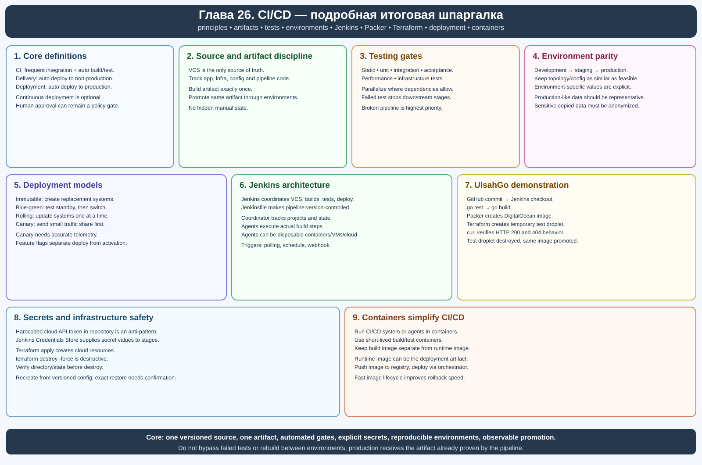
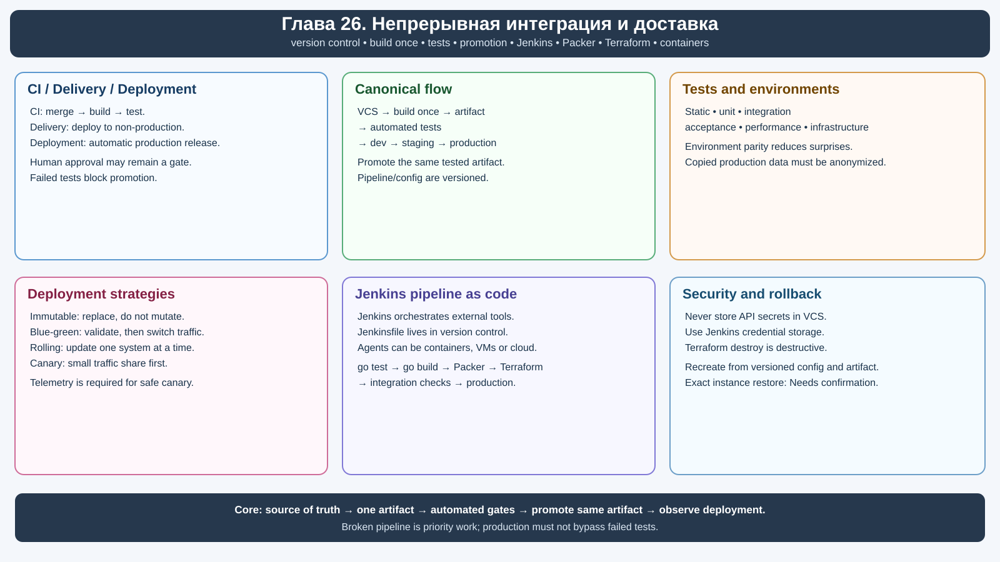

# Глава 26 — Непрерывная интеграция и доставка

Практические заметки по главе 26 книги «UNIX и Linux: руководство системного администратора», 5-е издание.

## Идентификация

- Book ID: unix-linux-system-administration-handbook-5e-ru-2020
- Глава: 26
- Название: «Непрерывная интеграция и доставка»
- Slug: continuous-integration-and-delivery
- Source policy: rag_only
- External sources: запрещены
- Model memory: запрещена
- Прямой доступ к source/book.pdf: не использовался
- Unknown data policy: отсутствующие или OCR-неоднозначные данные помечаются [Needs confirmation]

## Provenance

- RAG scope: p0956:c01–p0985:c01
- PDF pages: 956–985
- Printed pages: 955–984
- Boundary evidence:
  - p0955:c01 — завершение главы 25;
  - p0956:c01 — начало главы 26;
  - p0985:c01 — раздел 26.6 «Литература»;
  - p0986:c01 — начало главы 27.
- В диапазоне p0956:c01–p0985:c01 пропусков RAG не обнаружено: 30/30 chunks.
- Provenance verified: yes.

## Артефакты

- [commands.md](commands.md)
- [cheatsheet.md](cheatsheet.md)
- [diagram.md](diagram.md)
- [visual-cheatsheet.svg](visual-cheatsheet.svg)
- [visual-cheatsheet-detailed.svg](visual-cheatsheet-detailed.svg)

## Карта главы

- 26.1 — основные концепции CI, continuous delivery и continuous deployment;
- 26.2 — pipeline, build artifacts, testing и deployment;
- 26.3 — Jenkins, distributed builds и pipeline as code;
- 26.4 — практический pipeline UlsahGo на GitHub/Jenkins/Packer/Terraform/DigitalOcean;
- 26.5 — containers как CI/CD environment и build artifact;
- 26.6 — литература.

## Анализ главы

CI/CD в главе рассматривается не как один продукт, а как связанная operational system. CI объединяет частые изменения в общей кодовой базе и автоматически собирает и тестирует результат. Continuous delivery автоматически продвигает проверенную сборку в непроизводственные среды. Continuous deployment завершает цикл автоматическим выпуском в production без отдельного ручного шага.

Авторы подчёркивают, что continuous deployment не обязателен для каждой организации. Human approval может оставаться boundary в любом месте pipeline; важнее, чтобы каждый этап до этой boundary был простым, воспроизводимым и проверяемым.

### VCS как source of truth

Весь application code, infrastructure code, configuration и связанные документы следует хранить в version control. Ничто критичное не должно управляться вручную без зафиксированной записи. Pipeline-as-code продолжает ту же модель: Jenkinsfile хранится рядом с кодом либо в отдельном infrastructure repository.

### Build once, deploy often

Pipeline начинается с build artifact. После сборки тот же artifact должен проходить testing и deployment во все среды. Повторная сборка между средами ломает доказательство того, что именно протестированная версия попала в production.

Build artifact может быть:
- JAR/WAR;
- static binary;
- RPM/DEB;
- language package;
- container image;
- VM image;
- executable file.

Artifact repository должен быть доступен всем системам, участвующим в deployment.

### Integration discipline

Каждая фиксация в integration branch должна автоматически запускать build. Частые небольшие commits упрощают локализацию regression. Failed build не используется как повод искать виноватого: приоритет — восстановить pipeline.

Ключевое правило главы: сломанный pipeline исправляется прежде продолжения работы. Production deployment должен быть технически невозможен, если есть failed tests.

### Environments

Глава выделяет development, staging/test и production. Software последовательно продвигается через среды. Чем выше environment parity, тем меньше риск того, что production обнаружит несовместимость, отсутствующую в lower environments.

Lower environment datasets должны быть достаточно репрезентативными. Если production data копируются вниз, sensitive user data необходимо anonymize.

Environment-specific credentials, URLs и hostnames должны управляться через authoritative configuration source, а не через ручные изменения.

### Feature flags

Feature flag позволяет отделить code deployment от feature activation. Код можно заранее развернуть во всех средах, но включить функцию только там, где она готова. Откат функции тогда может быть configuration change вместо нового software release.

### Pipeline structure

Базовый pipeline:
1. build;
2. automated tests;
3. deployment to development;
4. tests;
5. deployment to test/staging;
6. tests;
7. deployment to production.

После успешных tests build становится release candidate; после production deployment — release.

Tests могут выполняться параллельно, если между ними нет dependency/conflict. Глава рассматривает static analysis, unit, integration, acceptance, performance и infrastructure tests.

### Deployment

Deployment заканчивается, когда новая версия запущена, а старая выведена из эксплуатации. Возможные mechanics:
- shell/SSH scripts;
- configuration management;
- container scheduler/API;
- specialized deployment tools;
- cloud deployment services.

Immutable deployment создаёт новые servers/images вместо in-place modification.

Zero-downtime patterns:
- blue-green — новая среда тестируется отдельно, затем traffic переключается;
- rolling — systems обновляются по одной и возвращаются в rotation;
- canary — новая версия сначала получает малую долю traffic.

Canary особенно зависит от telemetry/monitoring: без наблюдаемости невозможно быстро определить degradation.

### Jenkins

Jenkins выступает orchestrator: связывает VCS, build tools, tests, artifact creation и deployment. Он не выполняет всю работу сам — фактические действия делают external tools.

Jenkins project/job содержит stages, которые могут идти последовательно, параллельно или условно. Build context/workspace содержит checkout и supporting files.

Build trigger может быть polling, schedule или webhook. В практическом примере polling GitHub используется для простоты, но webhook назван более подходящим механизмом.

Distributed Jenkins разделяет master/coordinator и build agents. Agents можно маркировать по capabilities и запускать в containers, VMs или ephemeral cloud systems.

Pipeline as code задаётся Jenkinsfile. Это устраняет opaque UI-only configuration и делает pipeline versioned/reproducible.

### Практический pipeline UlsahGo

Демонстрационный workflow:
~~~text
GitHub commit
→ Jenkins checkout
→ go test
→ go build
→ Packer image build
→ Terraform test environment
→ integration tests with curl
→ destroy test environment
→ Terraform production environment
→ load-balancer tests
~~~

Build image становится единственным deployment artifact для следующих сред.

Глава показывает опасный anti-pattern: API token, напрямую записанный в Packer template. Авторы явно отмечают, что secrets в version control хранить нельзя. В улучшенном варианте Jenkins Credentials Store передаёт token и SSH fingerprint через environment variables.

### Ephemeral testing infrastructure

Terraform создаёт temporary environment для integration testing. После tests test droplet уничтожается. Эта модель уменьшает drift и делает environment creation частью pipeline.

Destroy action state-changing и потенциально destructive. Exact rollback уничтоженного ephemeral environment как восстановление прежнего instance не описан: [Needs confirmation]. Восстановление достигается повторным созданием из versioned configuration/artifact.

### Containers in CI/CD

Containers используются тремя способами:
- сама CI/CD platform может работать в containers;
- build/test environment может быть containerized;
- container image может быть deployment artifact.

Build container должен быть отделён от runtime image: build environment обычно содержит compiler/test tooling, которые runtime не нужны.

Для mature container pipeline workflow:
~~~text
build application in build container
→ create runtime image
→ push image to registry
→ deploy through orchestrator
~~~

## Основной принцип

~~~text
version control
→ one reproducible build artifact
→ automated tests
→ promote the same artifact
→ observable deployment
→ production only after gates pass
~~~

## Риски и anti-patterns

- manual configuration outside VCS creates untraceable drift;
- rebuilding separately for each environment breaks artifact identity;
- ignoring flaky/failed tests destroys trust in pipeline;
- production deployment must not proceed with failed tests;
- low environment parity hides production-only defects;
- copied production data must be anonymized;
- secrets in source control are prohibited;
- long-lived mutable build agents accumulate dependency conflicts;
- Jenkins credentials must be controlled as sensitive data;
- Packer/Terraform stages create/change/destroy infrastructure;
- canary/rolling/blue-green require working monitoring and traffic control;
- Terraform destroy is destructive;
- exact recovery after infrastructure deletion without versioned config/artifact: [Needs confirmation].

## Acceptance boundary

Source-supported verification:
- every integration commit triggers pipeline;
- build artifact is created once and reused;
- failed tests block subsequent deployment;
- pipeline logs expose failed stage and console output;
- Jenkinsfile is version controlled;
- secrets come from credential storage rather than repository;
- test environment is created, tested and destroyed reproducibly;
- production deployment uses the same tested image/artifact;
- health/integration checks verify expected HTTP status;
- deployment infrastructure is described as code;
- container build and runtime environments remain distinct where applicable.
