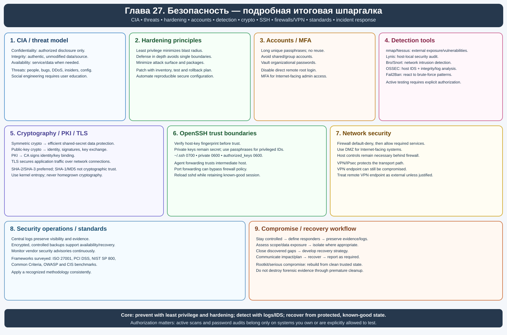
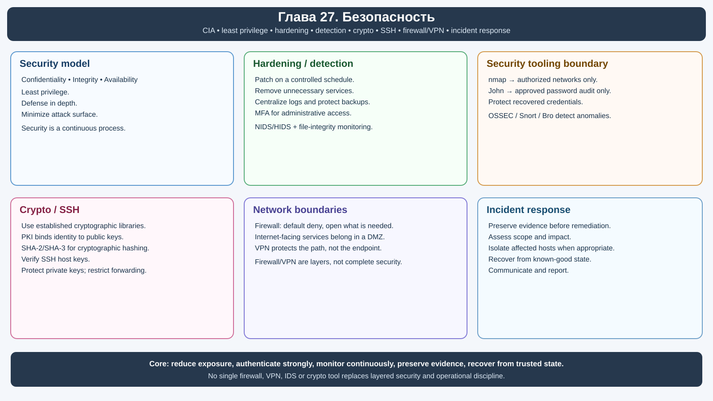

# Глава 27 — Безопасность

Практические заметки по главе 27 книги «UNIX и Linux: руководство системного администратора», 5-е издание.

## Идентификация

- Book ID: unix-linux-system-administration-handbook-5e-ru-2020
- Глава: 27
- Название: «Безопасность»
- Slug: security
- Source policy: rag_only
- External sources: запрещены
- Model memory: запрещена
- Прямой доступ к source/book.pdf: не использовался
- Unknown data policy: отсутствующие или OCR-неоднозначные данные помечаются [Needs confirmation]

## Provenance

- RAG scope: p0986:c01–p1043:c01
- PDF pages: 986–1043
- Printed pages: 985–1042
- Boundary evidence:
  - p0985:c01 — завершение главы 26;
  - p0986:c01 — начало главы 27;
  - p1042:c01–p1043:c01 — раздел 27.13 «Литература»;
  - p1044:c01 — начало главы 28.
- В диапазоне p0986:c01–p1043:c01 пропусков RAG не обнаружено: 58/58 chunks.
- Provenance verified: yes.

## Артефакты

- [commands.md](commands.md)
- [cheatsheet.md](cheatsheet.md)
- [diagram.md](diagram.md)
- [visual-cheatsheet.svg](visual-cheatsheet.svg)
- [visual-cheatsheet-detailed.svg](visual-cheatsheet-detailed.svg)

## Карта главы

- 27.1 — CIA: confidentiality, integrity, availability;
- 27.2 — слабые места: social engineering, software vulnerabilities, DDoS, insiders, configuration errors;
- 27.3 — hardening: least privilege, defense in depth, patching, service reduction, remote logging, backups, packet filtering, MFA, vigilance, penetration testing;
- 27.4 — passwords/accounts;
- 27.5 — nmap, Nessus, Metasploit, Lynis, John the Ripper, Bro, Snort, OSSEC, Fail2Ban;
- 27.6 — cryptography, PKI, TLS, hashes, randomness, OpenSSL, PGP, Kerberos;
- 27.7 — OpenSSH;
- 27.8 — firewalls;
- 27.9 — VPN/IPsec;
- 27.10 — certifications and standards;
- 27.11 — security information sources;
- 27.12 — incident response after server compromise;
- 27.13 — literature.

## Анализ главы

### Security is a process

Главная концептуальная рамка — CIA triad:
- confidentiality: доступ только для авторизованных субъектов;
- integrity: данные и источник не должны быть несанкционированно изменены;
- availability: данные и сервисы доступны авторизованным пользователям тогда, когда нужны.

Безопасность не сводится к одному продукту. Глава рассматривает её как постоянный процесс, в котором технические меры, процессы, обучение пользователей и operational discipline работают вместе.

### Threat model

Глава выделяет несколько типичных источников риска:
- social engineering и phishing;
- software vulnerabilities и input-validation failures;
- DDoS;
- trusted insiders;
- unsafe network/system/application configuration.

Человеческий фактор считается полноценной частью threat model. Пользователей нужно обучать распознавать phishing/phone/social-engineering attacks. Администраторы не должны запрашивать пользовательские пароли через email, IM или телефон.

### Hardening principles

Три основных operational principles:
1. least privilege — выдавать минимально необходимые права;
2. defense in depth — не полагаться на одну защитную границу;
3. attack-surface reduction — убирать ненужные interfaces, hosts, services и software.

Automation через configuration management/scripts уменьшает долю ручных ошибок и делает secure state воспроизводимым.

### Patching

Regular patching — одна из основных обязанностей администратора. Глава требует:
- иметь расписание;
- тестировать changes;
- иметь rollback plan;
- понимать applicability patches;
- вести точный inventory ОС и приложений;
- отслеживать vendor/security advisories.

Регулярность и управляемость важнее хаотичного emergency patching без процесса.

### Service exposure

Ненужные network services нужно отключать и по возможности удалять.

Source-supported discovery flow:
~~~text
list listening sockets
→ map port to process
→ identify service
→ stop/disable only if not required
→ verify port is no longer exposed
~~~

Для discovery chapter использует netstat и lsof; в Linux также упоминается ss.

### Logging and backups

Remote/central logging повышает обнаруживаемость и затрудняет attacker cleanup локальных logs.

Backups относятся к availability и должны:
- быть регулярными;
- храниться безопасно, желательно вне основной сети;
- иметь controlled access;
- быть encrypted.

Backup itself is a sensitive asset.

### Malware/rootkits

Глава подчёркивает value least privilege: код, запущенный не от root, имеет меньший blast radius.

Rootkits могут подменять utilities или работать на уровне kernel. Для detection chapter упоминает OSSEC, AIDE и chkrootkit.

Если host серьёзно скомпрометирован/rootkit установлен, глава предпочитает сохранить нужные данные, переформатировать систему и начать с clean state, а не полагаться на in-place cleanup.

### Packet filtering and MFA

Internet-exposed systems должны иметь filtering boundary. Host-level filters могут использоваться как дополнительный layer к edge firewall.

Cloud security groups рассматриваются как аналог filtering controls. Chapter также предлагает ограничивать egress, чтобы скомпрометированный host не мог свободно устанавливать исходящие connections.

MFA названа минимальным требованием для Internet-facing administrative interfaces, включая VPN, SSH и administrative web interfaces.

### Password/account hygiene

Password principles:
- long memorable passphrases preferable to short complex strings;
- password/passphrase must not be reused across purposes;
- shared/group accounts are dangerous;
- privileged accounts need stronger controls;
- password vaults improve controlled storage/audit;
- service/pseudo-user accounts should not permit interactive login.

Linux password aging uses chage; FreeBSD example uses pw.

Direct remote root login should be disabled. Chapter uses PermitRootLogin no and sudo-based elevation.

### Security tooling

nmap:
- shows externally visible open ports/services;
- active network scan;
- chapter explicitly forbids scanning someone else's network without administrator permission.

Nessus:
- network vulnerability scanner.

Metasploit:
- penetration-testing framework described conceptually;
- use is framed as owner-authorized security testing;
- no exploit commands are promoted in these artifacts.

Lynis:
- host-local configuration/security audit.

John the Ripper:
- password-strength auditing;
- chapter requires management approval before cracking passwords;
- output contains recovered secrets and must be protected/deleted after audit.

Bro and Snort:
- NIDS approaches;
- Bro emphasizes traffic-flow behavior;
- Snort uses signatures/rules.

OSSEC:
- HIDS;
- rootkit detection;
- file-integrity monitoring;
- log analysis;
- scheduled alerts;
- active response;
- manager/agent architecture with authenticated/encrypted links.

Fail2Ban:
- watches logs for brute-force/suspicious patterns and can temporarily block source IPs or notify responders.

### Cryptography

Chapter covers:
- symmetric cryptography;
- public-key cryptography;
- digital signatures;
- PKI / CA trust;
- TLS;
- cryptographic hashes;
- random-number generation;
- OpenSSL;
- PGP/OpenPGP;
- Kerberos.

Do not design homemade cryptography. Use established libraries/protocols.

Chapter recommends SHA-2/SHA-3 for general cryptographic hashing and marks SHA-1 as compromised; MD5 is not considered cryptographically secure.

Kernel entropy via /dev/random and /dev/urandom is the recommended random source rather than user-space homegrown generators.

### PKI/TLS

PKI uses a trusted CA to bind identity to public keys via signed certificates.

TLS:
- protects application protocols over network connections;
- provides confidentiality/integrity and server authentication;
- can be mutual when clients also present certificates.

The chapter reflects its publication-era TLS landscape; exact present-day protocol/cipher recommendations outside the RAG are [Needs confirmation].

### OpenSSL

Source-supported administrative uses:
- generate private key;
- generate CSR;
- inspect certificate;
- inspect/debug remote TLS session.

Private keys are sensitive data and must not be shared.

### SSH

OpenSSH provides:
- remote shell/command execution;
- public-key authentication;
- file transfer;
- port forwarding;
- proxying;
- agent support.

Host-key verification matters. Blindly accepting first-use host keys exposes users to MITM risk.

Public/private key permissions in chapter:
- ~/.ssh directory: 0700;
- private key: 0600;
- public key: 0644;
- authorized_keys: 0600.

Privileged accounts should use passphrases on private keys. Passphrase-less automation keys should correspond to accounts with restricted privileges.

Agent forwarding is convenient but creates a trust boundary: a compromised forwarding host can use the agent on the user's behalf. Use only on trusted hosts.

Port forwarding can deliberately or accidentally bypass network policy. Chapter shows how to disable it server-side.

sshd changes can be applied with HUP/reload and affect new connections while existing sessions remain.

### Firewalls

Firewall is one control in defense in depth, not a substitute for host security.

Preferred principle:
~~~text
default deny
→ explicitly open required services
→ place Internet-facing systems in DMZ
→ continue host-level hardening/monitoring
~~~

Stateful inspection can add context, but the chapter warns against treating firewall marketing as a complete security solution.

### VPN/IPsec

VPN creates an authenticated/encrypted tunnel across an untrusted network.

Critical boundary: a VPN protects the transport path, not necessarily the endpoint. VPN-connected remote systems should still be treated as external/untrusted unless explicitly justified.

IPsec is described as a standards-based authentication/encryption mechanism. MTU issues may arise because encapsulation increases packet size.

### Standards

Chapter surveys:
- ISO/IEC 27001;
- PCI DSS;
- NIST SP 800 series;
- Common Criteria;
- OWASP;
- CIS benchmarks.

Operational message: choose a recognized framework/methodology and apply it consistently rather than attempting ad-hoc security.

### Incident response

Chapter's compromise workflow:
1. do not panic;
2. determine appropriate response/team;
3. collect evidence/logs and back up systems;
4. assess damage/data exposure;
5. isolate compromised hosts where appropriate and close discovered gaps;
6. develop recovery strategy;
7. communicate plan and impact;
8. execute recovery;
9. report incident to appropriate parties when required.

Preserve evidence before making changes that may destroy it.

## Основной принцип

~~~text
inventory
→ minimize attack surface
→ least privilege
→ patch and configure reproducibly
→ authenticate strongly
→ encrypt sensitive transport/data
→ monitor/log centrally
→ detect anomalies
→ preserve evidence
→ recover from known-good state
~~~

## Риски

- social engineering bypasses technical controls;
- exposed/unneeded services expand attack surface;
- root/service overprivilege expands blast radius;
- stale software retains known vulnerabilities;
- weak/reused/shared passwords multiply compromise impact;
- password-audit output contains secrets;
- active scanning without authorization is inappropriate and may disrupt policy/operations;
- SSH host-key bypass disables an important authenticity check;
- agent forwarding extends trust to intermediate hosts;
- SSH port forwarding may bypass firewall policy;
- private keys/CA keys are high-value secrets;
- firewall/VPN alone do not secure endpoints;
- compromised/rootkit-infected systems may not be trustworthy after in-place cleanup;
- incident response can destroy evidence if changes happen before collection;
- exact recovery of a compromised system without a known-good backup/image: [Needs confirmation].

## Acceptance boundary

Source-supported security checks:
- listening services inventoried;
- unexpected ports mapped to owning processes;
- unnecessary services removed/disabled;
- remote logs available;
- backups protected and recoverable;
- privileged remote root login disabled;
- MFA applied to Internet-facing administrative access;
- SSH keys and directories have expected permissions;
- host keys verified rather than blindly accepted;
- private keys remain private;
- patches and inventory are tracked;
- scanning/password auditing performed only with explicit authorization;
- incident evidence collected before destructive remediation;
- compromised hosts recover from clean known-good state where feasible.
