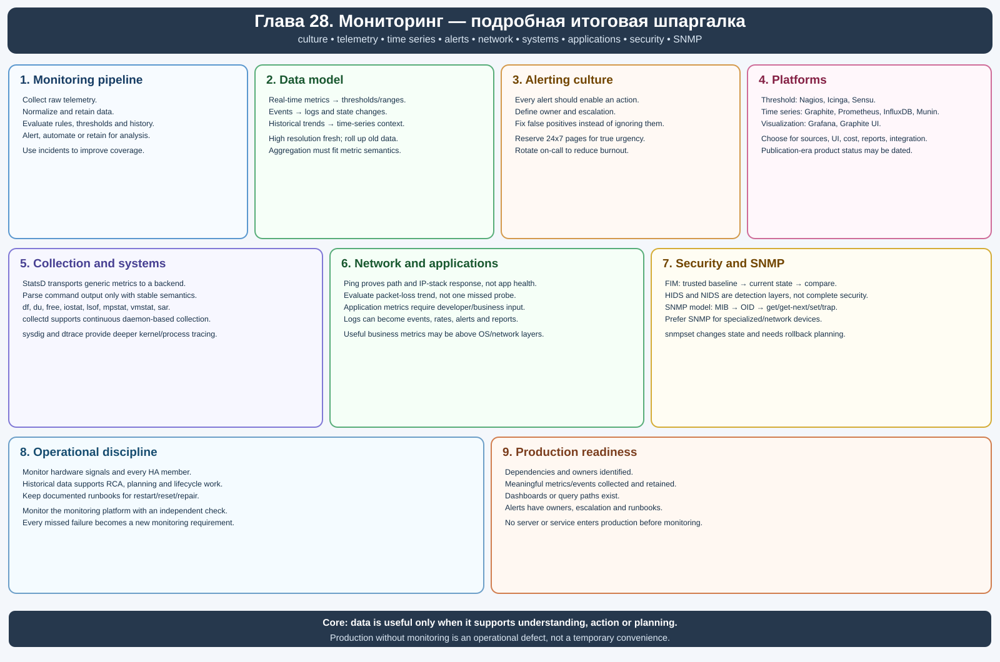
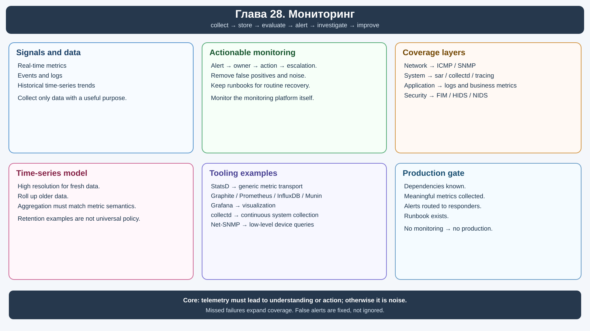

# Глава 28 — Мониторинг

Практические заметки по главе 28 книги «UNIX и Linux: руководство системного администратора», 5-е издание.

## Идентификация

- Book ID: unix-linux-system-administration-handbook-5e-ru-2020
- Глава: 28
- Название: «Мониторинг»
- Slug: monitoring
- Source policy: rag_only
- External sources: запрещены
- Model memory: запрещена
- Прямой доступ к source/book.pdf: не использовался
- Unknown data policy: отсутствующие или OCR-неоднозначные данные помечаются [Needs confirmation]

## Provenance

- RAG scope: p1044:c01–p1071:c01
- PDF pages: 1044–1071
- Printed pages: 1043–1070
- Boundary evidence:
  - p1043:c01 — завершение главы 27;
  - p1044:c01 — начало главы 28;
  - p1071:c01 — раздел 28.11 «Литература»;
  - p1072:c01 — начало главы 29.
- В диапазоне p1044:c01–p1071:c01 пропусков RAG не обнаружено: 28/28 chunks.
- Provenance verified: yes.

## Артефакты

- [commands.md](commands.md)
- [cheatsheet.md](cheatsheet.md)
- [diagram.md](diagram.md)
- [visual-cheatsheet.svg](visual-cheatsheet.svg)
- [visual-cheatsheet-detailed.svg](visual-cheatsheet-detailed.svg)

## Карта главы

- 28.1 — обзор мониторинга: data → evaluation → action;
- 28.2 — культура мониторинга;
- 28.3 — monitoring platforms;
- 28.4 — data collection, StatsD, parsing command output;
- 28.5 — network monitoring;
- 28.6 — system monitoring, collectd, sysdig, dtrace;
- 28.7 — application monitoring and logs;
- 28.8 — security monitoring, FIM and IDS;
- 28.9 — SNMP;
- 28.10 — operational recommendations;
- 28.11 — literature.

## Анализ главы

### Monitoring is part of production

Главный тезис главы: система или служба не должна попадать в production до того, как она добавлена в monitoring.

Мониторинг рассматривается не как отдельный dashboard, а как эксплуатационный pipeline:

~~~text
collect
→ normalize/store
→ evaluate against rules/context
→ alert / automate / retain
→ investigate
→ improve monitoring
~~~

Цель — обнаруживать проблемы до пользователей, понимать состояние среды и иметь данные для управления, capacity planning и последующего анализа.

### Three data classes

Глава делит monitoring data на три крупных типа:

1. Real-time metrics:
   - числовые или логические значения;
   - сравниваются с threshold/range;
   - могут напрямую генерировать alerts.

2. Events:
   - log entries;
   - state changes;
   - subsystem notifications;
   - могут агрегироваться в rates/counts или инициировать response напрямую.

3. Historical trends:
   - time-series data;
   - используются для сравнения текущего состояния с baseline/history;
   - позволяют видеть тенденции и корреляции.

### Data quality over data volume

Не нужно собирать всё подряд.

Каждая метрика должна иметь понятную цель:
- что она показывает;
- кто её использует;
- какое решение/действие она поддерживает.

Избыточная telemetry:
- нагружает monitoring platform;
- нагружает monitored systems;
- скрывает важные сигналы в шуме.

Monitoring scope необходимо периодически пересматривать.

### Time-series retention

Современный для главы подход — хранить monitoring data как time series.

По мере старения данные могут агрегироваться:
- высокая детализация для свежих данных;
- более грубая детализация для долгой истории.

Глава показывает пример Graphite/Carbon:
- 10-second data → 12 hours;
- 1-minute rollup → 7 days;
- 10-minute rollup → 1 year.

Это пример, а не универсальная retention policy.

Aggregation method зависит от semantics:
- counters/errors → sum может иметь смысл;
- utilization/load → average;
- lower/upper bounds → min/max.

Неправильный aggregation policy способен давать отсутствующие или неточные данные.

### Actionable alerts

Alert должен побуждать к действию.

Если alert:
- не требует действия;
- постоянно false-positive;
- относится к некритичной проблеме, но будит on-call ночью;

то monitoring culture деградирует.

Критичные проблемы могут требовать SMS/phone escalation. Менее критичные события можно направлять в ChatOps.

Operational rule:
~~~text
signal
→ owner
→ expected action
→ escalation path
→ runbook
~~~

### Dashboards

Dashboard:
- показывает только важные показатели;
- даёт контекст;
- группирует связанные значения;
- визуализирует trends;
- помогает быстро определить health/performance.

Большая часть collected data не обязана быть на dashboard.

Monitoring platform также должна позволять ad-hoc queries и exploratory analysis.

### Monitoring culture

Глава формулирует жёсткую эксплуатационную позицию:

- всё, от чего зависит пользователь/service, должно контролироваться;
- hardware health signals также должны мониториться;
- все элементы HA-системы должны наблюдаться отдельно;
- historical monitoring data должны быть доступны всей технической организации;
- alerts — общая ответственность, а не только задача «команды мониторинга»;
- false positives нужно исправлять, а не игнорировать;
- monitoring platform itself must be monitored.

Missed failure becomes a new monitoring requirement.

### Platform model

Глава рассматривает несколько классов tools.

Real-time / threshold-oriented:
- Nagios;
- Icinga;
- Sensu.

Time-series-oriented:
- Graphite;
- Prometheus;
- InfluxDB;
- Munin.

Visualization:
- Graphite UI;
- Grafana.

Commercial/hosted solutions также рассматриваются как допустимый вариант.

Product-specific assessments in the chapter describe the book's publication-era ecosystem; their current status is [Needs confirmation].

### Choosing a platform

Критерии выбора:
- data-source flexibility;
- interface/dashboard quality;
- cost;
- automatic discovery;
- reporting/notification integrations;
- fit with configuration management;
- plugin/check deployment model;
- compatibility with existing notification systems;
- network connectivity requirements.

Не существует одной универсально лучшей платформы.

### Data collection

Monitoring platform полезна только тогда, когда telemetry reaches it.

Sources:
- built-in plugins;
- command output;
- custom scripts;
- collectors such as collectd;
- protocol gateways such as StatsD;
- SNMP for suitable network devices.

Prefer libraries and standard integrations over one-off ad-hoc scripts when available.

### StatsD

StatsD в главе рассматривается прежде всего как простой UDP-based protocol/gateway для отправки arbitrary metrics в monitoring backend.

Example pipeline:

~~~text
application/script
→ StatsD
→ Graphite/Carbon
→ time-series storage
→ dashboard/analysis
~~~

Глава показывает отправку test counter через netcat на UDP/8125 и передачу parsed load average через StatsD client library.

### Network monitoring

Базовый network check — ICMP echo.

Успешный ping подтверждает:
- network path responds;
- target IP stack/kernel is alive.

Он не подтверждает работоспособность application-level service.

Single lost ping не должен автоматически означать outage. Глава рекомендует агрегировать probe results и анализировать packet-loss percentage over time.

Для throughput упоминается iPerf.

### System monitoring

System-level telemetry может поступать:
- из /proc;
- через sysctl;
- через standard commands;
- через collection daemon.

Chapter command set includes:
- df;
- du;
- free;
- iostat;
- lsof;
- mpstat;
- vmstat;
- sar;
- uptime;
- w;
- top.

Для automation лучше выбирать output format, который легко и стабильно parse.

### collectd

collectd — daemon for continuous system statistics collection.

Глава показывает plugins для:
- CPU;
- disk/filesystem;
- interfaces;
- load;
- memory;
- processes;
- RRDtool output.

Пример interval — 30 seconds; это sample configuration, не универсальная recommendation.

collectd может:
- store locally;
- work client/server;
- feed monitoring/time-series platforms.

### Deep tracing

sysdig и dtrace рассматриваются как более глубокие инструменты tracing kernel/process activity.

Они сложнее обычных monitoring commands и предназначены для deeper inspection rather than basic health checks.

### Application monitoring

Самый полезный monitoring часто находится на application/business level.

Examples from chapter:
- page load time;
- application errors;
- database behavior;
- connection problems;
- business metrics such as sales or shopping-cart behavior.

Application developers должны участвовать в выборе metrics.

### Log monitoring

Logs can be transformed into:
- alerts;
- counts/rates;
- reports;
- searchable event streams.

Глава упоминает:
- centralized log aggregation;
- logwatch for batch/daily summaries;
- OSSEC for more real-time monitoring.

### Security monitoring

Security monitoring must include process and policy, not only tools.

Глава выделяет две функции continuous security monitoring:
1. file/system integrity monitoring;
2. intrusion detection.

FIM:
~~~text
trusted baseline
→ current state
→ cryptographic comparison
→ alert on unexpected change
~~~

Planned maintenance and authorized updates must be distinguished from suspicious changes.

Tools mentioned:
- Tripwire;
- OSSEC;
- AIDE;
- mtree.

### HIDS and NIDS

NIDS:
- analyzes network traffic;
- looks for suspicious behavior/patterns.

HIDS:
- watches host state;
- network connections;
- file changes/checksums;
- daemon/application logs;
- privilege use;
- rootkit indicators.

HIDS alerts need integration into the common incident/ticket workflow. «Install and forget» is an anti-pattern.

### SNMP

SNMP is presented as a low-level collection protocol best suited to specialized/network devices.

Core operations:
- get;
- get-next;
- set;
- trap.

Data is organized through MIBs and OIDs.

The chapter recommends moving SNMP-collected data into a general-purpose monitoring platform quickly rather than using SNMP as the whole monitoring architecture.

SNMP write operations modify device/agent state and require stronger control than read-only queries.

### Monitoring operations

The final recommendations are operational rather than tool-specific:

- rotate on-call responsibility to avoid burnout;
- distinguish true 24×7 incidents from normal-business-hours issues;
- eliminate alert noise;
- maintain runbooks for routine recovery actions;
- monitor the monitoring platform;
- add monitoring after every missed failure;
- never introduce an unmonitored server/service into production.

## Основной принцип

~~~text
service dependency
→ choose meaningful signal
→ collect continuously
→ retain enough history
→ detect abnormal state
→ actionable alert
→ documented response
→ learn from incident
→ improve coverage
~~~

## Риски и anti-patterns

- collecting metrics without a defined purpose;
- alerting without an owner/action;
- treating a single failed probe as definitive outage;
- false-positive alert noise;
- disabling after-hours alerts instead of designing escalation;
- monitoring only the primary node of an HA system;
- unmonitored hardware health;
- relying only on ping for application health;
- parsing unstable human-readable command output when a better format exists;
- using SNMP writes casually;
- deploying SNMP agents where they are not required;
- FIM baseline created from an already compromised state;
- ignoring HIDS/FIM alerts;
- leaving monitoring platform itself unmonitored;
- placing a service into production before monitoring exists.

## Acceptance boundary

A monitored production service should have, where applicable:
- defined owner and dependencies;
- meaningful health/performance metrics;
- relevant events/logs;
- historical retention;
- dashboard or query path;
- actionable alert thresholds;
- escalation destination;
- runbook;
- coverage for HA components;
- monitoring of underlying network/system/application layers;
- monitoring platform health check;
- review process for false positives and missed failures.

Exact thresholds, retention periods and alert severities for a real environment are [Needs confirmation].
