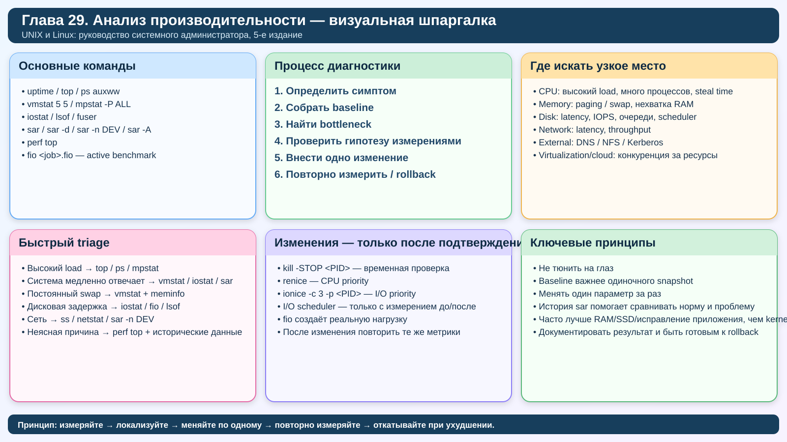

# Глава 29 — Анализ производительности

Практические заметки по главе 29 книги «UNIX и Linux: руководство системного администратора», 5-е издание.

Содержимое:

- [commands.md](commands.md) — таблица команд и назначение.
- [cheatsheet.md](cheatsheet.md) — operational-шпаргалка диагностики.
- [diagram.md](diagram.md) — Mermaid-диаграмма процесса поиска bottleneck.
- [visual-cheatsheet.svg](visual-cheatsheet.svg) — визуальная шпаргалка главы.

## Scope

Материалы составлены только по RAG-фрагментам главы 29.

Provenance: `p1072:c01`–`p1093:c01` (PDF pages 1072–1093; печатные страницы главы 1071–1092).

## Основной принцип

Baseline → измерение → локализация ограничивающего ресурса → одно изменение → повторное измерение → rollback при ухудшении.
