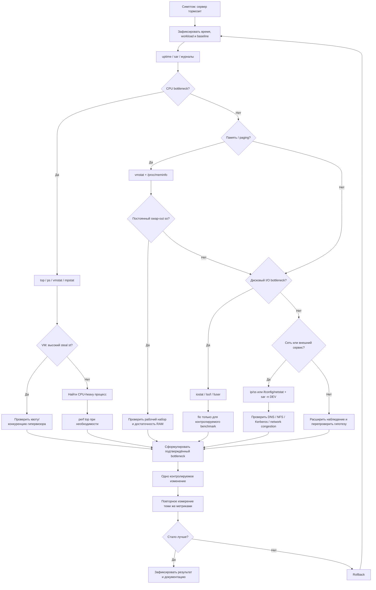

# Диаграмма диагностики производительности

## Смысл диаграммы

Диаграмма отражает подход главы: не начинать с tuning. Сначала измерить и локализовать ограничивающий ресурс, затем менять только один фактор и проверять результат теми же метриками.
