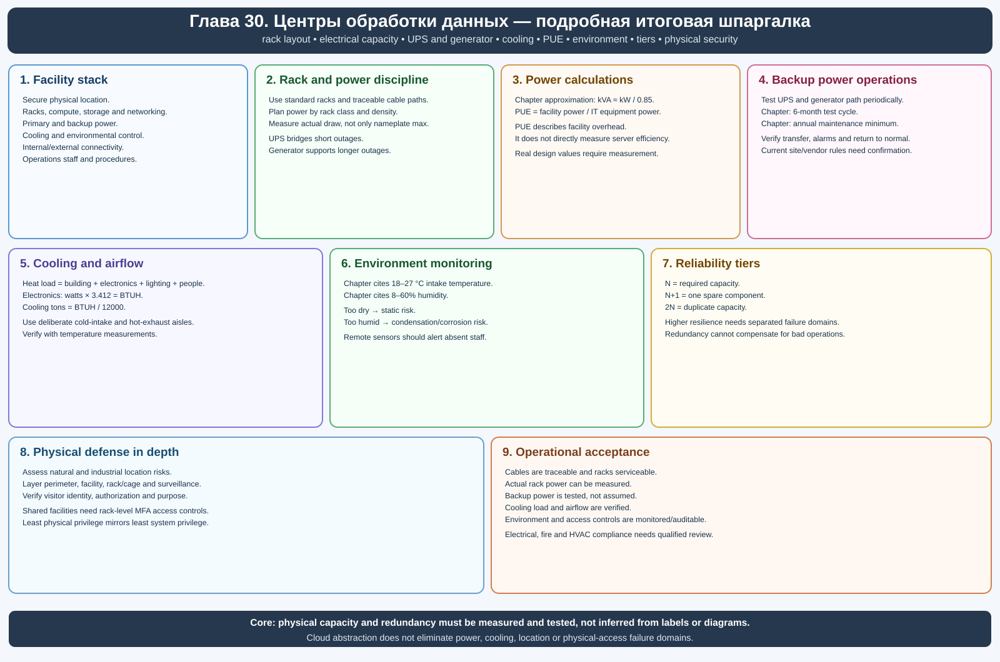
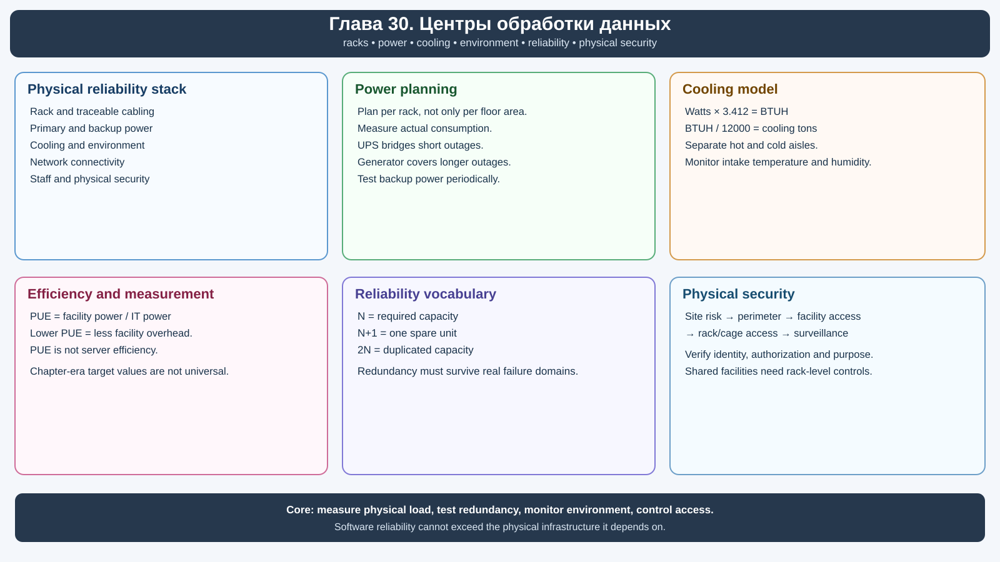

# Глава 30 — Центры обработки данных

Практические заметки по главе 30 книги «UNIX и Linux: руководство системного администратора», 5-е издание.

## Идентификация

- Book ID: unix-linux-system-administration-handbook-5e-ru-2020
- Глава: 30
- Название: «Центры обработки данных»
- Slug: data-centers
- Source policy: rag_only
- External sources: запрещены
- Model memory: запрещена
- Прямой доступ к source/book.pdf: не использовался
- Unknown data policy: отсутствующие или OCR-неоднозначные данные помечаются [Needs confirmation]

## Provenance

- RAG scope: p1094:c01–p1107:c01
- PDF pages: 1094–1107
- Printed pages: 1093–1106
- Boundary evidence:
  - p1093:c01 — раздел 29.8 «Литература»;
  - p1094:c01 — начало главы 30;
  - p1107:c01 — раздел 30.7 «Литература»;
  - p1108:c01 — начало главы 31.
- В диапазоне p1094:c01–p1107:c01 пропусков RAG не обнаружено: 14/14 chunks.
- Provenance verified: yes.

## Артефакты

- [commands.md](commands.md)
- [cheatsheet.md](cheatsheet.md)
- [diagram.md](diagram.md)
- [visual-cheatsheet.svg](visual-cheatsheet.svg)
- [visual-cheatsheet-detailed.svg](visual-cheatsheet-detailed.svg)

## Карта главы

- 30.1 — стойки;
- 30.2 — электропитание: UPS, генераторы, rack power, измерение, PUE, remote power control;
- 30.3 — охлаждение и окружающая среда: thermal load, hot/cold aisles, humidity, environmental monitoring;
- 30.4 — уровни надёжности центров обработки данных;
- 30.5 — физическая безопасность: location, perimeter, facility access, rack access;
- 30.6 — toolkit системного администратора;
- 30.7 — литература.

## Анализ главы

### Physical infrastructure remains part of systems reliability

Основной тезис главы: виртуальные и облачные системы всё равно зависят от физической инфраструктуры.

Service reliability зависит от:
- location;
- racks/cabling;
- primary and backup power;
- cooling;
- network connectivity;
- operations staff;
- physical security.

Размещение workload в нескольких data centers может уменьшить влияние отказа одного объекта, но chapter-specific architecture beyond this statement: [Needs confirmation].

### Racks and cabling

Rack-based deployment рассматривается как профессиональная база для обслуживания оборудования.

Chapter principles:
- использовать standard rack layout;
- сохранять cables доступными для tracing/service;
- network copper/fiber лучше прокладывать в overhead trays;
- underfloor space не должен превращаться в скрытый cable maze;
- power and network cabling should be organized predictably.

Operational value:
~~~text
organized rack
→ traceable cable
→ faster maintenance
→ lower accidental-change risk
~~~

### Power architecture

Data center power path включает:
- utility/commercial power;
- UPS;
- backup generators;
- potentially redundant power phases/sources.

UPS:
- bridges short outages;
- provides time for generator startup or controlled shutdown;
- is not intended as indefinite power source.

Generators:
- provide longer-duration backup while fuel remains;
- require fuel planning and maintenance.

Chapter states a local fuel reserve target of at least 72 hours for generator operation. This is a chapter-era planning example, not a universal current requirement.

### Backup power testing

Critical source-supported principle:
- UPS/generator components must be tested periodically;
- chapter recommends testing backup-power components every six months;
- maintenance should occur at least annually.

These are chapter recommendations. Current regulatory/vendor intervals for a real facility are [Needs confirmation].

### Plan power per rack, not only per floor area

Chapter rejects simplistic floor-area-only planning.

Preferred model:
~~~text
rack class
→ expected equipment density
→ measured/estimated kW per rack
→ grouped power zones
→ cooling capacity aligned to those zones
~~~

The chapter gives example rack-power classes from 6 kW to 40 kW per rack. These values describe its planning model and publication-era equipment assumptions; real deployment values require measurement.

### Measure actual consumption

Do not rely only on equipment nameplate maximums.

Measure actual power consumption:
- facility;
- row/rack;
- individual device where feasible.

This improves:
- capacity planning;
- cooling estimates;
- energy-cost understanding;
- PUE interpretation.

### kVA / kW

Chapter uses approximate conversion:

~~~text
kVA = kW / 0.85
~~~

for modern computer equipment planning.

This is explicitly an approximation from the chapter. Exact power factor for a real installation must be measured or engineered: [Needs confirmation].

### PUE

Chapter defines:

~~~text
PUE = total facility power / IT equipment power
~~~

Lower PUE means less facility overhead relative to IT load.

Important interpretation:
- PUE is a facility-efficiency metric;
- it does not directly measure server efficiency;
- replacing servers with more efficient systems can paradoxically make PUE worse if facility overhead stays constant.

Chapter mentions PUE examples and historical figures; these are publication-era context, not current benchmarks.

### Remote power control

If systems require recurring physical power cycling, chapter suggests managed remote power control.

This is an availability tool but also a high-risk control plane:
- remote power-off is disruptive;
- access must be protected;
- target device/rack must be verified before action.

Exact product/API/CLI procedure is not provided in the chapter: [Needs confirmation].

### Cooling

Cooling must be sized from actual heat load.

Chapter's thermal model includes:
- roof/walls/windows;
- electronic equipment;
- lighting;
- people.

For electronics, electrical power is effectively converted to heat.

Conversion used by chapter:

~~~text
BTUH = watts × 3.412
~~~

Cooling capacity:

~~~text
tons of cooling = BTUH / 12000
~~~

The chapter's worked example then applies a 50% allowance for estimation error and future growth. This is a chapter example, not a universal engineering factor.

### Temperature

The chapter cites ASHRAE 2012 guidance of 18–27 °C at server air intakes.

This is historical/source-grounded guidance from the book. Current ASHRAE recommendations for a real facility are [Needs confirmation].

### Hot and cold aisles

Cooling efficiency improves when airflow is controlled:

~~~text
cold aisle
→ server intake
→ server exhaust
→ hot aisle
→ heat removal
~~~

Rack orientation should prevent one server from ingesting another server's hot exhaust.

For raised-floor designs, the chapter places perforated tiles in cold aisles.

For non-raised-floor environments, in-row cooling is presented as an alternative.

### Humidity

Chapter cites a 2012 ASHRAE humidity range of 8–60%.

Reasoning:
- too dry → static-electricity risk;
- too humid → condensation/corrosion/short-circuit risk.

Current environmental requirements for specific hardware/facility: [Needs confirmation].

### Environmental monitoring

Critical infrastructure should be monitored even when staff are absent.

Chapter examples of environmental telemetry:
- temperature;
- sound/noise;
- power consumption.

These signals should trigger remote notification when abnormal.

Environmental monitoring should integrate with the general monitoring discipline from chapter 28.

### Reliability tiers

Chapter summarizes a four-tier Uptime Institute model and the redundancy concepts:
- N;
- N+1;
- 2N.

The conceptual value is common vocabulary for comparing facilities.

Higher redundancy alone does not guarantee service availability: poor design or operations can still cause outages.

The chapter's percentages/tier descriptions are source-grounded publication-era values; current certification requirements are [Needs confirmation].

### Physical security

The chapter applies defense in depth physically.

Threat classes:
- natural: fire, flood, earthquake, severe weather;
- human/industrial: crime, sabotage, nearby hazardous infrastructure.

Security layers include:
~~~text
site selection
→ perimeter
→ facility entry
→ rack/cage access
→ surveillance
~~~

### Location

Site selection should consider natural and man-made hazards.

A data center is a long-lived asset, so geographic/risk analysis should happen before commitment.

Exact acceptable risk thresholds: [Needs confirmation].

### Perimeter and facility access

Chapter recommends:
- controlled perimeter;
- continuous video coverage;
- no obvious external identification of facility purpose/owner;
- guarded or MFA-controlled access;
- verify visitor identity and authorization before entry.

The chapter gives an 8 m / 25 ft perimeter-distance example. Treat as source-era design guidance, not a universal legal/security standard.

### Rack access

In shared/colocation facilities, rack/cage access requires its own control boundary.

Chapter recommends:
- MFA physical access;
- per-rack surveillance.

The operational principle is least physical privilege:
~~~text
authorized person
+ authorized purpose
+ authorized location
+ auditable access
~~~

### Toolkit

Chapter closes with a physical toolkit rather than shell tools.

Categories:
- general hand tools;
- DMM;
- infrared thermometer;
- RJ-45 tools and spare cables/connectors;
- ESD wrist strap;
- portable network analyzer/laptop;
- spare power cable;
- emergency contact information.

The exact inventory should follow local equipment and safety requirements.

## Основной принцип

~~~text
service reliability
→ physical site
→ power redundancy
→ cooling capacity
→ environmental monitoring
→ network connectivity
→ physical access control
→ tested operational procedures
~~~

No amount of software abstraction removes dependency on physical infrastructure.

## Риски и anti-patterns

- relying on nameplate power instead of measured load;
- sizing power only from floor area;
- high-density racks without matching power/cooling capacity;
- treating UPS as long-duration power;
- untested generators/UPS;
- single-source fuel planning;
- poor cable traceability;
- mixing hot exhaust into cold intake;
- using historic temperature/humidity values as universal current standards;
- no environmental monitoring outside staffed hours;
- assuming redundancy tier alone guarantees availability;
- weak visitor authorization;
- shared facility without rack-level access control;
- remote power control without target verification;
- physical maintenance without ESD/electrical safety controls.

## Acceptance boundary

For a planned or operated data center, chapter-supported review points include:
- racks and cables are serviceable and traceable;
- expected power is modeled per rack;
- actual power can be measured;
- UPS coverage exists for servers/network;
- longer outages have a generator/recovery plan;
- backup power is tested and maintained;
- cooling load is independently checked;
- airflow uses deliberate hot/cold separation;
- temperature/humidity are monitored remotely;
- environmental alarms reach responders;
- redundancy level is explicitly understood;
- natural/man-made site risks are assessed;
- perimeter, facility and rack access are controlled;
- emergency tools and contact information are available.

Exact electrical design, breaker/load limits, fire protection, code compliance and current environmental standards require qualified facility/electrical/HVAC professionals and are [Needs confirmation] from this chapter alone.
