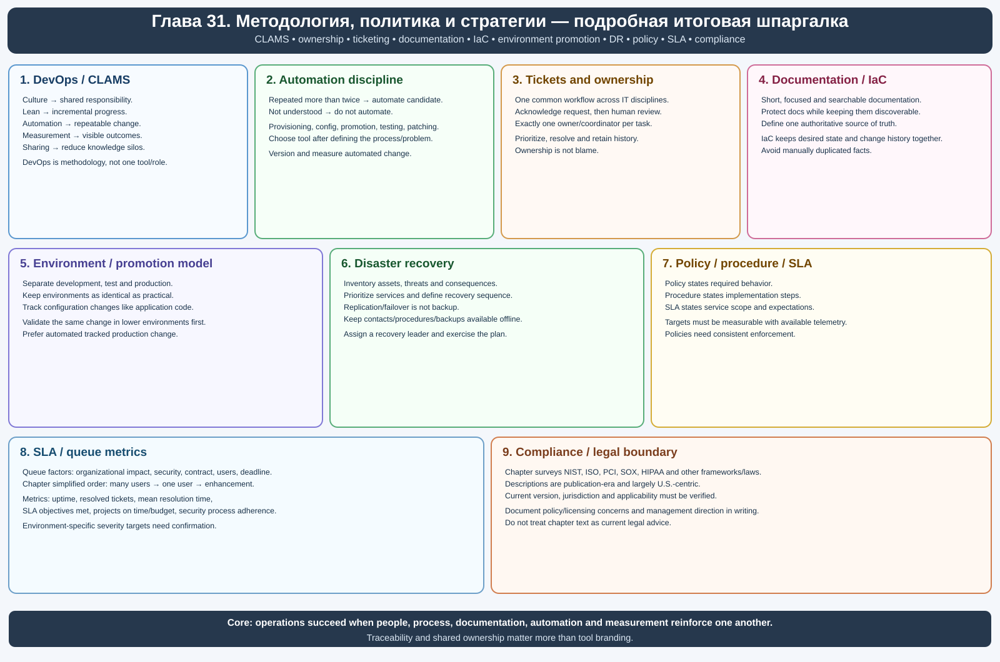
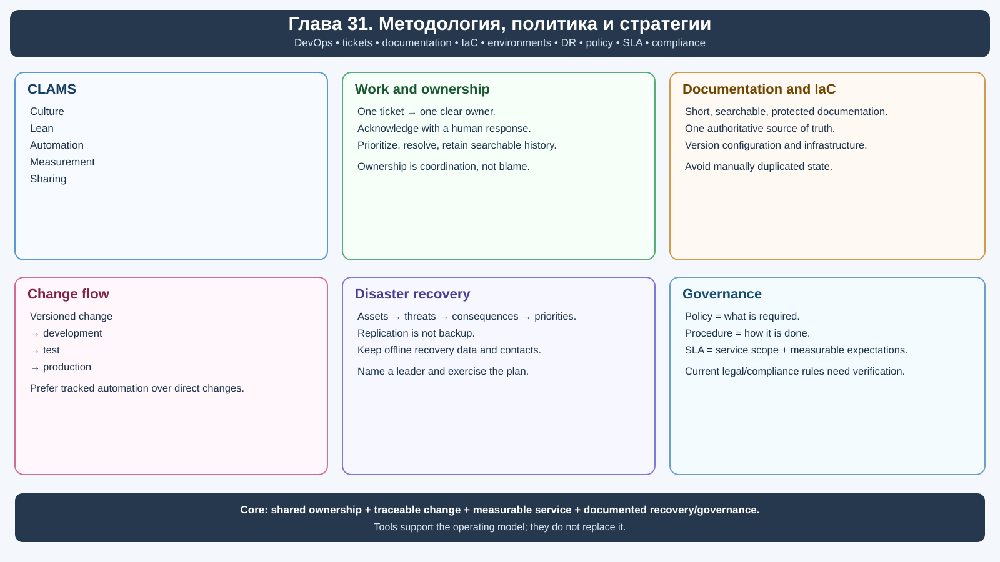

# Глава 31 — Методология, политика и стратегии

Практические заметки по главе 31 книги «UNIX и Linux: руководство системного администратора», 5-е издание.

## Идентификация

- Book ID: unix-linux-system-administration-handbook-5e-ru-2020
- Глава: 31
- Название: «Методология, политика и стратегии»
- Slug: methodology-policy-and-strategies
- Source policy: rag_only
- External sources: запрещены
- Model memory: запрещена
- Прямой доступ к source/book.pdf: не использовался
- Unknown data policy: отсутствующие, современные или юридически изменчивые данные помечаются [Needs confirmation]

## Provenance

- RAG scope: p1108:c01–p1139:c01
- PDF pages: 1108–1139
- Printed pages: 1107–1138
- Boundary evidence:
  - p1107:c01 — раздел 30.7 «Литература»;
  - p1108:c01 — начало главы 31;
  - p1138:c01–p1139:c01 — раздел 31.11 «Литература»;
  - p1140:c01 — начало «Краткой истории системного администрирования».
- В диапазоне p1108:c01–p1139:c01 пропусков RAG не обнаружено: 32/32 chunks.
- Provenance verified: yes.

## Артефакты

- [commands.md](commands.md)
- [cheatsheet.md](cheatsheet.md)
- [diagram.md](diagram.md)
- [visual-cheatsheet.svg](visual-cheatsheet.svg)
- [visual-cheatsheet-detailed.svg](visual-cheatsheet-detailed.svg)

## Карта главы

- 31.1 — DevOps: CLAMS, automation, measurement, sharing, роль системного администратора;
- 31.2 — ticket/task management;
- 31.3 — local documentation, infrastructure as code, documentation standards;
- 31.4 — separation of development/test/production environments;
- 31.5 — disaster recovery: risk assessment, recovery planning, staffing, security;
- 31.6 — policies and procedures;
- 31.7 — service-level agreements;
- 31.8 — compliance with laws and standards;
- 31.9 — legal issues, privacy, security policy enforcement, software licensing;
- 31.10 — professional organizations/conferences/resources;
- 31.11 — literature.

## Анализ главы

### IT exists to serve organizational goals

Глава начинает с организационного принципа: технология должна помогать бизнесу и пользователям достигать целей, а не превращаться в самостоятельную цель.

Историческая стратегия «минимизировать изменения ради стабильности» приводит к:
- technical debt;
- отставанию систем;
- конфликту между development и operations;
- страху изменений.

DevOps в логике главы — способ управлять изменениями совместно и воспроизводимо, а не просто новый набор инструментов.

### DevOps is methodology, not a person or tool

Глава прямо отделяет DevOps от:
- отдельной должности;
- отдельного человека;
- одной команды;
- одного environment;
- одного инструмента.

DevOps описывается через CLAMS:

~~~text
Culture
Lean
Automation
Measurement
Sharing
~~~

Главный operational effect — Dev и Ops совместно отвечают за жизненный цикл продукта и инфраструктуры.

### Culture

Source-supported patterns:
- Dev и Ops разделяют ответственность за среду;
- service/application не запускается без automated testing and monitoring;
- Dev и Ops заранее участвуют в approval/review;
- development environment должен отражать production;
- code reviews включают Ops;
- infrastructure reviews включают Dev;
- общие communication channels/ChatOps поддерживают постоянную связь.

Глава подчеркивает, что разделение территорий и blame culture мешают общей цели.

### Lean

Lean в главе означает:
- решать проблему итеративно;
- использовать real-time communication;
- спрашивать «что можно сделать сегодня?»;
- не строить тяжёлый процесс ради самого процесса.

### Automation

Два правила главы:

~~~text
if task must be done more than twice
→ automate it

do not automate what you do not understand
~~~

Automation должна охватывать:
- provisioning new machines;
- configuration management;
- code promotion;
- automated testing;
- systematic patch/update deployment.

Chapter-mentioned tools include Ansible, Salt, Puppet, Chef, Packer and Terraform, but chapter 31 does not provide executable command lines for them.

Tool selection should follow the process/problem, not the reverse.

### Measurement

Chapter's DevOps model requires pervasive measurement across:
- business;
- applications;
- databases;
- subsystems;
- servers;
- networks.

Collecting data is insufficient. Metrics must:
- be visible to stakeholders;
- have nominal targets;
- trigger investigation of anomalies.

The chapter's statement about sub-second measurement is a source-era aspiration, not a universal current requirement.

### Sharing

Knowledge should move:
- inside team;
- across organization;
- outside organization where appropriate.

Mechanisms include:
- presentations;
- talks;
- wiki articles;
- demonstrations;
- conferences/publications.

Sharing reduces knowledge silos and increases organizational capability.

### Role of system administrator in DevOps

The chapter retains a broad role for system administrators:
- provision/configure/automate infrastructure;
- secure, patch and update systems;
- deploy/support CI/CD, monitoring, virtualization, containers and ChatOps;
- teach infrastructure/security practices;
- operate physical/virtual/cloud infrastructure;
- troubleshoot;
- plan capacity;
- coordinate vendors;
- manage infrastructure lifecycle;
- promote collaboration.

The central theme is cross-functional responsibility rather than territorial ownership.

### Ticket/task management

A common ticket/task system should cover multiple IT disciplines.

Benefits:
- prevents forgotten work;
- reduces duplicate work;
- gives users status visibility;
- assigns ownership;
- creates searchable operational history;
- exposes workload and response metrics.

Every task should have one clearly defined owner.

Ownership is coordination/accountability, not blame.

### Human response matters

The chapter emphasizes that a quick response from a real person matters to user satisfaction even when the final resolution will take longer.

Good workflow:
~~~text
request arrives
→ acknowledge
→ human reads and understands
→ assign one owner
→ clarify if needed
→ prioritize
→ resolve
→ retain searchable history
~~~

### Ticket dispatcher

The chapter describes a dispatcher model:
- experienced administrator periodically takes dispatcher duty;
- reviews new tickets;
- gathers missing context;
- prioritizes;
- assigns to a person with suitable skills/time;
- follows timely completion.

This is presented as an organizational pattern, not a universal staffing model.

### Documentation as operational resilience

Documentation reduces:
- single-person knowledge dependency;
- repeated problem solving;
- configuration entropy.

It improves:
- reproducibility;
- onboarding;
- consistent modification;
- explainability.

Documentation must be both discoverable and protected.

### Infrastructure as code

IaC is treated as a high-value form of documentation.

Configuration definitions:
- live in version control;
- describe desired system state;
- allow comparison between environment and standard;
- keep implementation and documentation closer together.

Source of truth should be clear. Duplicate manually maintained copies of the same facts should be avoided.

### Documentation style

Chapter guidance:
- short, focused documents;
- start with overview;
- split complex details into separate focused pages;
- make documents searchable/indexable;
- use templates;
- embed documentation into normal processes;
- comments in configuration files can be valuable;
- define an authoritative source when duplication cannot be eliminated.

### Environment separation

Organizations need separate:
- development;
- testing;
- production.

They should be separate but as identical as practical.

Configuration changes should use the same structured promotion process as application code.

The chapter favors:
~~~text
versioned change
→ lower environment
→ test
→ promotion
→ production
~~~

over untracked manual production changes.

### Change traceability vs rigid role separation

The chapter criticizes rigid separation-of-duties schemes when approvers cannot meaningfully inspect changes and gates only create bureaucracy.

Preferred DevOps direction:
- track all changes as code;
- immutable audit history;
- automated application;
- test in lower environments;
- trace unexpected behavior back to a specific change;
- revert problematic change.

Ideal end state presented by the chapter:
- humans do not make direct administrative production changes;
- an automated, tracked process has the required privileges.

The chapter also states that this ideal may not be realistic for many organizations.

### Disaster recovery

DR begins with risk assessment.

Process:
~~~text
identify assets
→ enumerate threats
→ determine consequences
→ prioritize services
→ define recovery strategy
→ preserve offline/online recovery data
→ assign responders
→ exercise plan
~~~

Threats include:
- malicious users;
- flood/fire/earthquake/storm;
- power and cooling failure;
- telecom/cloud failure;
- hardware/network failure;
- user mistakes.

Exact probability/severity scoring model is not defined by this chapter: [Needs confirmation].

### Mirroring is not backup

A critical source-supported principle:

~~~text
replication / failover
≠ backup
~~~

Even geographically separated systems can lose data simultaneously.

DR requires backup planning, including offline/read-only copies where appropriate.

### DR plan structure

The chapter uses NIST 800-34 as a source for plan structure:
- introduction/scope;
- concept of operations;
- notification and activation;
- recovery sequence;
- return to normal operation.

Modern/current NIST revision and applicability: [Needs confirmation].

### Recovery kit and offline dependencies

During a disaster, network services and online documentation may be unavailable or compromised.

Keep locally accessible:
- contact list;
- recovery procedure;
- backup information/schedule;
- network maps;
- cloud login data;
- licenses/registration data;
- installation media;
- hardware/software configuration data;
- system startup/recovery instructions.

Sensitive recovery data must itself be protected.

### DR staffing

Assign a clear incident/recovery leader.

The chapter values:
- authority;
- ability to make difficult decisions with incomplete information;
- clear communication;
- leadership under pressure.

Plan for absences and insufficient staffing.

### Security incident planning

Security incidents require advance planning:
- who leads;
- who communicates;
- what legal stakeholders participate;
- how traffic surges or secondary impact are handled;
- how restoration proceeds.

Legal participation is explicitly recommended for incidents involving regulated/sensitive data.

### Policies vs procedures

Chapter distinction:

Policy/instruction:
- states requirement or rule;
- changes relatively infrequently.

Procedure:
- states how the requirement is executed;
- evolves as architecture/tools/configuration change.

Example logic:

~~~text
policy: backups must exist on defined schedule
procedure: exact system/tool/process that performs them
~~~

### Policy design

Chapter policy areas include:
- information security;
- third-party connectivity;
- asset management;
- data classification;
- personnel security;
- physical security;
- access management;
- secure development;
- incident management;
- business continuity;
- data retention;
- privacy/confidentiality.

Policies should:
- be consistent;
- have clear authority;
- define exceptions/escalation;
- not contradict each other.

### Service-level agreements

An SLA should explain in nontechnical terms:
- services provided;
- hours/support windows;
- response expectations;
- supported platforms/configurations;
- storage/upgrade/support boundaries;
- prioritization;
- how success is measured.

Users care primarily about service availability and restoration expectations, not internal component details.

### Queue prioritization

Chapter factors include:
- organizational importance;
- security impact;
- paid/contracted service level;
- number of affected users;
- deadlines.

Its simplified priority pattern is:
1. many people cannot work;
2. one person cannot work;
3. enhancement requests.

Lower-priority queues are generally treated FIFO.

This is a source pattern, not a universal incident-priority standard.

### SLA metrics

Chapter examples:
- projects delivered on time/budget;
- SLA items met;
- service uptime;
- tickets resolved satisfactorily;
- mean ticket resolution time;
- security incidents handled according to procedure.

Only measure targets that the organization can actually collect and verify.

### Compliance and standards

The chapter surveys a publication-era set of standards/laws/frameworks, including:
- CJIS;
- COBIT;
- COPPA;
- FERPA;
- FISMA;
- GLBA;
- HIPAA;
- ISO 27001/27002;
- NERC CIP;
- PCI DSS;
- FTC Red Flags;
- ITIL;
- SOX ITGC;
- NIST 800-53;
- NIST 800-34.

These descriptions are historical chapter content. Current versions, jurisdiction, legal applicability and compliance requirements are [Needs confirmation] and must be validated outside this rag_only workflow before operational/legal use.

### Legal issues

Chapter themes:
- privacy;
- security policy notification/acceptance;
- appropriate-use enforcement;
- logging/retention;
- software licensing.

Current legal requirements vary by jurisdiction and time and are [Needs confirmation].

The operationally durable principle is:
~~~text
policy / legal obligation
→ explicit documentation
→ user notification/acceptance where required
→ consistent enforcement
→ auditable written record
~~~

### Security-policy communication

The chapter argues that policies should be communicated explicitly and that users should acknowledge acceptable-use/security rules.

Security training should cover topics such as phishing and safe software/password behavior.

### Logging and legal context

The chapter notes that logs may have legal significance and mentions synchronized time via NTP in that context.

Exact evidentiary standards and retention requirements are jurisdiction-specific and [Needs confirmation].

### Software licensing

If license/compliance concerns arise, the chapter advises documenting the issue and management instructions in writing.

Do not silently normalize unlicensed software use.

### Professional community

The chapter lists organizations such as:
- FSF;
- USENIX;
- LOPSA;
- SANS;
- Linux Foundation;
- user groups/conferences.

Their current organization/status/program details are [Needs confirmation] under this rag_only policy.

## Основной принцип

~~~text
business goal
→ shared Dev/Ops ownership
→ documented work
→ versioned/automated change
→ lower-environment validation
→ measurable service
→ explicit policy/SLA
→ recovery/compliance planning
→ continuous learning and sharing
~~~

Successful administration is a socio-technical system: tools, process, people, documentation and accountability must reinforce one another.

## Риски и anti-patterns

- change avoidance that creates technical debt;
- Dev/Ops silos and blame culture;
- selecting tools before defining the problem;
- automating a process not understood;
- production service without automated test/monitoring;
- ticket without one accountable owner;
- ticket ownership used as blame;
- slow or purely robotic customer communication;
- undocumented systems owned by one expert;
- multiple manually updated sources of truth;
- direct untracked production changes;
- configuration drift between dev/test/prod;
- assuming replication is backup;
- DR procedures stored only on unavailable production systems;
- DR plan without staffing/contacts;
- policies without consistent enforcement;
- procedures confused with policies;
- SLA without measurable success criteria;
- blindly applying publication-era legal/compliance descriptions as current requirements;
- undocumented license/compliance concerns.

## Acceptance boundary

A mature operational process derived from this chapter should have:
- cross-functional ownership;
- automation only after process understanding;
- testing and monitoring before production;
- one ticket system or a clearly integrated workflow;
- one owner per task;
- searchable operational history;
- protected, discoverable documentation;
- version-controlled infrastructure/configuration where applicable;
- separated dev/test/prod environments;
- traceable promotion process;
- documented DR risks, priorities, contacts and recovery data;
- offline recovery dependencies;
- clear distinction between policy and procedure;
- measurable SLA/service goals;
- explicit legal/compliance owner and current-source validation.

Current legal/regulatory applicability, current standards versions and organization-specific SLA targets remain [Needs confirmation].
