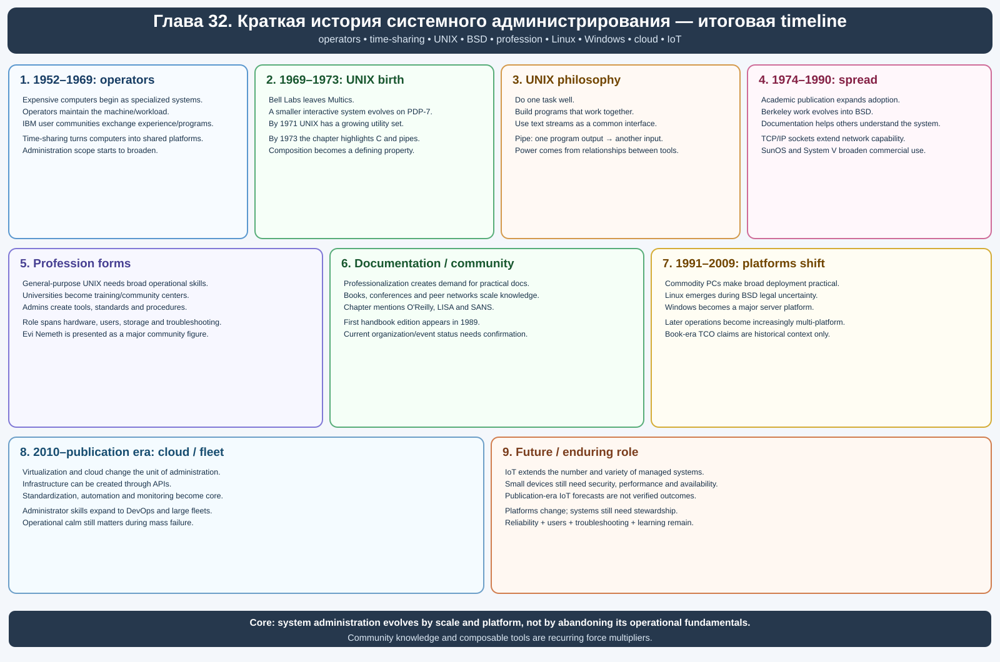
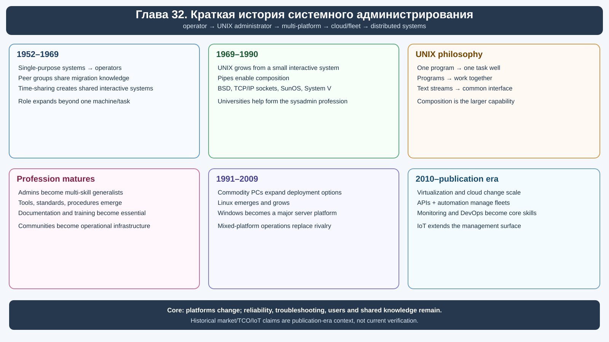

# Глава 32 — Краткая история системного администрирования

Canonical chapter 32 для заключительного ненумерованного раздела книги «UNIX и Linux: руководство системного администратора», 5-е издание.

## Идентификация

- Book ID: unix-linux-system-administration-handbook-5e-ru-2020
- Canonical chapter number: 32
- Source chapter number: отсутствует в книге
- Source title: «Краткая история системного администрирования»
- Slug: brief-history-of-system-administration
- Source policy: rag_only
- External sources: запрещены
- Model memory: запрещена
- Прямой доступ к source/book.pdf: не использовался
- Unknown data policy: неподтвержденные, современные и publication-era claims помечаются [Needs confirmation]

## Provenance

- RAG scope: p1140:c01–p1149:c01
- PDF pages: 1140–1149
- Printed pages: 1139–1148
- Boundary evidence:
  - p1139:c01 — завершение 31.11 «Литература»;
  - p1140:c01 — начало «Краткой истории системного администрирования»;
  - p1149:c01 — «Завтрашний день UNIX и Linux» и литература;
  - p1150:c01 — начало предметного указателя.
- В диапазоне p1140:c01–p1149:c01 пропусков RAG не обнаружено: 10/10 chunks.
- Provenance verified: yes.

## Артефакты

- [commands.md](commands.md)
- [cheatsheet.md](cheatsheet.md)
- [diagram.md](diagram.md)
- [visual-cheatsheet.svg](visual-cheatsheet.svg)
- [visual-cheatsheet-detailed.svg](visual-cheatsheet-detailed.svg)

## Что это за раздел

Это не обычная operational-глава, а историческая ретроспектива профессии системного администратора и экосистем UNIX/Linux.

Главная линия:
~~~text
single-purpose computer operator
→ time-sharing operator
→ UNIX general-purpose environment
→ professional system administrator
→ UNIX/Linux/Windows mixed operations
→ virtualization/cloud automation
→ distributed/IoT infrastructure stewardship
~~~

## Timeline

### 1952–1960 — системные операторы

Глава начинает историю с ранних коммерческих компьютеров IBM.

По тексту:
- IBM 701 вышел в 1952 году;
- IBM 704 был анонсирован в 1954 году;
- переход между поколениями создавал проблемы совместимости и обучения;
- пользователи IBM начали обмениваться опытом;
- из такого сообщества выросла группа SHARE.

Ключевой organizational lesson:
~~~text
new platform
→ operators share experience
→ community knowledge reduces unknowns
~~~

### 1961–1969 — time-sharing

Переход к разделению времени изменил роль обслуживающего персонала.

Раньше:
- компьютер был дорогим специализированным инструментом;
- оператор обслуживал конкретную задачу.

Time-sharing сделал компьютер:
- многопользовательским;
- более универсальным;
- общей платформой для разных задач.

Глава связывает этот переход с развитием Multics и идеей интерактивной вычислительной среды.

### 1969–1973 — рождение UNIX

После выхода Bell Labs из Multics несколько исследователей продолжили работу над более компактной системой.

Глава связывает ранний UNIX прежде всего с:
- Ken Thompson;
- Dennis Ritchie;
- PDP-7;
- простотой;
- интерактивной работой.

К 1971 году UNIX уже имел набор пользовательских команд.

К 1973 году глава выделяет два крупных развития:
- язык C;
- pipes / channels between programs.

### UNIX philosophy

Из истории pipe-механизма глава выводит три принципа:

~~~text
one program → one task done well
programs → work together
text streams → universal interface
~~~

Сила UNIX рассматривается не только как набор отдельных utilities, а как возможность композиции небольших программ.

### 1974–1990 — UNIX выходит за пределы Bell Labs

После публикаций и академического распространения UNIX становится широко известен.

Ключевые этапы в narrative главы:
- распространение исходного кода;
- университетские UNIX installations;
- John Lions и ранняя документация по ядру;
- Berkeley Software Distribution;
- Bill Joy;
- DARPA-funded CSRG;
- BSD;
- TCP/IP sockets;
- Sun Microsystems / SunOS;
- AT&T UNIX System V.

Важный эффект:
~~~text
same general-purpose OS
→ many disciplines
→ shared infrastructure
→ need for professional administration
~~~

### Эра системных администраторов

К началу 1980-х управление general-purpose UNIX systems требовало широкого набора навыков.

Глава описывает системного администратора как специалиста, который:
- настраивает систему под разные приложения и пользователей;
- решает hardware и software problems;
- управляет storage/backups;
- помогает пользователям;
- пишет/использует локальные tools and procedures.

Университеты стали важными центрами формирования профессии.

Глава отдельно связывает профессиональное сообщество с Evi Nemeth и группами администраторов, которые обменивались опытом и инструментами.

### Documentation and training

По мере формирования профессии выросла потребность в:
- practical UNIX documentation;
- structured training;
- professional conferences;
- books.

Глава упоминает:
- O'Reilly;
- USENIX LISA;
- SANS;
- первое издание UNIX System Administration Handbook в 1989 году.

Текущий статус этих мероприятий/организаций по состоянию на сегодня: [Needs confirmation], поскольку workflow rag_only.

### 1991–1995 — BSD uncertainty and Linux emergence

Глава описывает период, когда:
- PC hardware стало дешевле и производительнее;
- BSDI показала возможность production UNIX на commodity PCs;
- юридический конфликт AT&T/BSDI создал неопределенность;
- Linux появился как UNIX-like system for PCs;
- возникли ранние Linux distributions.

Историческая причинность и оценки в этом разделе передаются как narrative авторов главы, а не как независимая реконструкция.

### Transferable administrator skills

Глава подчеркивает, что опыт UNIX system administration оказался применим к Linux.

Устойчивый профессиональный принцип:
~~~text
platform changes
→ operational principles survive
~~~

### 1996–1999 — Windows growth

Windows NT и последующие Microsoft server platforms получили широкое распространение.

Глава описывает период platform rivalry между UNIX/Linux и Windows administrators.

### 2000–2009 — mixed environments

Следующий этап в narrative главы — уход от идеи обязательного выбора только одной платформы.

Успешные организации могли использовать:
- UNIX;
- Linux;
- Windows;

одновременно, выбирая платформу по задаче.

Приведенные в книге TCO-оценки относятся к публикационному/историческому контексту и не являются современным сравнением: [Needs confirmation].

### 2010–publication era — hyperscale cloud

Глава связывает следующий этап с:
- virtualization;
- cloud computing;
- API-driven infrastructure;
- automation;
- standardization;
- hyperscale environments.

Ручное администрирование отдельных физических серверов уступает управлению большими fleet-like environments.

Современный системный администратор в модели главы должен понимать:
- infrastructure creation/scaling;
- DevOps collaboration;
- simple automation scripting;
- monitoring;
- mass-failure handling.

### Tomorrow — IoT

Финальная часть расширяет scope профессии на сетевые embedded/IoT devices.

Основной тезис:
- маленькое устройство не перестает быть управляемой системой;
- networked devices требуют security, performance and availability management;
- supporting cloud infrastructure также требует системного администрирования.

Книга приводит прогноз о количестве IoT devices к 2020 году. Это publication-era prediction; его фактический результат здесь не проверяется и считается [Needs confirmation].

## Эволюция роли

~~~text
operator
→ platform specialist
→ UNIX administrator
→ multi-platform administrator
→ automation/cloud operator
→ infrastructure steward
~~~

При этом постоянными остаются:
- user needs;
- reliability;
- troubleshooting;
- documentation;
- sharing knowledge;
- adaptation to new platforms.

## Главная техническая идея UNIX

Исторический раздел особенно хорошо объясняет, почему UNIX tooling формировался как composable environment.

~~~text
small focused tool
+ standard data stream
+ composition
= larger capability
~~~

Эта идея в главе связывается с появлением pipes и ранней UNIX philosophy.

## История профессионального сообщества

Профессия формировалась не только через technology.

Ключевые механизмы:
- operator/user groups;
- universities;
- source-code sharing;
- practical documentation;
- conferences;
- peer networks;
- books and training.

Из этого следует chapter-supported pattern:

~~~text
complex systems
→ no single person knows everything
→ community knowledge becomes infrastructure
~~~

## Исторические команды

В разделе о UNIX 1971 года прямо названы:
- as;
- cal;
- cat;
- chdir;
- chmod;
- chown;
- cmp;
- cp;
- date;
- dc;
- du;
- ed;
- а также другие utilities.

Позже в примере композиции упоминаются grep и who.

Точные modern syntax/options для этих команд эта глава не документирует.

См. [commands.md](commands.md).

## Основной принцип

~~~text
hardware and platforms change
but administration remains:
understand systems
serve users
preserve reliability
share knowledge
automate where scale demands it
adapt without losing fundamentals
~~~

## Риски неправильной интерпретации

- считать исторический narrative современным market analysis;
- переносить publication-era TCO/market-share statements в настоящее;
- считать прогнозы IoT состоявшимися без проверки;
- использовать исторические product/organization status claims как текущие;
- считать историю UNIX/Linux линейной и исчерпывающей;
- приписывать главе modern CLI syntax, которого в ней нет;
- путать enduring principles с конкретными технологиями периода.

## Acceptance boundary

После чтения артефактов должно быть понятно:
- чем системный оператор отличался от более позднего системного администратора;
- почему time-sharing изменил эксплуатационную модель;
- как UNIX связал small tools, text streams и composition;
- какую роль сыграли universities, BSD и professional communities;
- как сформировалась отдельная профессия;
- почему UNIX knowledge переносился на Linux;
- как multi-platform operations сменили platform rivalry;
- как virtualization/cloud изменили единицу управления от host к fleet;
- почему IoT остается частью systems-management problem;
- какие утверждения являются историческим narrative, а какие publication-era predictions.

Современные market shares, organization status и результаты прогнозов: [Needs confirmation].
