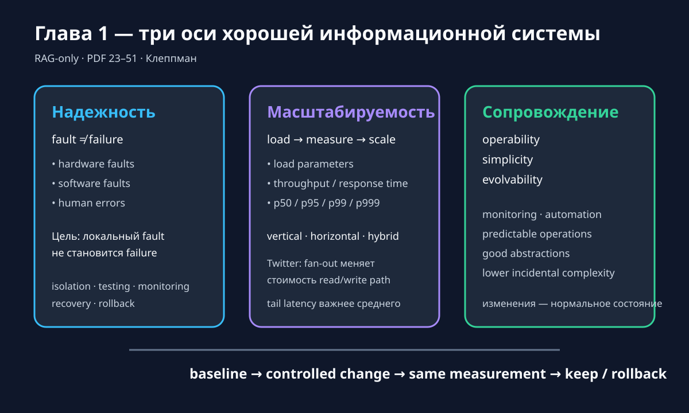
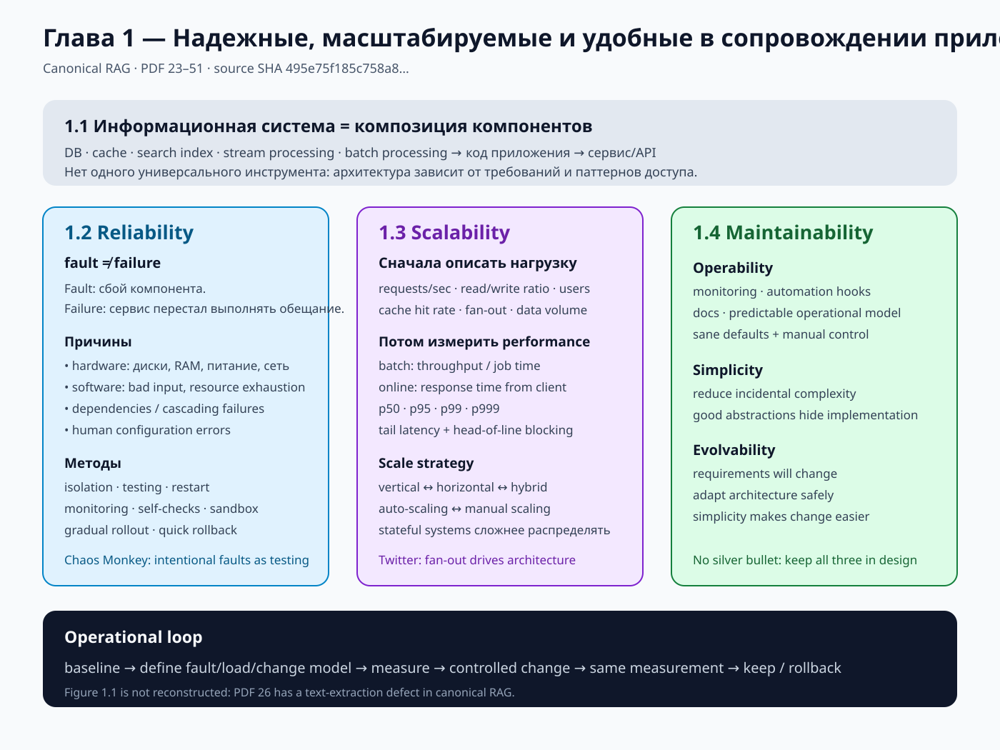

# Глава 1 — Надежные, масштабируемые и удобные в сопровождении приложения

RAG-grounded разбор главы 1 книги «Высоконагруженные приложения: программирование, масштабирование, поддержка».

## Идентификация

- Book ID: `vysokonagruzhennye-prilozheniya-martin-kleppmann-ru`
- Глава: 1
- Название: «Надежные, масштабируемые и удобные в сопровождении приложения»
- Slug: `reliable-scalable-maintainable-applications`
- Source policy: `rag_only`
- External sources: запрещены
- Model memory: запрещена
- Прямой доступ к canonical PDF: не использовался
- Book readiness: `READY` по `BOOK-READINESS v1.3`; актуальный CI process-gate подтвердил READY для этой книги
- Chapter contract: `CHAPTER-ANALYSIS-REQUEST v1.3` → `CHAPTER-ARTIFACT-COLLECTION v1.7`

## Provenance

- Source format: PDF
- Chapter source locator range: PDF `23–51`
- PDF 52: addressable text chunk отсутствует
- Следующий chapter boundary: PDF 53 начинается заголовком главы 2 «Модели данных и языки запросов»
- Boundary evidence:
  - `p0023:c01` — начало главы 1;
  - `p0024:c01` — раздел 1.1;
  - `p0027:c01` — раздел 1.2;
  - `p0032:c01` — раздел 1.3;
  - `p0043:c01` — раздел 1.4;
  - `p0047:c01`–`p0048:c01` — раздел 1.5 «Резюме»;
  - `p0050:c01`–`p0051:c01` — окончание библиографии главы;
  - `p0053:c01` — начало главы 2.
- Chapter boundary verified: yes
- Source SHA-256: `495e75f185c758a8223ca25b0fb35a8e6db693b06fb78c102e624a01ff852685`

## Содержимое

- [cheatsheet.md](cheatsheet.md) — operational/conceptual checklist по надежности, масштабируемости и сопровождению.
- [commands.md](commands.md) — только source-confirmed запросы, инструменты и действия.
- [diagram.md](diagram.md) — концептуальный flow проектирования и проверки системы.
- [summary.md](summary.md) — RAG-grounded перенос смысла раздела 1.5 «Резюме».
- [source-findings.md](source-findings.md) — зарегистрированный extraction defect рисунка 1.1.
- [visual-cheatsheet.svg](visual-cheatsheet.svg) — компактный обзор.
- [visual-cheatsheet-detailed.svg](visual-cheatsheet-detailed.svg) — подробный обзор.

Review/control questions в подтвержденном конце главы не обнаружены, поэтому `review-questions.md` и `review-answers.md` не создаются.

## Карта главы

1. Высоконагруженные данными приложения как композиция стандартных блоков: БД, кэши, поисковые индексы, потоковая и пакетная обработка.
2. Подходы к работе над информационными системами: несколько специализированных компонентов объединяются кодом приложения и скрываются за сервисным API.
3. Надежность: различие между `fault` и `failure`, устойчивость к сбоям и ограниченность идеи «предотвратить все сбои».
4. Аппаратные сбои: избыточность отдельных компонентов и переход к системам, способным переносить потерю целых машин.
5. Программные сбои: систематические ошибки, исчерпание общих ресурсов, зависимые сервисы и каскадные отказы.
6. Человеческий фактор: проектирование безопасных интерфейсов, sandbox, тестирование, быстрый rollback, постепенное развертывание и мониторинг.
7. Масштабируемость: сначала описать нагрузку параметрами, затем измерить производительность.
8. Twitter как пример: fan-out определяет реальную нагрузку сильнее, чем просто количество твитов; архитектура может быть гибридной.
9. Производительность: throughput для batch-систем и response time для online-сервисов.
10. Percentiles: p50 для типичного случая, высокие процентили для tail latency; SLO/SLA связывают ожидания с измеримыми порогами.
11. Load testing: нагрузочный клиент должен отправлять запросы независимо от времени ответа, иначе измерение искажает очереди.
12. Как справиться с нагрузкой: vertical, horizontal и прагматичная смесь; auto-scaling против ручного масштабирования.
13. Удобство сопровождения: operability, simplicity и evolvability.
14. Простота: снижать побочную сложность и использовать хорошие абстракции.
15. Возможность развития: облегчать адаптацию к неизбежно меняющимся требованиям.
16. Резюме и библиография.

## Основной принцип

Глава не предлагает «универсальную архитектуру». Она задает три проверяемые оси проектирования:

`надежность → масштабируемость → удобство сопровождения`.

Для каждой оси сначала нужно сформулировать, что именно считается хорошим результатом и как это будет измеряться. Масштабируемость нельзя оценивать без конкретных параметров нагрузки и характеристик производительности; надежность — без явного различения сбоев компонентов и отказа сервиса; сопровождение — без оценки работы операторов, сложности и способности системы изменяться.

## Практический смысл для инфраструктуры

Source-grounded operational framing главы:

- не считать отказ отдельного компонента автоматически отказом всей системы;
- проектировать механизм, который не дает локальному сбою перерасти в пользовательский failure;
- фиксировать реальные load parameters вместо общего ярлыка «высокая нагрузка»;
- оценивать latency распределением и хвостовыми процентилями, а не одним средним;
- проверять систему нагрузкой без искусственного ограничения очередей;
- выбирать vertical/horizontal scaling по фактическому профилю нагрузки;
- строить эксплуатацию вокруг мониторинга, предсказуемой operational model, автоматизации и возможности ручного вмешательства;
- уменьшать побочную сложность через подходящие абстракции;
- предусматривать изменение требований как нормальное состояние системы.

## Ограничения

- Анализ основан только на addressable RAG chunks и deterministic lexical index.
- Внешние URL и упомянутые продукты не открывались и не использовались как дополнительные источники.
- Рис. 1.1 на PDF 26 плохо извлечен текстовым RAG; его графическая структура не реконструировалась. См. [source-findings.md](source-findings.md).
- Глава концептуальная: она не содержит полноценного набора shell/admin-команд. В `commands.md` сохранены только явный SQL-пример и source-confirmed инструменты/действия.
- Конкретные значения нагрузки и latency из примеров книги сохранены как исторические source examples, а не как текущие нормативы.
