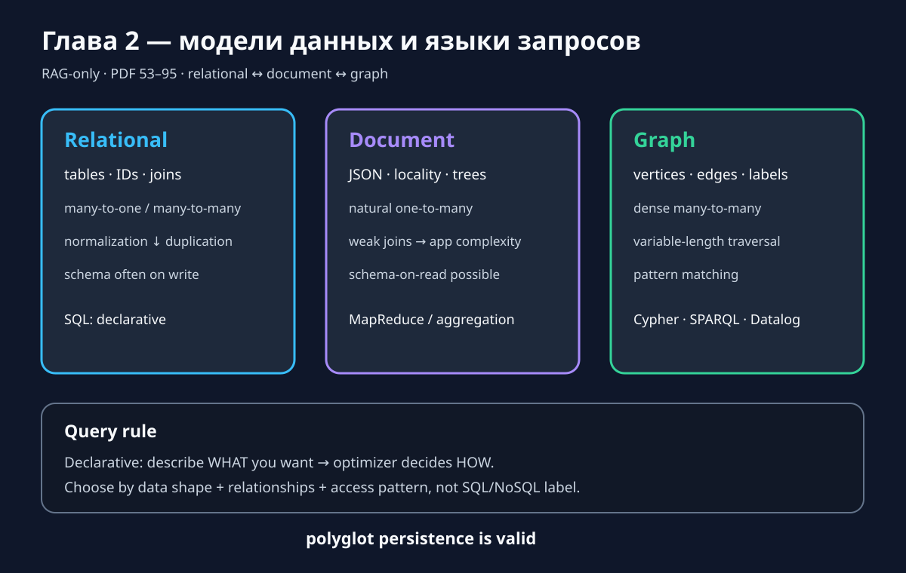
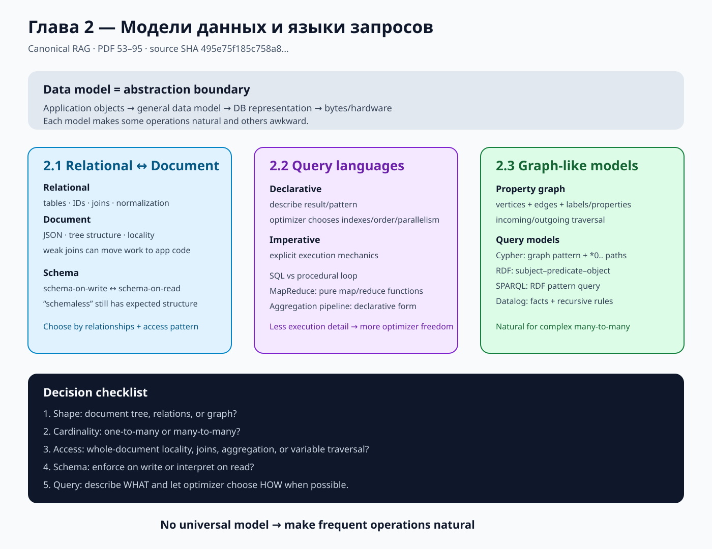

# Глава 2 — Модели данных и языки запросов

RAG-grounded разбор главы 2 книги «Высоконагруженные приложения: программирование, масштабирование, поддержка».

## Идентификация

- Book ID: `vysokonagruzhennye-prilozheniya-martin-kleppmann-ru`
- Глава: 2
- Название: «Модели данных и языки запросов»
- Slug: `data-models-and-query-languages`
- Source policy: `rag_only`
- External sources: запрещены
- Model memory: запрещена
- Прямой доступ к canonical PDF: не использовался
- Book readiness: `READY` по `BOOK-READINESS v1.3`; source/RAG provenance на current `main` согласован
- Chapter contract: `CHAPTER-ANALYSIS-REQUEST v1.3` → `CHAPTER-ARTIFACT-COLLECTION v1.7`

## Provenance

- Source format: PDF
- Chapter source locator range: PDF `53–95`
- PDF 96: addressable text chunk отсутствует
- Следующий chapter boundary: PDF 97 начинается заголовком главы 3 «Подсистемы хранения и извлечение данных»
- Boundary evidence:
  - `p0053:c01` — начало главы 2;
  - `p0054:c01` — начало раздела 2.1;
  - `p0070:c01` — начало раздела 2.2;
  - `p0076:c01` — начало раздела 2.3;
  - `p0090:c01`–`p0091:c01` — раздел 2.4 «Резюме»;
  - `p0092:c01`–`p0095:c01` — библиография;
  - `p0097:c01` — начало главы 3.
- Chapter boundary verified: yes
- Source SHA-256: `495e75f185c758a8223ca25b0fb35a8e6db693b06fb78c102e624a01ff852685`

## Содержимое

- [cheatsheet.md](cheatsheet.md) — выбор модели данных и query model по структуре связей и workload.
- [commands.md](commands.md) — source-confirmed SQL, MongoDB MapReduce/aggregation, Cypher, SPARQL и Datalog examples.
- [diagram.md](diagram.md) — conceptual decision flow по выбору relational/document/graph и query style.
- [summary.md](summary.md) — RAG-grounded перенос смысла раздела 2.4 «Резюме».
- [visual-cheatsheet.svg](visual-cheatsheet.svg) — компактный обзор.
- [visual-cheatsheet-detailed.svg](visual-cheatsheet-detailed.svg) — подробный обзор.

Review/control questions между разделом 2.4 и библиографией не обнаружены, поэтому `review-questions.md` и `review-answers.md` не создаются.

## Карта главы

1. Модель данных как слой абстракции: каждый слой выражает свои объекты в терминах нижележащего.
2. Реляционная модель и ее историческая устойчивость.
3. NoSQL как набор альтернатив, а не единая модель; polyglot persistence.
4. Object-relational impedance mismatch и ORM как частичное снижение трения.
5. Документная модель: JSON, локальность, естественное представление деревьев «один-ко-многим».
6. Нормализация: ID вместо дублирования человекочитаемых значений снижает избыточность, но требует ссылок.
7. Связи «многие-к-одному» и «многие-ко-многим» ухудшают естественность документной модели.
8. Исторические параллели: hierarchical model, IMS, network/CODASYL, relational model.
9. Schema-on-read и schema-on-write как разные точки применения схемы.
10. Локальность документа полезна, если приложение обычно читает большой фрагмент документа целиком; иначе она может стать затратной.
11. Declarative vs imperative query languages: SQL задает результат, а optimizer выбирает способ выполнения.
12. Декларативность облегчает оптимизацию и параллельное выполнение.
13. MapReduce дает программируемый distributed query model, но требует согласованных pure map/reduce functions.
14. MongoDB aggregation pipeline возвращает запрос к более декларативной форме.
15. Graph-like data models естественны при насыщенных связях «многие-ко-многим».
16. Property graphs: vertices + edges + labels/properties.
17. Cypher: pattern matching и variable-length graph traversal.
18. RDF/triple stores: subject–predicate–object и URI namespaces.
19. SPARQL: declarative pattern query поверх RDF.
20. Datalog: факты, правила и рекурсивное построение производных предикатов.
21. Резюме: relational, document и graph модели полезны в разных предметных областях; универсальной модели нет.

## Основной принцип

Модель данных — не просто формат хранения. Она определяет, какие структуры и связи выражаются естественно, какие запросы просты, где находится сложность и какие оптимизации доступны системе.

Практический выбор строится не вокруг ярлыка «SQL vs NoSQL», а вокруг формы данных и связей:

- дерево / автономный документ → документная модель может быть естественной;
- регулярные данные и существенные joins → реляционная модель часто проще;
- плотные и изменяющиеся связи «многие-ко-многим» → графовая модель может лучше соответствовать предметной области.

Отдельно от модели данных выбирается стиль запроса. Декларативный запрос говорит, какой результат нужен, и оставляет порядок выполнения optimizer'у; императивный код фиксирует больше механики выполнения.

## Практический смысл

- Не выбирать БД только по категории продукта; сначала описать shape данных и relationships.
- Выявить, где данные дублируются и где нормализация уменьшает риск несогласованности.
- Проверить, нужны ли частые joins или traversal по переменной глубине.
- Разделять schema-on-read и schema-on-write как разные operational trade-offs, а не «schema vs no schema».
- Использовать document locality только там, где обычно нужен документ целиком.
- Предпочитать declarative query model, когда важно оставить optimizer'у свободу перестроения выполнения.
- Для graph workloads оценивать не только хранение вершин/ребер, но и естественность traversal/query expression.
- Допускать polyglot persistence: разные компоненты приложения могут требовать разных моделей данных.

## Ограничения

- Анализ основан только на addressable RAG chunks и deterministic lexical index.
- Внешние URL, документация продуктов и современное состояние упомянутых СУБД не проверялись.
- Версии MongoDB/PostgreSQL/Neo4j и возможности продуктов представлены только как исторические source examples книги.
- Визуальные рисунки главы не реконструировались; артефакты опираются на текстовое RAG-содержание.
- Material source contradiction/extraction defect, влияющий на выводы этих артефактов, не обнаружен.
