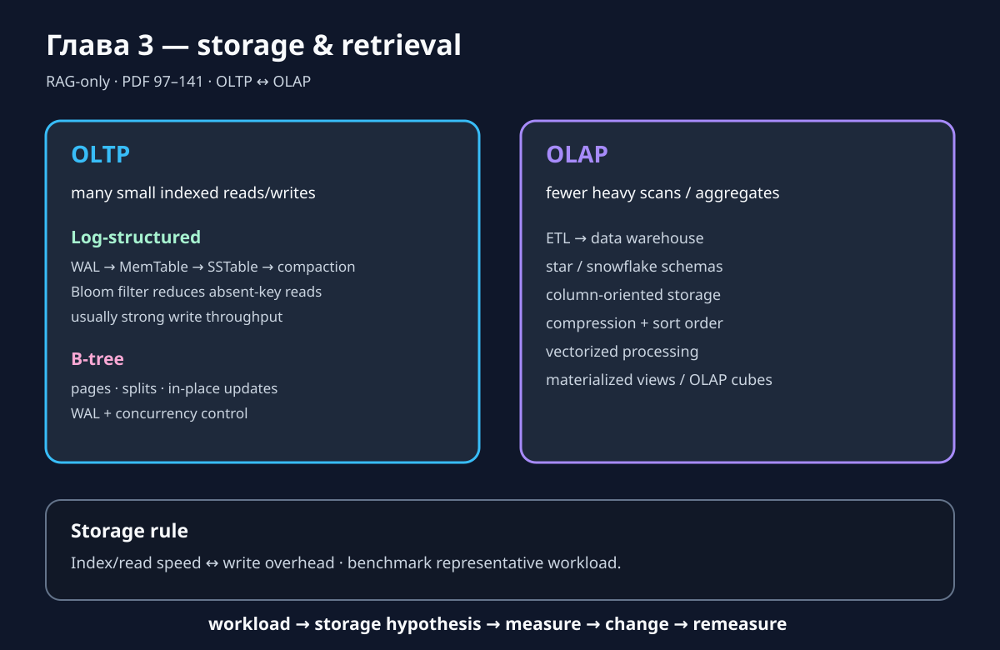
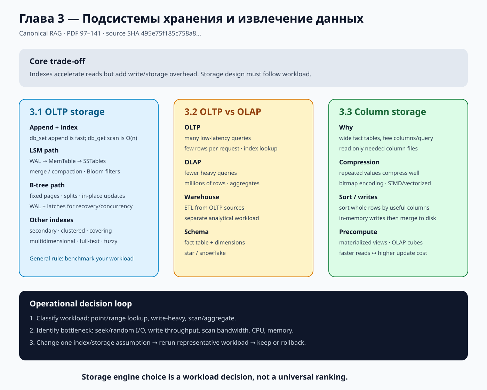

# Глава 3 — Подсистемы хранения и извлечение данных

RAG-grounded разбор главы 3 книги «Высоконагруженные приложения: программирование, масштабирование, поддержка».

## Идентификация

- Book ID: `vysokonagruzhennye-prilozheniya-martin-kleppmann-ru`
- Глава: 3
- Название: «Подсистемы хранения и извлечение данных»
- Slug: `storage-and-retrieval`
- Source policy: `rag_only`
- External sources: запрещены
- Model memory: запрещена
- Прямой доступ к canonical PDF: не использовался
- Book readiness: `READY` по `BOOK-READINESS v1.3`; retrieval integrity smoke test повторно пройден
- Chapter contract: `CHAPTER-ANALYSIS-REQUEST v1.3` → `CHAPTER-ARTIFACT-COLLECTION v1.7`

## Provenance

- Source format: PDF
- Chapter source locator range: PDF `97–141`
- PDF 142: addressable text chunk отсутствует
- Следующий chapter boundary: PDF 143 начинается главой 4 «Кодирование и эволюция»
- Boundary evidence:
  - `p0097:c01` — начало главы 3;
  - `p0098:c01` — начало 3.1;
  - `p0120:c01` — начало 3.2;
  - `p0127:c01` — начало 3.3;
  - `p0135:c01`–`p0136:c01` — 3.4 «Резюме»;
  - `p0136:c01`–`p0141:c01` — библиография;
  - `p0143:c01` — начало главы 4.
- Chapter boundary verified: yes
- Source SHA-256: `495e75f185c758a8223ca25b0fb35a8e6db693b06fb78c102e624a01ff852685`

## Содержимое

- [cheatsheet.md](cheatsheet.md) — operational framing выбора storage/index architecture под workload.
- [commands.md](commands.md) — source-confirmed Bash и SQL examples.
- [diagram.md](diagram.md) — conceptual flow OLTP/OLAP и storage-engine choices.
- [summary.md](summary.md) — RAG-grounded перенос смысла раздела 3.4 «Резюме».
- [source-findings.md](source-findings.md) — extraction issue рисунка 3.8 на PDF 124.
- [visual-cheatsheet.svg](visual-cheatsheet.svg) — компактный обзор.
- [visual-cheatsheet-detailed.svg](visual-cheatsheet-detailed.svg) — подробный обзор.

Review/control questions между резюме и библиографией не обнаружены, поэтому `review-questions.md` и `review-answers.md` не создаются.

## Карта главы

1. Простейшее append-only key-value storage на Bash как модель журнала.
2. Индекс как дополнительная структура: ускоряет чтение, но увеличивает стоимость записи.
3. Hash index поверх append-only log.
4. Segment compaction/merging и восстановление после частично записанных данных.
5. SSTables и MemTable: сортированные immutable segments.
6. LSM-tree: WAL + MemTable + SSTables + background compaction; Bloom filters для отсутствующих ключей.
7. B-tree: page-oriented storage, balanced tree, in-place page updates.
8. Надежность B-tree: write-ahead log и concurrency control.
9. LSM vs B-tree: обычно LSM сильнее на write path, B-tree — на read path, но результат зависит от workload.
10. Secondary, clustered и covering indexes; multi-dimensional/full-text indexes.
11. In-memory databases и роль диска для durability.
12. OLTP vs OLAP: разные access patterns и разные bottlenecks.
13. Data warehouse как отдельная аналитическая БД; ETL.
14. Star/snowflake schemas: fact table + dimensions.
15. Column-oriented storage для wide analytical tables.
16. Column compression, vectorized processing и sort order.
17. Writes в column store через in-memory structure и последующее слияние.
18. Materialized views и OLAP cubes как предварительно вычисленные aggregates.
19. Резюме: storage engine нужно выбирать под конкретный workload.

## Основной принцип

Подсистема хранения — это набор компромиссов между стоимостью записи, стоимостью чтения, объемом памяти/диска и формой запросов.

Нельзя выбирать индекс или storage engine только по названию технологии. Сначала нужно классифицировать workload:

- много коротких key-based reads/writes → OLTP;
- немного тяжелых scan/aggregate queries по большому числу строк → OLAP.

Для OLTP глава сравнивает две базовые философии:

- log-structured: append + immutable sorted segments + compaction;
- page-oriented: B-tree + update pages in place + WAL.

Для аналитики акцент смещается к компактному column storage, sequential scans, compression и предварительным aggregates.

## Практический смысл

- Индексировать только то, что окупает write/storage overhead.
- Сравнивать LSM/B-tree на representative workload, а не по общему правилу.
- Учитывать recovery path: WAL/log должен быть частью модели надежности.
- Следить за compaction и write amplification как частью стоимости log-structured storage.
- Не запускать тяжелую аналитику на production OLTP только потому, что интерфейс SQL одинаков.
- Для warehouse workload минимизировать объем реально читаемых данных: column selection, compression и подходящий sort order.
- Materialized aggregates ускоряют конкретные запросы, но увеличивают стоимость обновлений.
- Настройка БД должна исходить из того, где находится bottleneck: random access/seek, write throughput, scan bandwidth, CPU или memory.

## Ограничения

- Анализ основан только на canonical addressable RAG chunks и deterministic lexical index.
- Внешние документы, современные benchmark results и актуальные версии СУБД не использовались.
- Рисунки не реконструировались по model memory.
- PDF 124 содержит поврежденное text extraction представление рисунка 3.8; см. [source-findings.md](source-findings.md).
- Численные рекомендации по cache sizes, compaction thresholds и DB tuning parameters отсутствуют в артефактах, если они не подтверждены RAG.
