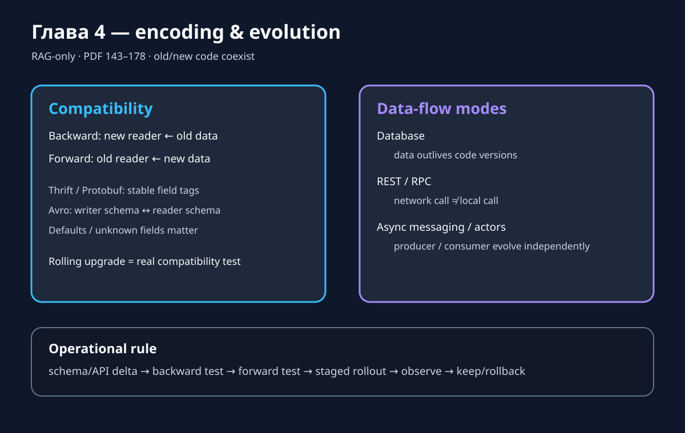
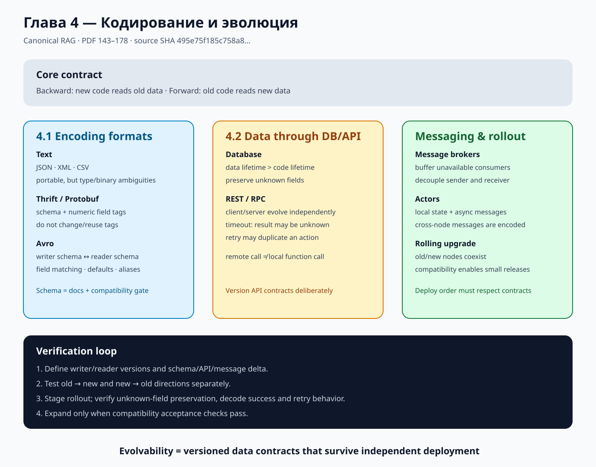

# Глава 4 — Кодирование и эволюция

RAG-grounded разбор главы 4 книги «Высоконагруженные приложения: программирование, масштабирование, поддержка».

## Идентификация

- Book ID: `vysokonagruzhennye-prilozheniya-martin-kleppmann-ru`
- Глава: 4
- Название: «Кодирование и эволюция»
- Slug: `encoding-and-evolution`
- Source policy: `rag_only`
- External sources: запрещены
- Model memory: запрещена
- Canonical PDF direct access: не использовался
- Book readiness: `READY`
- Chapter contract: `CHAPTER-ANALYSIS-REQUEST v1.3` → `CHAPTER-ARTIFACT-COLLECTION v1.7`

## Provenance

- PDF range: `143–178`
- `p0143:c01` — начало главы 4
- `p0144:c01` — начало 4.1
- `p0161:c01` — начало 4.2
- `p0173:c01`–`p0174:c01` — 4.3 «Резюме»
- `p0175:c01`–`p0178:c01` — библиография
- `p0179:c01` — начало части II
- следующая numbered chapter: PDF 185, глава 5
- Source SHA-256: `495e75f185c758a8223ca25b0fb35a8e6db693b06fb78c102e624a01ff852685`

## Содержимое

- [cheatsheet.md](cheatsheet.md)
- [commands.md](commands.md)
- [diagram.md](diagram.md)
- [summary.md](summary.md)
- [visual-cheatsheet.svg](visual-cheatsheet.svg)
- [visual-cheatsheet-detailed.svg](visual-cheatsheet-detailed.svg)

Review/control questions перед библиографией не обнаружены.

## Карта главы

1. Encoding/decoding: in-memory structures ↔ byte sequence.
2. Language-specific serialization: удобство ценой привязки к языку и слабой evolvability.
3. JSON/XML/CSV: interoperability, но неоднозначности типов и binary data.
4. Thrift/Protocol Buffers: schema, numeric field tags, code generation.
5. Schema evolution: field tags нельзя менять или повторно использовать; новые поля должны сохранять compatibility.
6. Avro: writer schema + reader schema и schema resolution.
7. Schemas как documentation и compatibility gate.
8. Data flow через БД: old/new code может сосуществовать; неизвестные поля нельзя терять.
9. Data flow через REST/RPC: remote call отличается от local call.
10. Async messaging и message brokers.
11. Distributed actors и совместимость сообщений при rolling upgrade.
12. Резюме: evolvability опирается на backward/forward compatibility.

## Основной принцип

- **Backward compatibility:** новый код читает данные старого кода.
- **Forward compatibility:** старый код читает данные нового кода.

Rolling/staged deployment означает реальное сосуществование разных версий. Поэтому schema/API/message evolution должна проектироваться заранее.

## Практический смысл

- Проверять compatibility до deploy.
- Считать field tags persistent contract.
- Сохранять неизвестные поля при read-modify-write.
- Для RPC учитывать timeout, retry и возможное повторное выполнение.
- Проектировать API/message contracts для независимого обновления producers/consumers.
- Rolling upgrade использовать как проверку совместимости версий.

## Ограничения

- Только canonical RAG.
- Внешняя документация не использовалась.
- Версии продуктов не актуализировались.
- Binary-layout figures не реконструировались.
- Material extraction defect, влияющий на выводы, не обнаружен.
