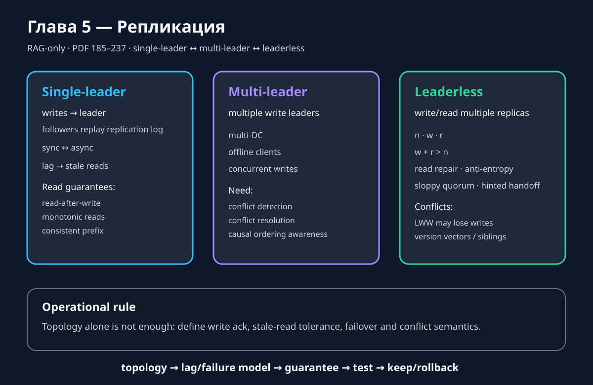
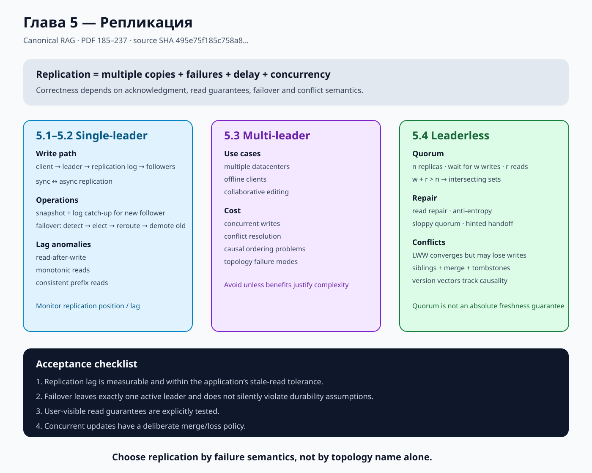

# Глава 5 — Репликация

RAG-grounded разбор главы 5 книги «Высоконагруженные приложения: программирование, масштабирование, поддержка».

## Идентификация

- Book ID: `vysokonagruzhennye-prilozheniya-martin-kleppmann-ru`
- Глава: 5
- Название: «Репликация»
- Slug: `replication`
- Source policy: `rag_only`
- External sources: запрещены
- Model memory: запрещена
- Canonical PDF direct access: не использовался
- Book readiness: `READY`
- Retrieval integrity smoke test: `PASS`
- Chapter contract: `CHAPTER-ANALYSIS-REQUEST v1.3` → `CHAPTER-ARTIFACT-COLLECTION v1.7`

## Provenance

- Source format: PDF
- Chapter source locator range: PDF `185–237`
- PDF 238: addressable text chunk отсутствует
- Следующая глава: PDF 239 — глава 6 «Секционирование»
- Boundary evidence:
  - `p0185:c01` — начало главы 5;
  - `p0186:c01` — начало 5.1;
  - `p0196:c01` — начало 5.2;
  - `p0203:c01` — начало 5.3;
  - `p0214:c01` — начало 5.4;
  - `p0230:c01`–`p0232:c01` — 5.5 «Резюме»;
  - `p0232:c01`–`p0237:c01` — 5.6 «Библиография»;
  - `p0239:c01` — начало главы 6.
- Chapter boundary verified: yes
- Source SHA-256: `495e75f185c758a8223ca25b0fb35a8e6db693b06fb78c102e624a01ff852685`

## Содержимое

- [cheatsheet.md](cheatsheet.md) — operational/conceptual checklist по replication topology, lag, failover, quorum и conflict handling.
- [commands.md](commands.md) — только source-confirmed параметры, механизмы и инструменты; готовых универсальных CLI-команд глава не дает.
- [diagram.md](diagram.md) — conceptual flow выбора replication model и проверки гарантий.
- [summary.md](summary.md) — RAG-grounded перенос смысла раздела 5.5.
- [visual-cheatsheet.svg](visual-cheatsheet.svg) — компактный обзор.
- [visual-cheatsheet-detailed.svg](visual-cheatsheet-detailed.svg) — подробный обзор.

Review/control questions между резюме и библиографией не обнаружены.

## Карта главы

1. Single-leader replication: один leader принимает writes, followers применяют replication log.
2. Synchronous vs asynchronous replication: durability/availability/latency trade-off.
3. Создание новой replica через consistent snapshot + replay изменений после snapshot position.
4. Follower recovery и leader failover.
5. Риски failover: потеря нереплицированных writes, split brain, неверно выбранный timeout.
6. Replication log implementations: statement-based, WAL shipping, logical/row-based, trigger-based.
7. Replication lag и eventual consistency.
8. Read-after-write consistency.
9. Monotonic reads.
10. Consistent prefix reads.
11. Multi-leader replication для нескольких ЦОДов, offline clients и collaborative editing.
12. Конфликты при concurrent writes и ограничения replication topology.
13. Leaderless replication: write/read несколько replicas.
14. Read repair и anti-entropy.
15. Quorum parameters `n`, `w`, `r`; условие `w + r > n`.
16. Ограничения quorum guarantees и необходимость мониторинга staleness.
17. Sloppy quorum и hinted handoff.
18. Concurrent writes, last-write-wins и риск silent data loss.
19. Happens-before / concurrency.
20. Siblings, tombstones и application-side merge.
21. Version vectors для различения overwrite и concurrent writes.
22. Резюме: single-leader, multi-leader и leaderless — разные trade-offs между simplicity, availability и consistency.

## Основной принцип

Репликация — не «копирование данных», а управление конкурирующими версиями состояния при задержках, сбоях и частичной доступности сети.

Нужно явно определить:

- кто имеет право принимать запись;
- когда write считается подтвержденной;
- насколько stale read допустим;
- что произойдет при отказе leader/replica;
- какие гарантии чтения нужны приложению;
- как система различает последовательные и concurrent updates;
- кто и как разрешает конфликт.

## Практический смысл

- Не считать asynchronous replication эквивалентом durability на всех replicas.
- Для failover понимать риск потери writes, не дошедших до promoted follower.
- Измерять replication lag и использовать его как operational signal.
- Выбирать read consistency по user-visible semantics, а не только по latency.
- Не применять multi-leader без явной conflict-resolution model.
- Для leaderless систем считать `n/w/r` частью availability/consistency contract.
- Не считать `w + r > n` абсолютной гарантией свежести во всех failure/timing scenarios.
- Hinted handoff повышает write availability, но ослабляет немедленную visibility.
- LWW обеспечивает convergence ценой возможной потери concurrent writes.
- Если data loss неприемлем, нужно сохранять concurrent values и корректно merge'ить их.

## Ограничения

- Только canonical addressable RAG и deterministic lexical index.
- Внешняя документация упомянутых СУБД не использовалась.
- Версии и product behavior сохранены как historical source examples.
- Рисунки главы не реконструировались.
- Material source contradiction/extraction defect, влияющий на артефакты, не обнаружен.
