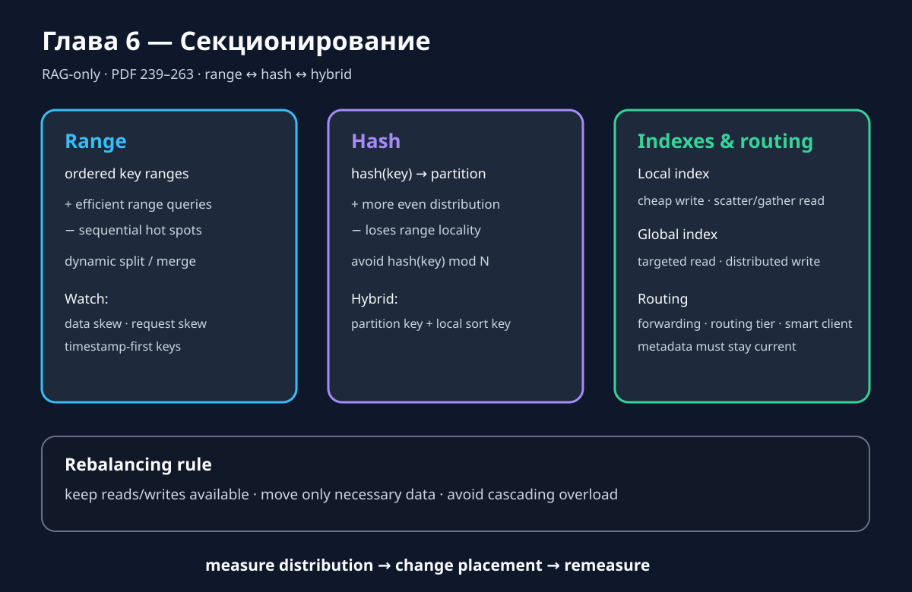
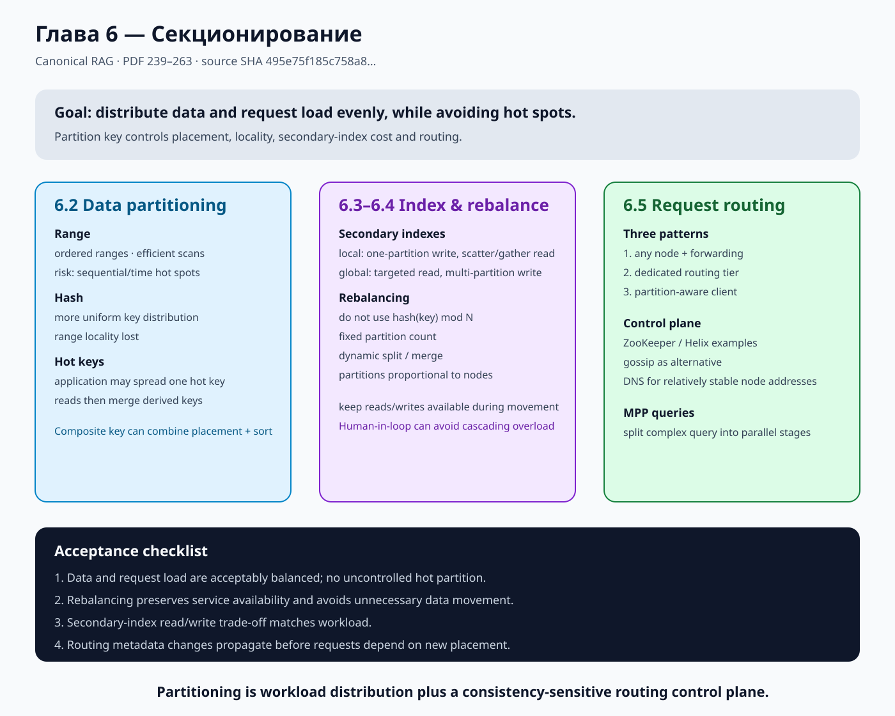

# Глава 6 — Секционирование

RAG-grounded разбор главы 6 книги «Высоконагруженные приложения: программирование, масштабирование, поддержка».

## Идентификация

- Book ID: `vysokonagruzhennye-prilozheniya-martin-kleppmann-ru`
- Глава: 6
- Название: «Секционирование»
- Slug: `partitioning`
- Source policy: `rag_only`
- External sources: запрещены
- Model memory: запрещена
- Canonical PDF direct access: не использовался
- Book readiness: `READY`
- Retrieval integrity smoke test: `PASS`
- Chapter contract: `CHAPTER-ANALYSIS-REQUEST v1.3` → `CHAPTER-ARTIFACT-COLLECTION v1.7`

## Provenance

- Source format: PDF
- Chapter source locator range: PDF `239–263`
- PDF 264: addressable text chunk отсутствует
- Следующая глава: PDF 265 — глава 7 «Транзакции»
- Boundary evidence:
  - `p0239:c01` — начало главы 6;
  - `p0240:c01` — начало 6.1;
  - `p0241:c01` — начало 6.2;
  - `p0246:c01` — начало 6.3;
  - `p0250:c01` — начало 6.4;
  - `p0255:c01` — начало 6.5;
  - `p0259:c01`–`p0260:c01` — 6.6 «Резюме»;
  - `p0260:c01`–`p0263:c01` — 6.7 «Библиография»;
  - `p0265:c01` — начало главы 7.
- Chapter boundary verified: yes
- Source SHA-256: `495e75f185c758a8223ca25b0fb35a8e6db693b06fb78c102e624a01ff852685`

## Содержимое

- [cheatsheet.md](cheatsheet.md) — operational/conceptual checklist по partitioning, hot spots, secondary indexes, rebalancing и request routing.
- [commands.md](commands.md) — source-confirmed параметры, механизмы и инструменты; универсальных CLI-команд глава не дает.
- [diagram.md](diagram.md) — conceptual flow выбора partitioning scheme и маршрутизации.
- [summary.md](summary.md) — RAG-grounded перенос смысла раздела 6.6.
- [source-findings.md](source-findings.md) — extraction defect рисунка 6.7 на PDF 256.
- [visual-cheatsheet.svg](visual-cheatsheet.svg) — компактный обзор.
- [visual-cheatsheet-detailed.svg](visual-cheatsheet-detailed.svg) — подробный обзор.

Review/control questions между резюме и библиографией не обнаружены.

## Карта главы

1. Partitioning и replication независимы по основной логике и обычно используются вместе.
2. Цель partitioning — равномерно распределить data volume и request load.
3. Skew и hot spots снижают эффективность масштабирования.
4. Range partitioning сохраняет sort order и эффективные range queries, но подвержен hot spots.
5. Hash partitioning распределяет load равномернее, но разрушает естественный key order и range locality.
6. Composite key может совместить hash partition key с сортировкой внутри partition.
7. Очень горячий key может потребовать application-side key spreading и последующего read merge.
8. Secondary indexes усложняют partitioning.
9. Document-partitioned/local secondary index: write локальна, read требует scatter/gather.
10. Term-partitioned/global secondary index: read может идти в одну index partition, write затрагивает несколько index partitions.
11. Global index updates часто asynchronous, поэтому возможна временная staleness.
12. Rebalancing нужен при росте нагрузки/данных и отказах узлов.
13. Hash mod N — плохая схема rebalancing, потому что изменение N перемещает большинство keys.
14. Fixed partition count: перемещаются partitions между nodes без изменения key→partition mapping.
15. Dynamic partitioning: split/merge partitions по размеру.
16. Partitions proportional to nodes: фиксированное число partitions на node.
17. Full-auto rebalancing может усилить перегрузку и привести к cascading failure.
18. Routing options: любой node с forwarding, dedicated routing tier, partition-aware client.
19. Cluster metadata должен оставаться актуальным; используются coordination service или gossip.
20. MPP analytical systems распараллеливают query stages по partitions.
21. Резюме: partitioning — workload distribution problem, а не только способ разрезать dataset.

## Основной принцип

Секционирование эффективно только тогда, когда data volume и query load распределяются достаточно равномерно.

Выбор partition key определяет:

- где окажутся данные;
- какие запросы останутся локальными;
- появятся ли hot spots;
- придется ли использовать scatter/gather;
- сколько данных придется перемещать при rebalancing.

## Практический смысл

- Не выбирать partition key без анализа workload.
- Разделять data skew и request skew.
- Range partitioning применять, когда range locality важнее риска hot spots.
- Hash partitioning применять, когда важнее равномерность key distribution.
- Не использовать `hash(key) mod N` для схемы, где N меняется.
- Secondary-index design считать частью partition design.
- При local index учитывать tail latency scatter/gather.
- При global index учитывать distributed write и asynchronous visibility.
- Rebalancing выполнять так, чтобы кластер продолжал обслуживать reads/writes.
- Автоматический rebalancing не сочетать бездумно с агрессивным failure detection.
- Routing metadata считать consistency-sensitive control-plane state.

## Ограничения

- Только canonical addressable RAG и deterministic lexical index.
- Внешняя документация упомянутых систем не использовалась.
- Product versions и defaults сохранены как historical source examples.
- Рисунки не реконструировались по model memory.
- PDF 256 содержит поврежденное text extraction представление рисунка 6.7; см. [source-findings.md](source-findings.md).
