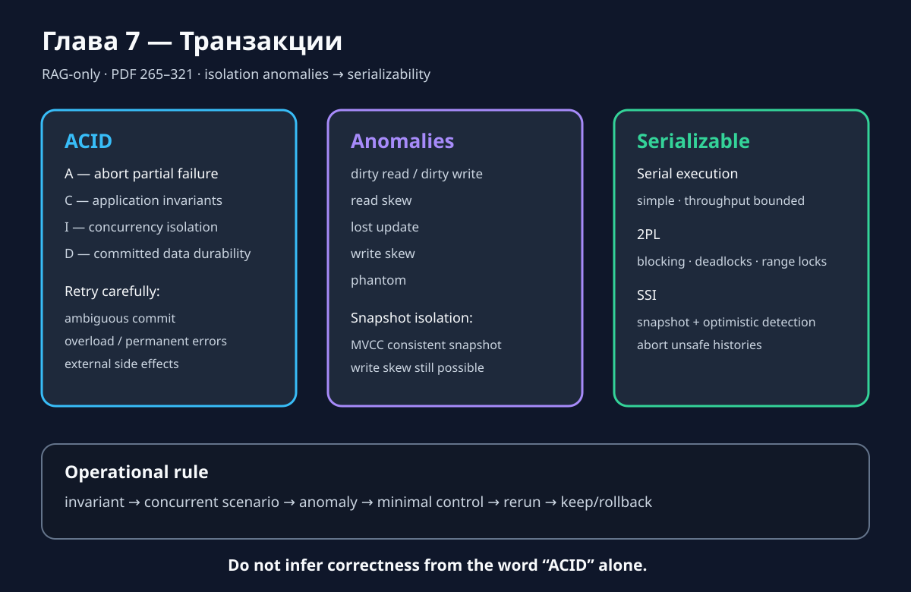
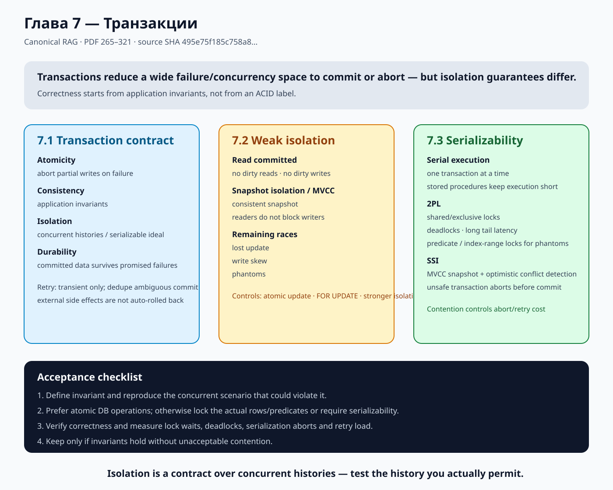

# Глава 7 — Транзакции

RAG-grounded разбор главы 7 книги «Высоконагруженные приложения: программирование, масштабирование, поддержка».

## Идентификация

- Book ID: `vysokonagruzhennye-prilozheniya-martin-kleppmann-ru`
- Глава: 7
- Название: «Транзакции»
- Slug: `transactions`
- Source policy: `rag_only`
- External sources: запрещены
- Model memory: запрещена
- Canonical PDF direct access: не использовался
- Book readiness: `READY`
- Retrieval integrity smoke test: `PASS`
- Chapter contract: `CHAPTER-ANALYSIS-REQUEST v1.3` → `CHAPTER-ARTIFACT-COLLECTION v1.7`

## Provenance

- Source format: PDF
- Chapter source locator range: PDF `265–321`
- PDF 322: addressable text chunk отсутствует
- Следующая глава: PDF 323 — глава 8 «Проблемы распределенных систем»
- Boundary evidence:
  - `p0265:c01` — начало главы 7;
  - `p0267:c01` — начало 7.1;
  - `p0277:c01` — начало 7.2;
  - `p0298:c01` — начало 7.3;
  - `p0314:c01`–`p0316:c01` — 7.4 «Резюме»;
  - `p0316:c01`–`p0321:c01` — 7.5 «Библиография»;
  - `p0323:c01` — начало главы 8.
- Chapter boundary verified: yes
- Source SHA-256: `495e75f185c758a8223ca25b0fb35a8e6db693b06fb78c102e624a01ff852685`

## Содержимое

- [cheatsheet.md](cheatsheet.md) — operational/conceptual checklist по ACID, isolation anomalies и serializability.
- [commands.md](commands.md) — source-confirmed SQL examples.
- [diagram.md](diagram.md) — flow выбора isolation/locking strategy и проверки anomalies.
- [summary.md](summary.md) — RAG-grounded перенос смысла раздела 7.4.
- [visual-cheatsheet.svg](visual-cheatsheet.svg) — компактный обзор.
- [visual-cheatsheet-detailed.svg](visual-cheatsheet-detailed.svg) — подробный обзор.

Review/control questions между резюме и библиографией не обнаружены, поэтому `review-questions.md` и `review-answers.md` не создаются.

## Карта главы

1. Транзакция группирует несколько reads/writes в логическую единицу: commit целиком или abort целиком.
2. ACID не является однозначной маркетинговой меткой; реальные гарантии нужно проверять отдельно.
3. Atomicity в ACID — защита от partial failure через abort/rollback, а не concurrency atomicity.
4. Consistency в смысле ACID — сохранение application invariants; в общем случае это ответственность приложения.
5. Isolation в сильном смысле — результат как при serial execution, но на практике часто используются более слабые уровни.
6. Durability — обязательство не терять committed data, но абсолютной гарантии не существует.
7. Multi-object transactions упрощают согласование связанных объектов, денормализованных данных и secondary indexes.
8. Abort/retry полезны, но повтор не всегда безопасен: ambiguous commit, overload, permanent errors и external side effects.
9. Read committed предотвращает dirty reads и dirty writes.
10. Snapshot isolation/MVCC дает consistent snapshot и устраняет read skew, но не делает систему serializable.
11. Lost update возникает в read-modify-write loop; решения: atomic operation, explicit lock, automatic detection.
12. Write skew — более общий race на нескольких объектах; snapshot isolation его не устраняет.
13. Phantom — write изменяет множество объектов, соответствующих ранее выполненному predicate query.
14. Serializable isolation — сильнейшая рассматриваемая защита от этих anomalies.
15. Три подхода к serializability: actual serial execution, 2PL, SSI.
16. Serial execution упрощает concurrency, но ограничено throughput одного execution thread/partition и требует коротких transactions.
17. 2PL блокирует конфликтующие readers/writers, предотвращает anomalies, но ухудшает latency и создает deadlocks.
18. Predicate/index-range locks защищают от phantoms.
19. SSI — optimistic: transactions выполняются без блокирования друг друга на read path, а опасные serialization conflicts обнаруживаются перед commit.
20. SSI сохраняет MVCC snapshot reads, но при conflict abort/retry rate влияет на throughput.
21. Резюме: слабая isolation требует явного понимания того, какие race conditions остаются на application layer.

## Основной принцип

Изоляция — это контракт между базой и приложением о том, какие concurrent histories допустимы.

Нельзя делать вывод о корректности только из слова `ACID` или названия уровня isolation. Нужно ответить:

- какие invariants защищает приложение;
- какие anomalies предотвращает выбранный уровень;
- какие races остаются возможными;
- где используются atomic operations или explicit locks;
- как обрабатываются abort/retry;
- нужна ли настоящая serializability.

## Практический смысл

- Для read-modify-write сначала искать атомарную DB operation вместо application loop.
- Если нужна explicit locking, блокировать именно те rows/predicates, на которых основано решение.
- Не считать snapshot isolation эквивалентом serializability.
- Для backup/analytics использовать consistent snapshots вместо inconsistent multi-read state.
- Retry aborted transaction делать только для transient errors и с учетом overload/backoff.
- При ambiguous commit использовать application-level deduplication/idempotency.
- External side effects не считать автоматически rolled back вместе с DB transaction.
- 2PL оценивать не только по средней latency, но и по lock queues/deadlocks/tail latency.
- SSI оценивать по serialization-conflict/abort rate и длине read-write transactions.

## Ограничения

- Только canonical addressable RAG и deterministic lexical index.
- Внешняя документация PostgreSQL/MySQL/Oracle/SQL Server и современные defaults не использовались.
- Product-specific isolation semantics сохранены только как historical source examples.
- Рисунки главы не реконструировались по model memory.
- Material source contradiction/extraction defect, влияющий на chapter artifacts, не обнаружен.
