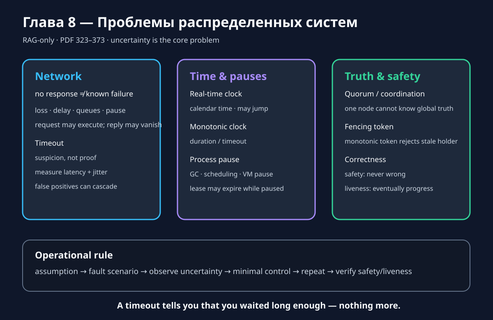
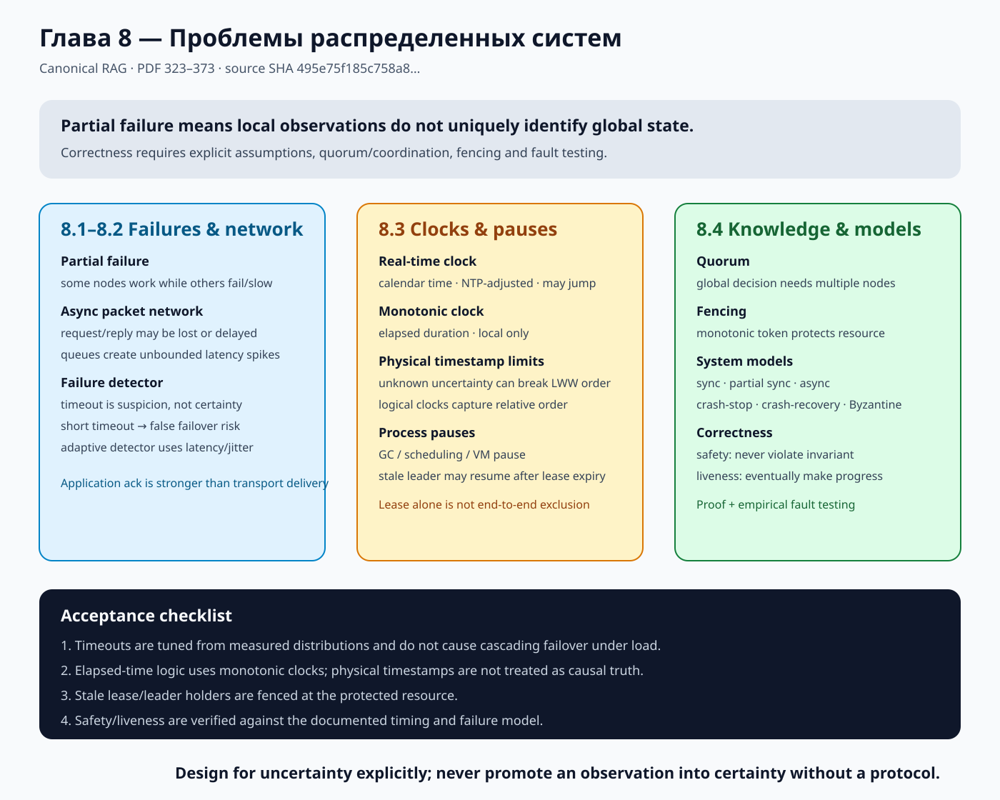

# Глава 8 — Проблемы распределенных систем

RAG-grounded разбор главы 8 книги «Высоконагруженные приложения: программирование, масштабирование, поддержка».

## Идентификация

- Book ID: `vysokonagruzhennye-prilozheniya-martin-kleppmann-ru`
- Глава: 8
- Название: «Проблемы распределенных систем»
- Slug: `trouble-with-distributed-systems`
- Source policy: `rag_only`
- External sources: запрещены
- Model memory: запрещена
- Canonical PDF direct access: не использовался
- Book readiness: `READY`
- Retrieval integrity smoke test: `PASS`
- Chapter contract: `CHAPTER-ANALYSIS-REQUEST v1.3` → `CHAPTER-ARTIFACT-COLLECTION v1.7`

## Provenance

- Source format: PDF
- Chapter source locator range: PDF `323–373`
- PDF 374: addressable text chunk отсутствует
- Следующая глава: PDF 375 — глава 9 «Согласованность и консенсус»
- Boundary evidence:
  - `p0323:c01` — начало главы 8;
  - `p0324:c01` — начало 8.1;
  - `p0328:c01` — начало 8.2;
  - `p0338:c01` — начало 8.3;
  - `p0353:c01` — начало 8.4;
  - `p0364:c01`–`p0365:c01` — 8.5 «Резюме»;
  - `p0366:c01`–`p0373:c01` — 8.6 «Библиография»;
  - `p0375:c01` — начало главы 9.
- Chapter boundary verified: yes
- Source SHA-256: `495e75f185c758a8223ca25b0fb35a8e6db693b06fb78c102e624a01ff852685`

## Содержимое

- [cheatsheet.md](cheatsheet.md) — operational/conceptual checklist по partial failures, network uncertainty, clocks, pauses, leases, fencing и system models.
- [commands.md](commands.md) — source-confirmed APIs, pseudocode и tools.
- [diagram.md](diagram.md) — failure/uncertainty flow и decision model.
- [summary.md](summary.md) — RAG-grounded перенос смысла раздела 8.5.
- [visual-cheatsheet.svg](visual-cheatsheet.svg) — компактный обзор.
- [visual-cheatsheet-detailed.svg](visual-cheatsheet-detailed.svg) — подробный обзор.

Review/control questions между резюме и библиографией не обнаружены.

## Карта главы

1. Partial failure — определяющая особенность distributed systems: часть системы может работать, часть — нет.
2. Надежную систему приходится строить поверх компонентов, допускающих сбои.
3. Shared-nothing nodes общаются только через сеть; sender не знает, доставлен ли request и обработан ли он.
4. Timeout не отличает node failure от network delay, queueing, pause или lost response.
5. Слишком короткий timeout дает false positive и может усиливать перегрузку вплоть до cascading failure.
6. Timeout следует выбирать по наблюдаемому latency/jitter distribution, а не по «магическому» числу.
7. Phi Accrual failure detector — пример адаптивной оценки подозрения на отказ.
8. Real-time clock и monotonic clock служат разным целям.
9. Real-time clock может корректироваться NTP и даже идти назад; для elapsed duration нужен monotonic clock.
10. NTP уменьшает clock skew, но не делает clock exact; timestamp имеет uncertainty.
11. Physical timestamps ненадежны для causal ordering; LWW может потерять правильную запись.
12. Logical clocks лучше выражают relative event ordering, когда wall-clock time не нужен.
13. Process может надолго остановиться из-за GC, scheduling, page faults, I/O и virtualization и затем продолжить работу, не зная о паузе.
14. Lease может истечь во время pause; старый leader/lock holder после resume не должен иметь возможность портить state.
15. Fencing token — монотонно растущий token; downstream resource отклоняет операции со старым token.
16. Узел не может единолично знать «истину»; серьезные решения требуют quorum/coordination.
17. Byzantine faults рассматриваются отдельно; для большинства server systems глава предполагает non-Byzantine environment.
18. Простые защиты от слабых форм «лжи»: checksums, input validation, несколько NTP servers.
19. System model формализует timing/failure assumptions.
20. Timing models: synchronous, partially synchronous, asynchronous.
21. Node failure models: crash-stop, crash-recovery, Byzantine.
22. Для практических систем глава считает реалистичной partially synchronous + crash-recovery model.
23. Correctness разделяется на safety и liveness.
24. Safety должно сохраняться всегда; liveness может зависеть от условий восстановления сети/узлов.
25. Теоретическая proof и empirical fault testing дополняют друг друга.

## Основной принцип

В distributed system отсутствие ответа почти никогда не объясняет причину.

Из локальной точки зрения node видит только:

- сообщения, которые пришли;
- сообщения, которые не пришли вовремя;
- показания собственных часов;
- собственное текущее состояние.

Из этого нельзя надежно вывести, что remote node умер, request не был выполнен, lease все еще принадлежит текущему process или локальное wall-clock time правильно отражает causal order.

Поэтому correctness строится через explicit assumptions, quorum/coordination, monotonic identifiers и failure-aware protocols.

## Практический смысл

- Timeout считать detector suspicion, а не доказательством node death.
- Измерять latency distribution и jitter перед tuning timeout.
- Проверять recovery после network partition, а не только момент возникновения сбоя.
- Не использовать wall-clock timestamps для causal ordering без отдельного обоснования.
- Для duration/timeouts использовать monotonic clock.
- Clock synchronization контролировать как источник uncertainty, а не бинарный healthy/unhealthy state.
- Lease/lock должен дополняться fencing token там, где stale holder способен выполнить destructive write.
- Process pause считать нормальным failure mode.
- Fault injection включать network delay/loss, process pauses и slow nodes.
- Разделять safety и liveness acceptance criteria.
- Явно документировать system model, под которой алгоритм считается корректным.

## Ограничения

- Только canonical addressable RAG и deterministic lexical index.
- Внешняя документация NTP, ZooKeeper, Akka, Cassandra и TrueTime не использовалась.
- Исторические product examples не актуализировались.
- Рисунки главы не реконструировались по model memory.
- Material source contradiction/extraction defect, влияющий на chapter artifacts, не обнаружен.
