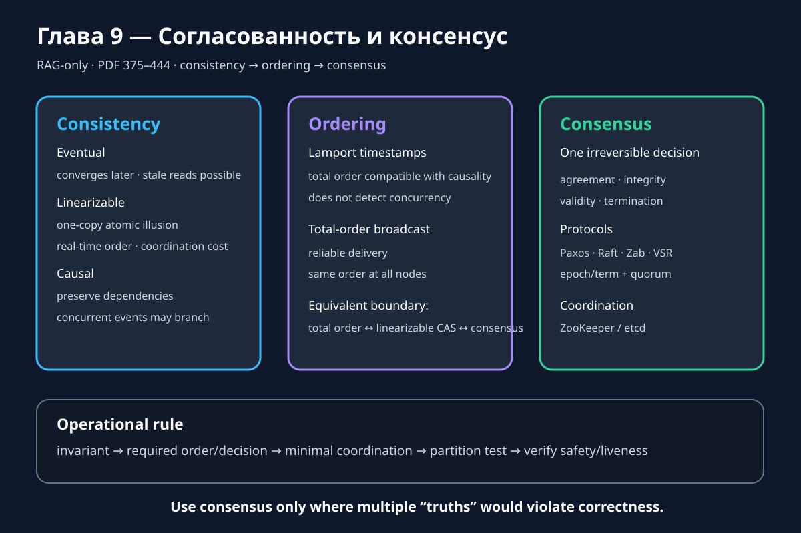
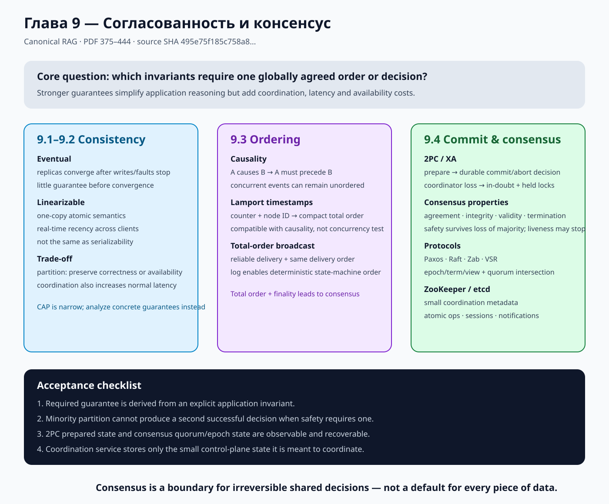

# Глава 9 — Согласованность и консенсус

RAG-grounded разбор главы 9 книги «Высоконагруженные приложения: программирование, масштабирование, поддержка».

## Идентификация

- Book ID: `vysokonagruzhennye-prilozheniya-martin-kleppmann-ru`
- Глава: 9
- Название: «Согласованность и консенсус»
- Slug: `consistency-and-consensus`
- Source policy: `rag_only`
- External sources: запрещены
- Model memory: запрещена
- Canonical PDF direct access: не использовался
- Book readiness: `READY`
- Retrieval integrity smoke test: `PASS`
- Chapter contract: `CHAPTER-ANALYSIS-REQUEST v1.3` → `CHAPTER-ARTIFACT-COLLECTION v1.7`

## Provenance

- Source format: PDF
- Chapter source locator range: PDF `375–444`
- PDF 445: начало части III «Производные данные»
- Следующая numbered chapter: PDF 449 — глава 10 «Пакетная обработка»
- Boundary evidence:
  - `p0375:c01` — начало главы 9;
  - `p0376:c01` — начало 9.1;
  - `p0378:c01` — начало 9.2;
  - `p0394:c01` — начало 9.3;
  - `p0409:c01` — начало 9.4;
  - `p0432:c01`–`p0434:c01` — 9.5 «Резюме»;
  - `p0435:c01`–`p0444:c01` — 9.6 «Библиография»;
  - `p0445:c01` — начало части III;
  - `p0449:c01` — начало главы 10.
- Chapter boundary verified: yes
- Source SHA-256: `495e75f185c758a8223ca25b0fb35a8e6db693b06fb78c102e624a01ff852685`

## Содержимое

- [cheatsheet.md](cheatsheet.md) — operational/conceptual checklist по linearizability, causality, total-order broadcast, 2PC и consensus.
- [commands.md](commands.md) — source-confirmed operations/APIs/tools.
- [diagram.md](diagram.md) — связи consistency guarantees и consensus-equivalent problems.
- [summary.md](summary.md) — RAG-grounded перенос смысла раздела 9.5.
- [visual-cheatsheet.svg](visual-cheatsheet.svg) — компактный обзор.
- [visual-cheatsheet-detailed.svg](visual-cheatsheet-detailed.svg) — подробный обзор.

Review/control questions между резюме и библиографией не обнаружены.

## Карта главы

1. Eventual consistency означает eventual convergence, но почти ничего не гарантирует до момента convergence.
2. Более сильные consistency models упрощают reasoning приложения ценой performance/availability trade-offs.
3. Linearizability создает иллюзию одной atomic copy данных.
4. Linearizability и serializability — разные гарантии; их сочетание дает strict serializability.
5. Linearizable register полезен для leader election/locks, uniqueness constraints и cross-channel timing dependencies.
6. Single-leader replication потенциально linearizable при корректном leadership; multi-leader обычно нет.
7. Leaderless systems не следует считать linearizable без специально доказанного protocol.
8. При network fault linearizability конфликтует с availability: нельзя одновременно обслужить обе disconnected стороны и сохранить одну актуальную copy.
9. CAP в книге рассматривается как узкая и исторически важная, но слабая практическая модель design trade-offs.
10. Linearizability увеличивает latency даже без partition из-за coordination/network delay.
11. Causality — более слабый порядок: causal events упорядочены, concurrent events могут оставаться неупорядоченными.
12. Causal consistency не требует полной real-time ordering всех операций.
13. Lamport timestamps дают total order, совместимый с causality, но не позволяют определить concurrency.
14. Просто total order недостаточно: нужно знать, когда order окончателен.
15. Total-order broadcast требует reliable delivery и одинакового delivery order на всех nodes.
16. Total-order broadcast можно использовать для state machine replication, serializable transactions, locks/uniqueness и fencing-like sequencing.
17. Linearizable compare-and-set/register и total-order broadcast эквивалентны consensus.
18. Distributed atomic commit требует общего решения commit/abort.
19. 2PC использует coordinator и prepare/commit phases; после prepare participant обещает следовать coordinator decision.
20. Coordinator failure может оставить transactions in-doubt и удерживать locks.
21. XA стандартизует 2PC coordination между heterogeneous participants, но повышает coupling и failure amplification.
22. Fault-tolerant consensus должен обеспечивать agreement, integrity, validity и termination.
23. Paxos, Raft, Zab и Viewstamped Replication реализуют идеи consensus/total-order broadcast.
24. Consensus protocols используют terms/epochs/ballots и quorum intersection для защиты от stale leaders.
25. Safety обычно сохраняется даже при потере majority; liveness требует достаточно живого/связанного majority.
26. ZooKeeper/etcd позволяют вынести consensus/coordination в специализированный service.
27. ZooKeeper предоставляет linearizable atomic ops, total ordering, sessions/failure detection и change notifications.
28. Coordination service подходит для small, slowly changing metadata, а не для high-throughput application state.
29. Membership/leader election/partition assignment — типичные coordination tasks.
30. Не всякая система требует global consensus; иногда branching/merging histories лучше соответствуют workload.

## Основной принцип

Consensus нужен тогда, когда несколько nodes должны принять одно неотменяемое решение и нельзя безопасно допустить несколько независимых «правд».

Практический вопрос не «нужна ли сильная consistency вообще», а:

- какой invariant требует coordination;
- достаточно ли causal ordering;
- нужен ли total order;
- должен ли decision быть linearizable;
- можно ли пережить временную unavailability ради safety;
- где должен находиться consensus boundary.

## Практический смысл

- Не путать linearizability с serializable transaction isolation.
- Не маркировать систему «CP/AP» как замену анализу конкретных guarantees.
- Для uniqueness/leader election/lock ownership использовать protocol с реальным consensus/linearizable primitive.
- Causal consistency применять там, где concurrent branches допустимы и могут merge.
- 2PC считать atomic-commit mechanism, но не fault-tolerant consensus с termination guarantee.
- In-doubt transactions и coordinator log считать operational risk.
- Consensus quorum/epoch logic не реализовывать ad hoc.
- Coordination metadata держать небольшим и редко меняющимся.
- Consensus service не использовать как general-purpose high-throughput database.
- Проверять отдельно safety under partition и liveness after quorum recovery.

## Ограничения

- Только canonical addressable RAG и deterministic lexical index.
- Внешняя документация Paxos/Raft/Zab/ZooKeeper/etcd/XA не использовалась.
- Product behavior и historical examples не актуализировались.
- Рисунки главы не реконструировались по model memory.
- Material source contradiction/extraction defect, влияющий на chapter artifacts, не обнаружен.
