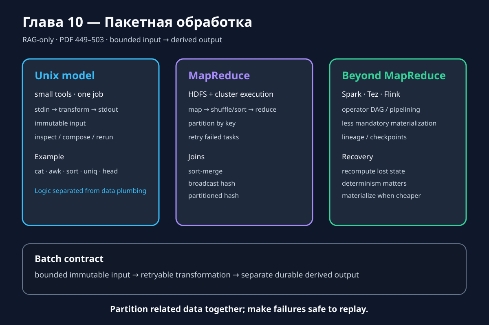
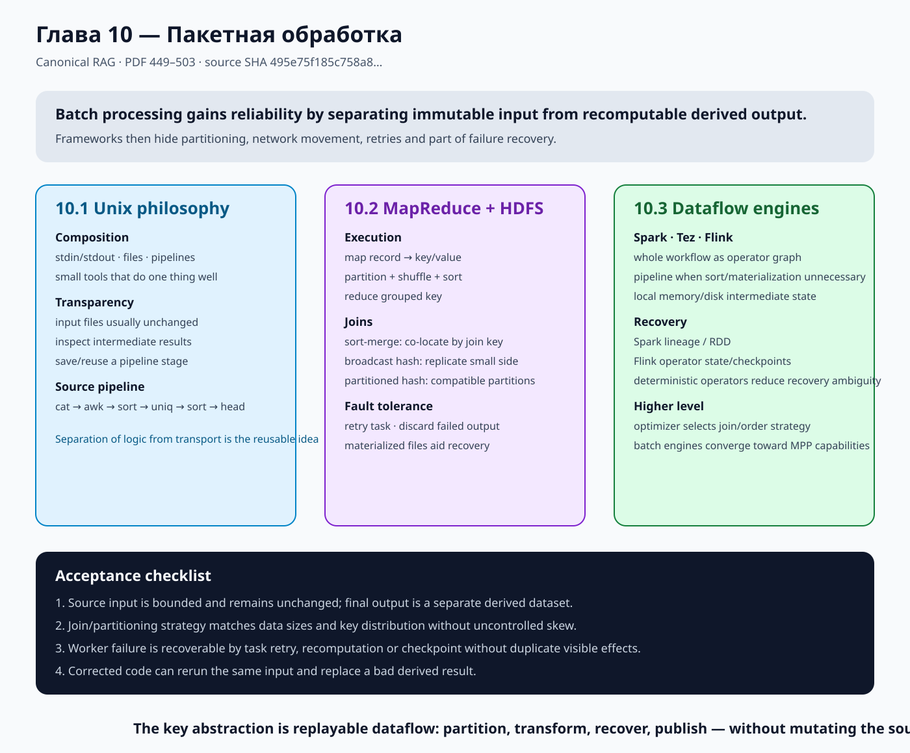

# Глава 10 — Пакетная обработка

RAG-grounded разбор главы 10 книги «Высоконагруженные приложения: программирование, масштабирование, поддержка».

## Идентификация

- Book ID: `vysokonagruzhennye-prilozheniya-martin-kleppmann-ru`
- Глава: 10
- Название: «Пакетная обработка»
- Slug: `batch-processing`
- Source policy: `rag_only`
- External sources: запрещены
- Model memory: запрещена
- Canonical PDF direct access: не использовался
- Book readiness: `READY`
- Retrieval integrity smoke test: `PASS`
- Chapter contract: `CHAPTER-ANALYSIS-REQUEST v1.3` → `CHAPTER-ARTIFACT-COLLECTION v1.7`

## Provenance

- Source format: PDF
- Chapter source locator range: PDF `449–503`
- PDF 504: addressable text chunk отсутствует
- Следующая глава: PDF 505 — глава 11 «Потоковая обработка»
- Boundary evidence:
  - `p0449:c01` — начало главы 10;
  - `p0451:c01` — начало 10.1;
  - `p0458:c01` — начало 10.2;
  - `p0482:c01` — начало 10.3;
  - `p0494:c01`–`p0496:c01` — 10.4 «Резюме»;
  - `p0496:c01`–`p0503:c01` — 10.5 «Библиография»;
  - `p0505:c01` — начало главы 11.
- Chapter boundary verified: yes
- Source SHA-256: `495e75f185c758a8223ca25b0fb35a8e6db693b06fb78c102e624a01ff852685`

## Содержимое

- [cheatsheet.md](cheatsheet.md) — operational/conceptual checklist по Unix pipelines, MapReduce, joins, fault tolerance и dataflow engines.
- [commands.md](commands.md) — source-confirmed Unix commands/tools и execution primitives.
- [diagram.md](diagram.md) — dataflow главы и выбор batch-processing model.
- [summary.md](summary.md) — RAG-grounded перенос смысла раздела 10.4.
- [visual-cheatsheet.svg](visual-cheatsheet.svg) — компактный обзор.
- [visual-cheatsheet-detailed.svg](visual-cheatsheet-detailed.svg) — подробный обзор.

Review/control questions между резюме и библиографией не обнаружены.

## Карта главы

1. Глава различает online services, batch processing и stream processing.
2. Для batch главной мерой является throughput по bounded input, а не interactive response latency.
3. Unix pipeline демонстрирует сильную модель композиции: маленькие инструменты, стандартные streams и clear data boundaries.
4. Input files обычно immutable; pipeline можно безопасно повторять и исследовать по этапам.
5. `stdin`/`stdout` отделяют application logic от механизма transport/data plumbing.
6. Text/record-oriented interfaces позволяют соединять инструменты, написанные независимо.
7. MapReduce переносит идею Unix pipeline на distributed filesystem и cluster execution.
8. HDFS — shared-nothing distributed filesystem с replicated/encoded blocks и centralized metadata через NameNode.
9. Scheduler старается перемещать computation к data, чтобы уменьшить network traffic.
10. Map phase обрабатывает input records независимо и emits key-value pairs.
11. Shuffle/partition/sort собирает одинаковые keys в одном reducer.
12. Reduce phase обрабатывает все values одного key.
13. Несколько MapReduce jobs образуют workflow через materialized files в distributed filesystem.
14. Full scan естественен для batch workloads, где требуется обработать значительную часть dataset.
15. Sort-merge join размещает связанные records с одинаковым join key в одном reducer.
16. Broadcast hash join эффективен, когда один input достаточно мал, чтобы быть скопированным в каждый mapper/operator.
17. Partitioned hash join возможен, когда оба inputs совместимо partitioned.
18. MapReduce хорошо подходит для построения derived data, например поисковых индексов.
19. Immutable input + replaceable output упрощают rollback после human/code errors: job можно исправить и rerun.
20. Task retries безопаснее, когда callbacks не имеют externally visible side effects.
21. MPP databases оптимизируют аналитический SQL; Hadoop ecosystem делает ставку на flexible storage и arbitrary processing code.
22. Materialization каждого intermediate stage в HDFS повышает fault tolerance, но добавляет disk/network I/O и stage barriers.
23. Spark, Tez и Flink моделируют весь workflow как dataflow и позволяют pipeline intermediate data между operators.
24. Dataflow engines избегают ненужной сортировки и могут держать intermediate state в memory/local disk.
25. При потере intermediate state Spark/Flink/Tez используют recomputation/lineage/checkpoints; deterministic operators делают recovery предсказуемее.
26. Pregel-style graph processing использует iterative vertex-centric message passing и checkpoints.
27. Declarative/high-level APIs позволяют optimizer выбирать join strategy и execution plan.
28. Современные batch engines и MPP databases постепенно сближаются: batch становится более declarative, MPP — более programmable.
29. Fundamental batch contract: bounded immutable input → deterministic/retryable transformation → separate durable output.
30. Глава 11 снимает bounded-input assumption и переходит к unbounded streams.

## Основной принцип

Надежность batch processing возникает не только из cluster machinery, а из ограниченной модели вычисления:

- input не изменяется;
- intermediate/output можно пересчитать;
- task можно повторить;
- failed output можно отбросить;
- communication/partitioning берет на себя framework;
- externally visible side effects минимизируются.

Это уменьшает пространство distributed failure scenarios, которые должен вручную обрабатывать application code.

## Практический смысл

- Для массовой переработки данных предпочитать reproducible transformations над immutable snapshot/input.
- Разделять logic и data movement.
- Не делать mapper/reducer/operator скрыто stateful или externally side-effecting без отдельного design.
- Для join сначала определить data size и partitioning: sort-merge, broadcast hash или partitioned hash.
- Не materialize intermediate state только потому, что так устроен legacy workflow; оценивать pipeline/dataflow execution.
- При recomputation проверять determinism operators.
- Materialize промежуточное состояние, если его повторное вычисление существенно дороже хранения.
- Final output хранить отдельно от input и публиковать как новую derived version.
- Для batch job acceptance проверять correctness output, throughput, skew и recoverability, а не только wall-clock success.
- Использовать high-level declarative operators там, где optimizer способен выбрать лучший execution plan.

## Ограничения

- Только canonical addressable RAG и deterministic lexical index.
- Внешняя документация Hadoop/Spark/Flink/Tez/Pregel/Hive не использовалась.
- Product versions и historical examples не актуализировались.
- Рисунки главы не реконструировались по model memory.
- Material source contradiction/extraction defect, влияющий на chapter artifacts, не обнаружен.
