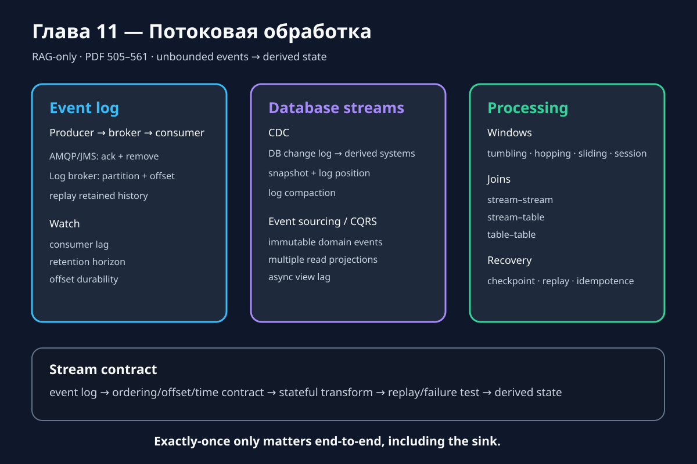
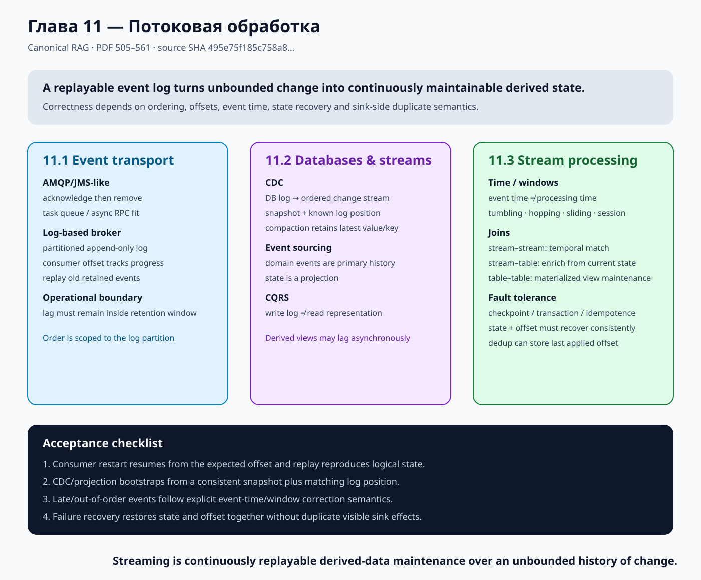

# Глава 11 — Потоковая обработка

RAG-grounded разбор главы 11 книги «Высоконагруженные приложения: программирование, масштабирование, поддержка».

## Идентификация

- Book ID: `vysokonagruzhennye-prilozheniya-martin-kleppmann-ru`
- Глава: 11
- Название: «Потоковая обработка»
- Slug: `stream-processing`
- Source policy: `rag_only`
- External sources: запрещены
- Model memory: запрещена
- Canonical PDF direct access: не использовался
- Book readiness: `READY`
- Retrieval integrity smoke test: `PASS`
- Chapter contract: `CHAPTER-ANALYSIS-REQUEST v1.3` → `CHAPTER-ARTIFACT-COLLECTION v1.7`

## Provenance

- Source format: PDF
- Chapter source locator range: PDF `505–561`
- PDF 562: addressable text chunk отсутствует
- Следующая глава: PDF 563 — глава 12 «Будущее информационных систем»
- Boundary evidence:
  - `p0505:c01` — начало главы 11;
  - `p0506:c01` — начало 11.1;
  - `p0519:c01` — начало 11.2;
  - `p0533:c01` — начало 11.3;
  - `p0551:c01`–`p0553:c01` — 11.4 «Резюме»;
  - `p0553:c01`–`p0561:c01` — 11.5 «Библиография»;
  - `p0563:c01` — начало главы 12.
- Chapter boundary verified: yes
- Source SHA-256: `495e75f185c758a8223ca25b0fb35a8e6db693b06fb78c102e624a01ff852685`

## Содержимое

- [cheatsheet.md](cheatsheet.md) — operational/conceptual checklist по event streams, log brokers, CDC, event sourcing, windows, joins и exactly-once semantics.
- [commands.md](commands.md) — source-confirmed APIs, tools и processing primitives.
- [diagram.md](diagram.md) — event-log/dataflow model главы.
- [summary.md](summary.md) — RAG-grounded перенос смысла раздела 11.4.
- [visual-cheatsheet.svg](visual-cheatsheet.svg) — компактный обзор.
- [visual-cheatsheet-detailed.svg](visual-cheatsheet-detailed.svg) — подробный обзор.

Review/control questions между резюме и библиографией не обнаружены.

## Карта главы

1. Stream processing обрабатывает unbounded input continuously вместо bounded batch input.
2. Event — immutable record о произошедшем факте; producer публикует событие, consumer его обрабатывает.
3. Polling storage для low-latency change detection неэффективен; специализированные messaging systems push/notify consumers.
4. Direct messaging связывает producer/consumer lifecycle; broker decouples them and buffers messages.
5. Traditional AMQP/JMS-like brokers обычно удаляют acknowledged messages и подходят для task queues/asynchronous RPC.
6. Log-based broker хранит ordered append-only log; consumers отслеживают offset и могут replay old events.
7. Partitioning журнала обеспечивает parallelism; order гарантирован внутри partition.
8. Consumer lag — ключевой operational signal; слишком сильное отставание может выйти за retention window.
9. Replay через offset делает stream processing похожим на batch rerun.
10. Database replication log — тоже stream database changes.
11. Dual writes в DB + index/cache опасны: concurrent ordering и partial failure создают inconsistency.
12. Change Data Capture (CDC) делает DB source of truth, а derived systems — consumers ordered change stream.
13. Initial snapshot должен быть согласован с известной log position.
14. Log compaction сохраняет последнее value per key и позволяет rebuild derived state без полного history.
15. Event sourcing сохраняет application-domain events как primary log, а current state строится как projection.
16. CQRS отделяет write representation/event log от read-optimized materialized views.
17. Async derived views создают read-after-write lag; это нужно считать consistency contract.
18. Immutable history облегчает rebuild новых projections, но complicates true data deletion.
19. Stream processor может: обновлять storage, доставлять human-facing notifications или преобразовывать input stream в output stream.
20. Complex Event Processing ищет patterns в event sequences.
21. Stream analytics использует windows над unbounded input.
22. Event time и processing time различаются; late/out-of-order events нужно обрабатывать явно.
23. Window types: tumbling, hopping, sliding, session.
24. Stream-stream join связывает events внутри временного окна.
25. Stream-table join обогащает event локальным/реплицированным state.
26. Table-table join поддерживает materialized view как stream изменений.
27. Stateful stream processing требует recoverable local/remote state.
28. Delivery/recovery semantics осложняются тем, что output непрерывен и нельзя просто отбросить весь job result.
29. Exactly-once/effectively-once достигается комбинацией checkpoint/microbatch/transactions/idempotence/deduplication.
30. Message offset можно сохранять вместе с external state для idempotent application.
31. Reprocessing требует deterministic behavior и stable ordering where assumed.
32. Local state можно snapshot/replicate или rebuild из replayable input.
33. Глава завершает переход: batch = bounded dataflow, stream = unbounded continuously updated dataflow.

## Основной принцип

Поток — это не «данные в реальном времени», а replayable ordered history событий, из которой можно непрерывно строить производное состояние.

Надежная stream architecture требует явного ответа на вопросы:

- какой event является source of truth;
- какой порядок гарантирован;
- сколько history хранится;
- где находится consumer offset;
- как consumer восстанавливается после failure;
- какой state ему нужен;
- что происходит с late/out-of-order events;
- как предотвращается duplicate visible effect;
- какие derived views можно rebuild из журнала.

## Практический смысл

- Consumer lag мониторить относительно retention horizon, а не только как абсолютное число.
- Для critical integration предпочитать ordered CDC/log over ad hoc dual writes.
- Initial snapshot привязывать к конкретной log position.
- Derived index/cache строить как projection, которую можно rebuild.
- Не смешивать event time и processing time в window logic.
- Join type выбирать по nature inputs: stream-stream, stream-table, table-table.
- Stateful processor проектировать вместе с recovery state/offset semantics.
- Exactly-once проверять end-to-end до external sink, а не по marketing label framework.
- Если sink не transactional, использовать idempotence/dedup metadata, когда source это позволяет.
- Replay должен быть безопасен и детерминирован настолько, насколько этого требует state recovery.
- Event sourcing не отменяет требования privacy/deletion; immutable history имеет operational/legal boundaries.

## Ограничения

- Только canonical addressable RAG и deterministic lexical index.
- Внешняя документация Kafka/Flink/Samza/Storm/Debezium и современных versions не использовалась.
- Product behavior и historical examples не актуализировались.
- Рисунки главы не реконструировались по model memory.
- Material source contradiction/extraction defect, влияющий на chapter artifacts, не обнаружен.
