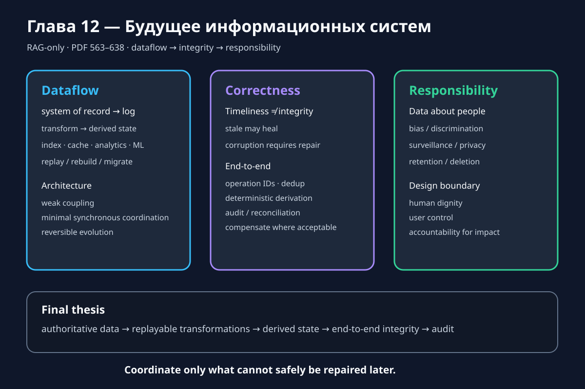
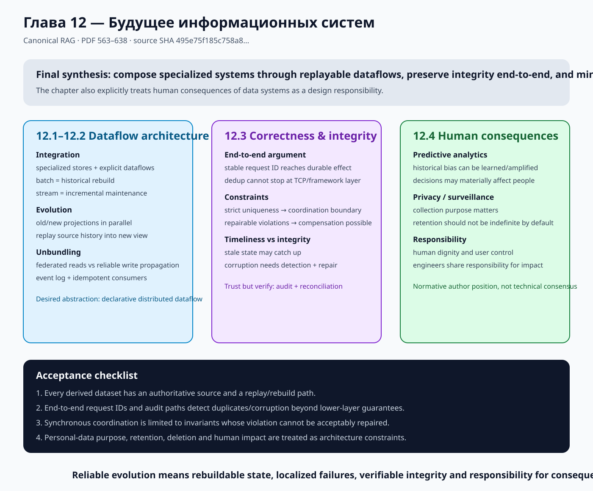

# Глава 12 — Будущее информационных систем

RAG-grounded разбор главы 12 книги «Высоконагруженные приложения: программирование, масштабирование, поддержка».

## Идентификация

- Book ID: `vysokonagruzhennye-prilozheniya-martin-kleppmann-ru`
- Глава: 12
- Название: «Будущее информационных систем»
- Slug: `future-of-data-systems`
- Source policy: `rag_only`
- External sources: запрещены
- Model memory: запрещена
- Canonical PDF direct access: не использовался
- Book readiness: `READY`
- Retrieval integrity smoke test: `PASS`
- Chapter contract: `CHAPTER-ANALYSIS-REQUEST v1.3` → `CHAPTER-ARTIFACT-COLLECTION v1.7`

## Provenance

- Source format: PDF
- Chapter source locator range: PDF `563–638`
- PDF 639–640: addressable text chunks отсутствуют
- Глава 12: финальная numbered chapter книги
- Boundary evidence:
  - `p0563:c01` — начало главы 12;
  - `p0564:c01` — начало 12.1 «Интеграция данных»;
  - `p0574:c01` — начало 12.2 «Отделение от баз данных»;
  - `p0594:c01` — начало 12.3 «Стремление к корректности»;
  - `p0614:c01` — начало 12.4 «Делать что должно»;
  - `p0627:c01`–`p0628:c01` — 12.5 «Резюме»;
  - `p0628:c01`–`p0638:c01` — 12.6 «Библиография».
- Chapter boundary verified: yes
- Source SHA-256: `495e75f185c758a8223ca25b0fb35a8e6db693b06fb78c102e624a01ff852685`

## Содержимое

- [cheatsheet.md](cheatsheet.md) — conceptual/operational checklist по data integration, derived state, correctness/integrity, coordination boundaries, auditability и ethics.
- [commands.md](commands.md) — source-confirmed commands, conceptual operations и mechanisms.
- [diagram.md](diagram.md) — flow от systems of record к derived state, integrity и audit.
- [summary.md](summary.md) — RAG-grounded перенос смысла раздела 12.5.
- [visual-cheatsheet.svg](visual-cheatsheet.svg) — компактный обзор.
- [visual-cheatsheet-detailed.svg](visual-cheatsheet-detailed.svg) — подробный обзор.

Review/control questions между резюме и библиографией не обнаружены.

## Карта главы

1. Нет одного storage/query engine, оптимального для всех workloads; сложные приложения неизбежно комбинируют специализированные systems.
2. Data integration нужно рассматривать как explicit dataflow: system of record → transformations → derived systems.
3. Batch и stream processing — два режима построения derived state; различие между ними постепенно размывается.
4. Reprocessing historical data позволяет безопасно эволюционировать schema/index/cache/model и выполнять постепенные migrations.
5. Lambda architecture популяризовала immutable event history + batch/stream views, но удваивает implementation/operations complexity.
6. Unified batch/stream model требует replay, exactly/effectively-once semantics и event-time processing.
7. 12.2 предлагает мыслить «database inside-out»: отделять storage/query/processing capabilities и связывать их dataflow interfaces.
8. Federated databases унифицируют reads; unbundled systems унифицируют reliable writes/change propagation.
9. Asynchronous event log with idempotent consumers reduces failure coupling across heterogeneous systems compared with synchronous distributed transactions.
10. Derived datasets можно понимать как indexes/materialized views organization-wide.
11. Declarative dataflow shell — желаемая abstraction: задавать transformations/dependencies вместо ручного glue code.
12. Read path можно продлить до subscriptions/live views, чтобы UI обновлялся от changes rather than repeated polling.
13. Reads themselves can be treated as events when provenance/causal analysis requires it.
14. Stateful correctness is harder than stateless recovery; transactions solve many problems but do not eliminate application/data corruption.
15. End-to-end argument: duplicate suppression, checksums, encryption and integrity guarantees must reach application endpoints.
16. Request/operation identifiers are source-confirmed mechanism for end-to-end deduplication.
17. Unique constraints require coordination when violations must be rejected synchronously.
18. Conflicting requests can be partitioned by the value being constrained and serialized in a log partition.
19. Cross-partition operations can be decomposed into durable request event + deterministic derived instructions with end-to-end request ID.
20. Timeliness and integrity are distinct: stale data may heal; corrupted/inconsistent data usually requires explicit repair.
21. Chapter argues integrity is often more important than strict timeliness.
22. Exactly/effectively-once delivery, deterministic derivation and deduplication preserve integrity without global atomic commit in many workflows.
23. Some business constraints can be checked asynchronously and compensated later rather than enforced synchronously.
24. Coordination should be paid only where irreversible constraints truly require it.
25. Auditing and independent integrity verification should complement trust in storage/transaction mechanisms.
26. Event-sourced/dataflow architectures improve provenance because outputs can be traced to immutable inputs and deterministic transformations.
27. Cryptographic integrity techniques and Merkle-tree-based audit mechanisms are presented as promising directions.
28. 12.4 is explicitly normative/opinionated: software engineers must consider consequences of data systems for people.
29. Predictive analytics can encode/amplify historical bias and may affect employment, credit, insurance and other important decisions.
30. Data collection can become surveillance; privacy and human dignity are presented as design responsibilities.
31. Data should not be retained indefinitely merely because storage is cheap; deletion/retention and user control matter.
32. Final thesis: reliable, scalable systems should combine weakly coupled dataflows, strong integrity, minimal necessary coordination and explicit ethical responsibility.

## Основной принцип

Architecture should be organized around explicit flows of facts and derived state, not around the assumption that one database owns every capability.

For each piece of state ask:

- где authoritative input/system of record;
- какая transformation строит derived state;
- можно ли projection rebuild/replay;
- какой invariant действительно требует synchronous coordination;
- где достаточно eventual/asynchronous processing;
- как detect/recover corruption;
- есть ли end-to-end identifier/provenance;
- кто affected by data collection/automation;
- how long data should exist and who controls it.

## Практический смысл

- Prefer one source of truth plus replayable transformations over independent dual writes.
- Keep derived state replaceable and rebuildable.
- Design migrations as parallel old/new projections with reversible rollout.
- Avoid heterogeneous distributed transactions when ordered event log + idempotent consumers provides the required invariant.
- Push operation IDs end-to-end, not only between intermediate services.
- Partition constraint decisions by conflict key where source model permits.
- Separate timeliness SLO from integrity invariant.
- Add audit/reconciliation paths even when underlying database is considered trustworthy.
- Use synchronous coordination only for constraints whose violation cannot be repaired acceptably.
- Treat compensating processes as explicit business semantics, not hidden error handling.
- Preserve provenance from user/request event to derived outputs.
- Treat privacy, retention, explainability and discrimination risk as architecture requirements where data concerns people.

## Ограничения

- Только canonical addressable RAG и deterministic lexical index.
- Глава содержит авторские мнения и прогнозы; артефакты сохраняют эту framing и не представляют их как universal consensus.
- Внешние источники по regulation, ethics, current privacy law, blockchain, Merkle trees или modern products не использовались.
- Historical product examples не актуализировались.
- Рисунки главы не реконструировались по model memory.
- Material source contradiction/extraction defect, влияющий на chapter artifacts, не обнаружен.
