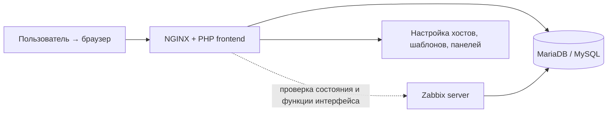
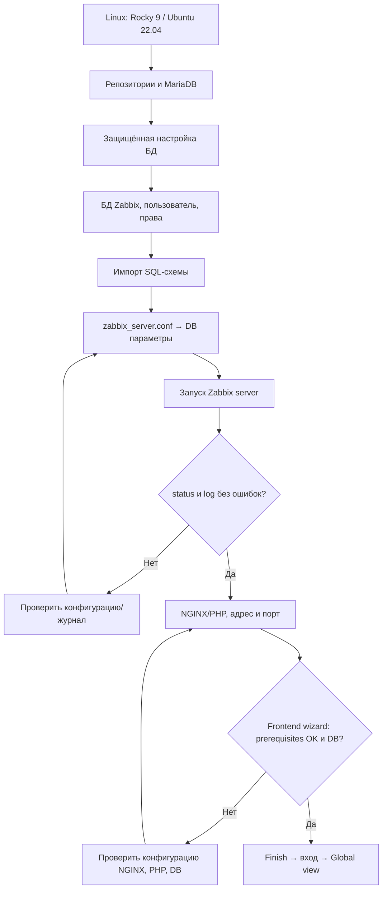
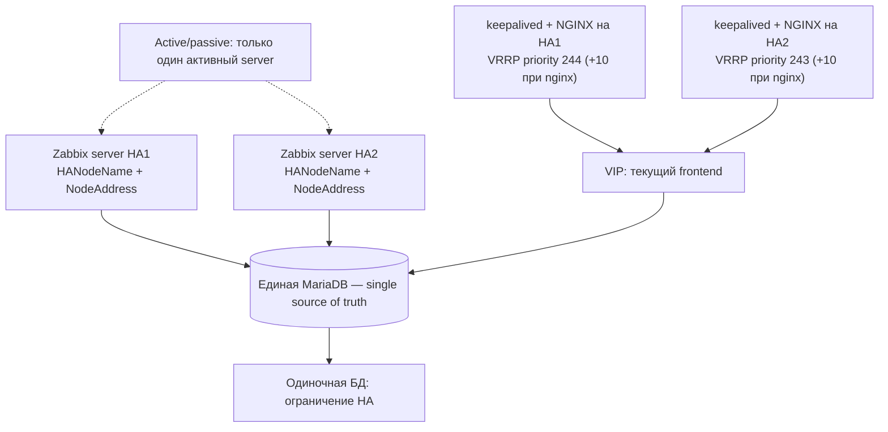
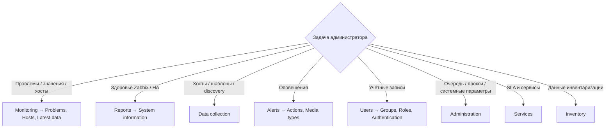

# Глава 1 — диаграммы по RAG (Mermaid)

**Границы:** PDF 20–58; основание: [README](README.md). Диаграммы реконструируют **текстовые** связи, а не оригинальные рисунки 1.1–1.36.

## 1. Взаимодействие компонентов ([p0024](../../../rag/chunks/p0001-p0100/p0024-c01.md), [p0030](../../../rag/chunks/p0001-p0100/p0030-c01.md))

Смысл: Zabbix server пишет значения и конфигурацию в БД, frontend взаимодействует с той же БД. Без правильно настроенного frontend нельзя удобно конфигурировать систему; сам запуск server этого не доказывает.

## 2. Начальная установка и проверка ([p0020](../../../rag/chunks/p0001-p0100/p0020-c01.md)–[p0030](../../../rag/chunks/p0001-p0100/p0030-c01.md))

Здесь нет автоматического «восстановить всё»: конкретный rollback полного развертывания не задан источником.

## 3. Два независимых механизма HA ([p0031](../../../rag/chunks/p0001-p0100/p0031-c01.md)–[p0043](../../../rag/chunks/p0001-p0100/p0043-c01.md))

При отказе NGINX на HA1 его приоритет падает с 254 до 244, HA2 с работающим NGINX сохраняет 253 и получает VIP. Это механизм резервирования **frontend**, отдельный от active/passive Zabbix server. База данных одна.

## 4. Где найти нужные данные ([p0046](../../../rag/chunks/p0001-p0100/p0046-c01.md)–[p0058](../../../rag/chunks/p0001-p0100/p0058-c01.md))

**RAG-политика:** никакие ветки схем не основаны на внешних предположениях. Неустранённые отличия команд: [source-findings.md](source-findings.md).
