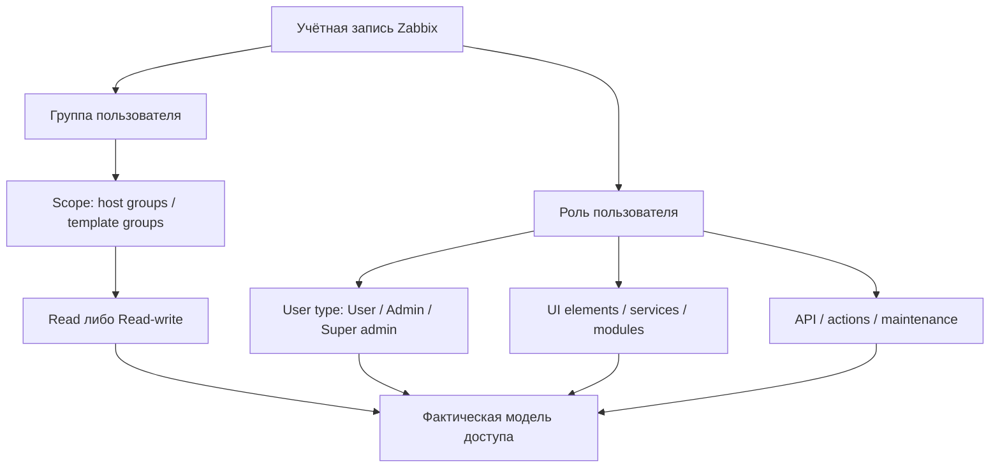
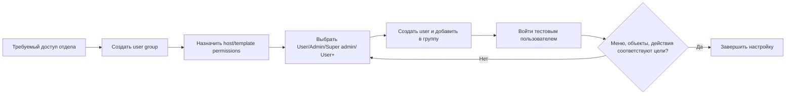
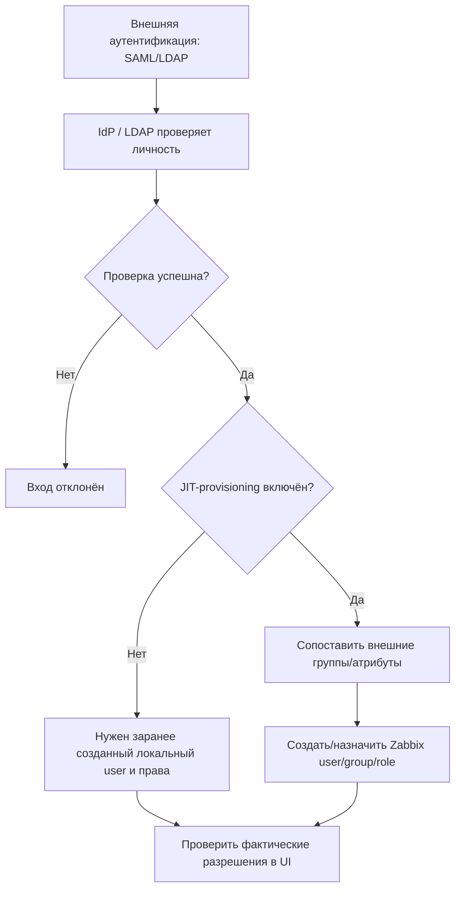
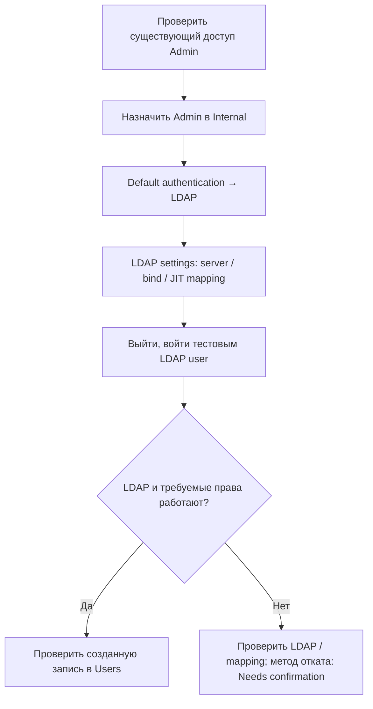

# Глава 2 — Mermaid: доступ и внешняя аутентификация

Только [RAG PDF p59–p92](README.md). Схемы реконструируют текст, а не недоступные для машинного извлечения рисунки.

## 1. Разделение слоёв доступа ([p0061](../../../rag/chunks/p0001-p0100/p0061-c01.md)–[p0077](../../../rag/chunks/p0001-p0100/p0077-c01.md))

Имена групп **не** равны уровню роли. В книге s_network и r_infra получили Super admin, хотя принадлежали к предметным группам; таблица ролей на p74 требует проверять глобальные права.

## 2. Подготовка Cloud Hoster ([p0061](../../../rag/chunks/p0001-p0100/p0061-c01.md)–[p0077](../../../rag/chunks/p0001-p0100/p0077-c01.md))

## 3. SAML/LDAP без JIT и с JIT ([p0077](../../../rag/chunks/p0001-p0100/p0077-c01.md), [p0084](../../../rag/chunks/p0001-p0100/p0084-c01.md)–[p0086](../../../rag/chunks/p0001-p0100/p0086-c01.md), [p0091](../../../rag/chunks/p0001-p0100/p0091-c01.md)–[p0092](../../../rag/chunks/p0001-p0100/p0092-c01.md))

## 4. Безопасная последовательность переключения LDAP ([p0088](../../../rag/chunks/p0001-p0100/p0088-c01.md)–[p0091](../../../rag/chunks/p0001-p0100/p0091-c01.md))

**Границы:** последовательность B перед C дана в тексте книги; конкретная процедура отката LDAP/JIT не описана, никаких вымышленных действий в схеме нет.
