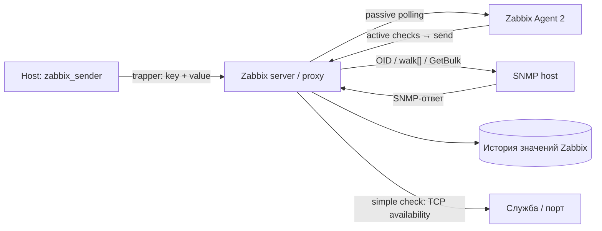
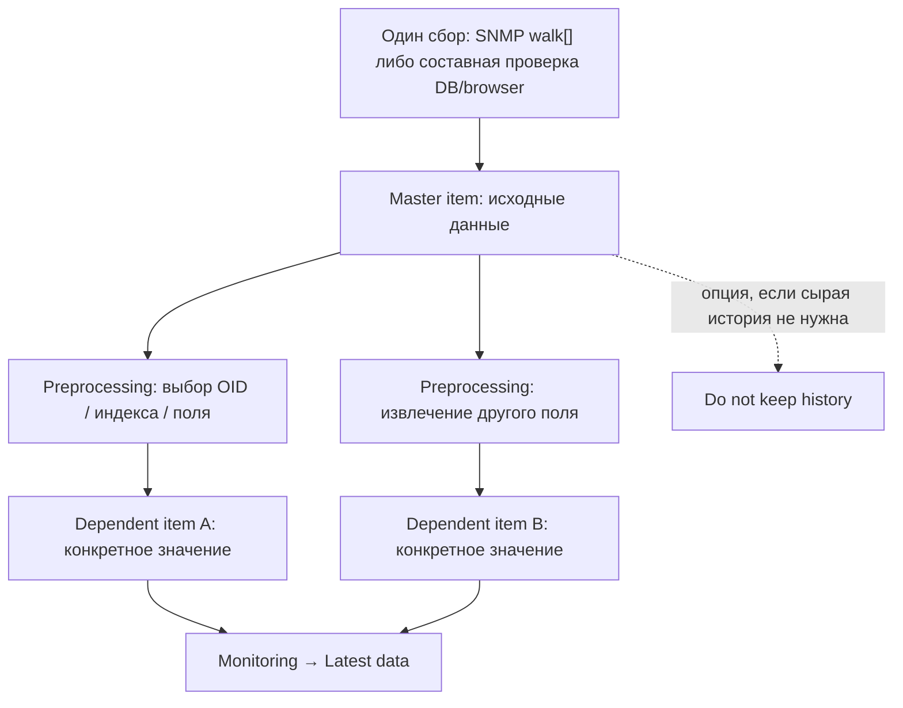
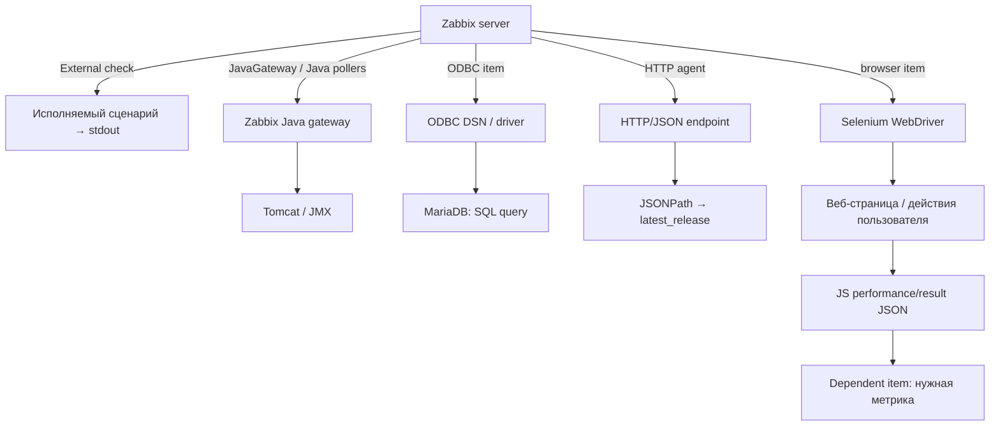
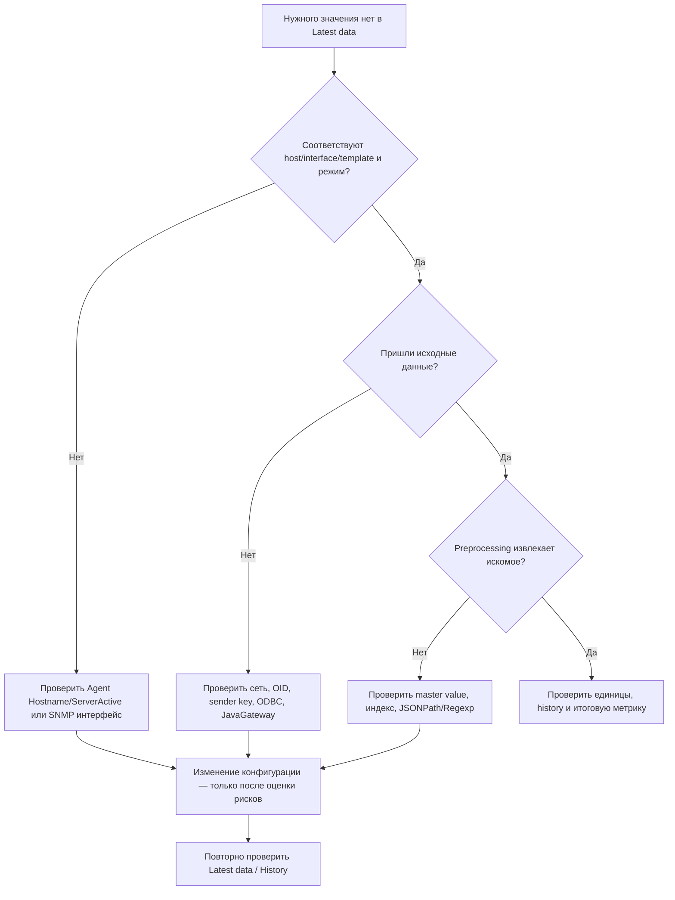

# Глава 3 — Mermaid-схемы по RAG

**Основа:** [README](README.md), PDF 93–160. Диаграммы отражают **только текстово подтверждённые связи**, не копируют и не интерпретируют невидимые изображения учебника.

## 1. Где начинается передача метрик ([p0095](../../../rag/chunks/p0001-p0100/p0095-c01.md)–[p0101](../../../rag/chunks/p0101-p0200/p0101-c01.md), [p0115](../../../rag/chunks/p0101-p0200/p0115-c01.md)–[p0123](../../../rag/chunks/p0101-p0200/p0123-c01.md))

У простого TCP-check смысл результата **только с точки зрения server/proxy**, поскольку firewall по пути может помешать запросу ([p0122](../../../rag/chunks/p0101-p0200/p0122-c01.md)).

## 2. Мастер, preprocessing и зависимые элементы ([p0111](../../../rag/chunks/p0101-p0200/p0111-c01.md)–[p0115](../../../rag/chunks/p0101-p0200/p0115-c01.md), [p0125](../../../rag/chunks/p0101-p0200/p0125-c01.md)–[p0130](../../../rag/chunks/p0101-p0200/p0130-c01.md))

Dependent item не выполняет отдельный сбор по своему interval. Вычисляемый item — другая модель: расчёт агрегата из существующих значений (пример 15-минутной средней памяти).

## 3. Маршруты получения значений ([p0130](../../../rag/chunks/p0101-p0200/p0130-c01.md)–[p0153](../../../rag/chunks/p0101-p0200/p0153-c01.md))

Ветви не взаимозаменяемы: JMX требует Java gateway, ODBC требует connector/DSN, browser зависит от Selenium/JS (и несёт отличающиеся риски).

## 4. Диагностический алгоритм ([p0097](../../../rag/chunks/p0001-p0100/p0097-c01.md), [p0113](../../../rag/chunks/p0101-p0200/p0113-c01.md), [p0155](../../../rag/chunks/p0101-p0200/p0155-c01.md)–[p0160](../../../rag/chunks/p0101-p0200/p0160-c01.md))

## 5. Осознанные ограничения

- Browser-пример со строкой `systemctl restart zabbbix-server` и `dnf` для Ubuntu содержит исходниковые несоответствия; **не нормализовать молча** ([p0144](../../../rag/chunks/p0101-p0200/p0144-c01.md)).
- `AllowKey=system.run[*]` и отключённая JMX-аутентификация/SSL — высокорисковые настройки из учебного примера, не образец производственной эксплуатации ([p0133](../../../rag/chunks/p0101-p0200/p0133-c01.md), [p0155](../../../rag/chunks/p0101-p0200/p0155-c01.md)).
- Для неизвестных regexp/параметров скриншотов оставить `RAG_MISS`: подробности [source-findings.md](source-findings.md).
