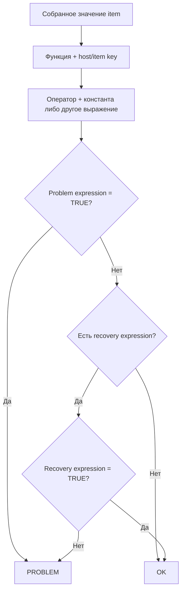
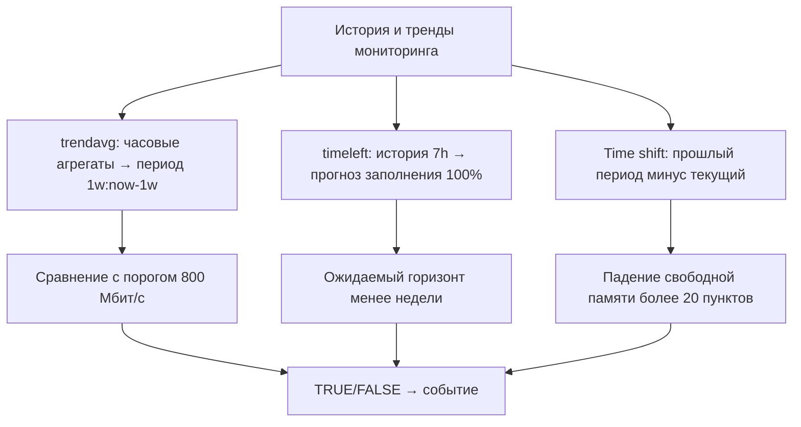
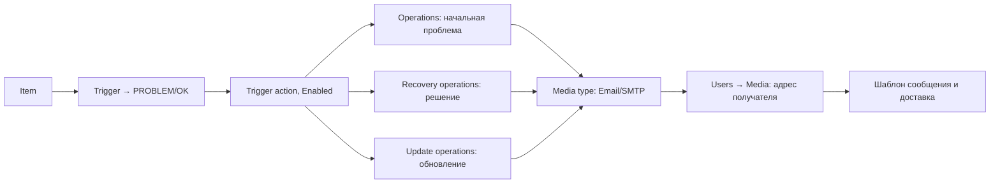
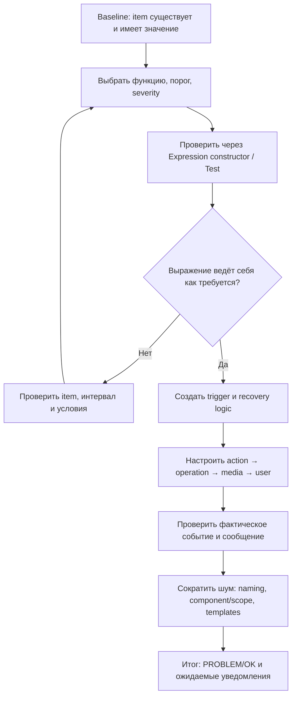

# Глава 4 — Mermaid: логика триггеров и оповещений

**Источник:** accepted RAG PDF 161–196. Эти диаграммы структурируют **подтверждённые текстовые отношения**, а не восстанавливают невидимые рисунки 4.1–4.46.

## 1. От значения item к PROBLEM и OK ([p0167](../../../rag/chunks/p0101-p0200/p0167-c01.md)–[p0173](../../../rag/chunks/p0101-p0200/p0173-c01.md))

При дополнительном recovery expression требуется `problem = FALSE` одновременно с `recovery = TRUE`, чтобы выйти из PROBLEM ([p0170](../../../rag/chunks/p0101-p0200/p0170-c01.md)). Ветвь приведена **для оценки уже возникшей проблемы**; не использовать рисунок как спецификацию всех внутренностей движка.

## 2. Три продвинутых способа принять решение ([p0174](../../../rag/chunks/p0101-p0200/p0174-c01.md)–[p0182](../../../rag/chunks/p0101-p0200/p0182-c01.md))

Численные значения и смысл выражений приведены в исходном тексте, **точные функции с item keys на рисунках не восстановлены**. Контрольный пример для shift: `80-50=30` (TRUE), `80-70=10` (FALSE) ([p0181](../../../rag/chunks/p0101-p0200/p0181-c01.md)).

## 3. Разделение правила, канала и адресата ([p0182](../../../rag/chunks/p0101-p0200/p0182-c01.md)–[p0190](../../../rag/chunks/p0101-p0200/p0190-c01.md))

**Имеющийся trigger не доказывает доставку**: нужны action, операция, media type, активный адресат и доступный SMTP.

## 4. Контролируемый цикл настройки ([p0166](../../../rag/chunks/p0101-p0200/p0166-c01.md), [p0181](../../../rag/chunks/p0101-p0200/p0181-c01.md)–[p0182](../../../rag/chunks/p0101-p0200/p0182-c01.md), [p0190](../../../rag/chunks/p0101-p0200/p0190-c01.md)–[p0194](../../../rag/chunks/p0101-p0200/p0194-c01.md))

## Отдельный блок риска

SSH-пример имеет противоречие `1/0` между [p0167](../../../rag/chunks/p0101-p0200/p0167-c01.md) и [p0168](../../../rag/chunks/p0101-p0200/p0168-c01.md). Предлагаемый для тестирования firewall DROP ([p0163](../../../rag/chunks/p0101-p0200/p0163-c01.md)) блокирует входящие подключения и **не сопровождается процедурой безопасного удаления правила**. Не использовать как готовую операционную инструкцию. Читайте [source-findings.md](source-findings.md).

**RAG_MISS:** конкретные поля UI и точные формулы trigger builder, SMTP и media templates, существующие только как рисунки.
