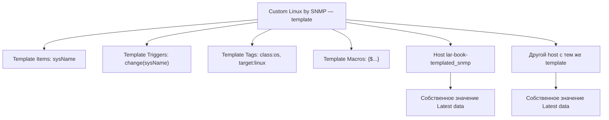
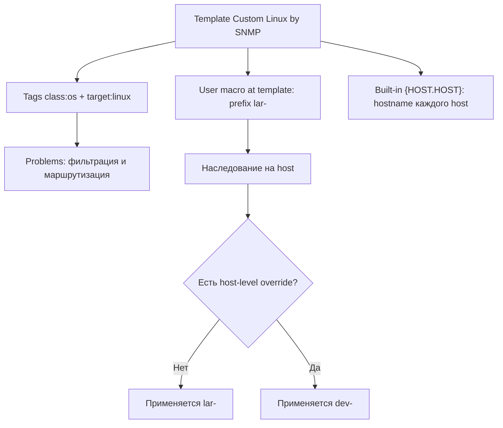
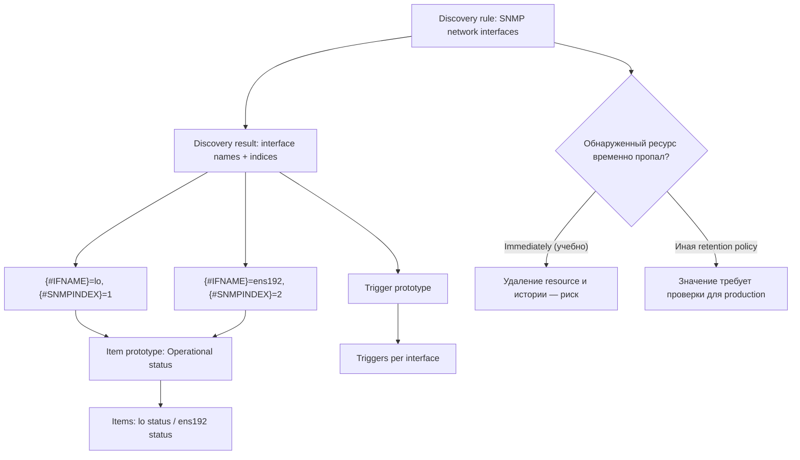
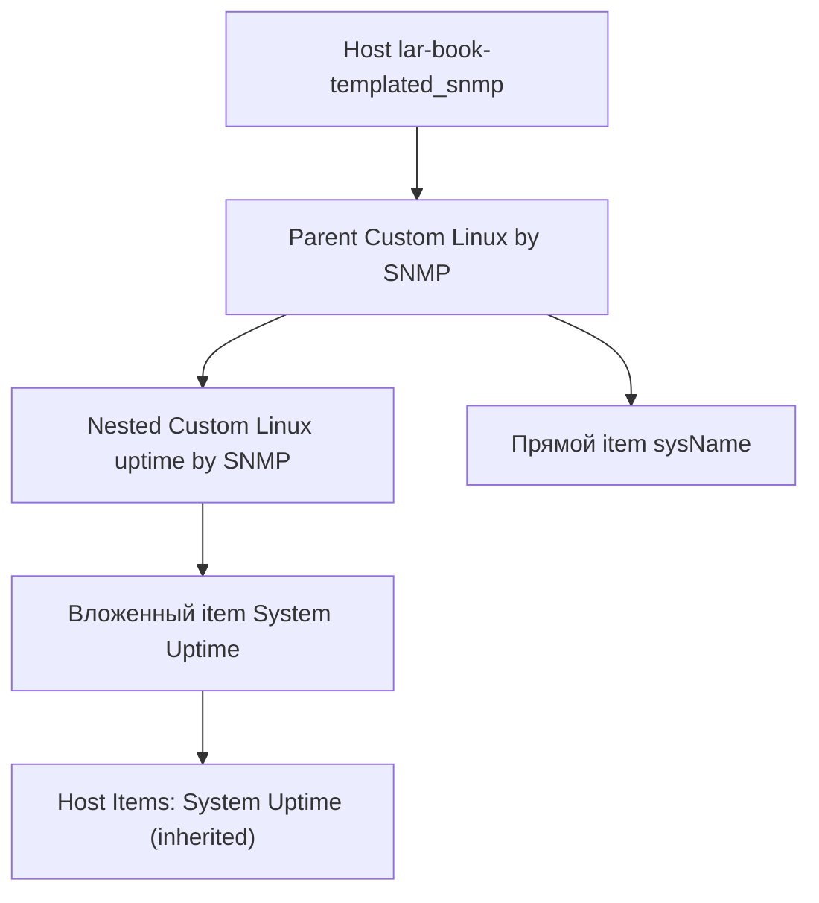
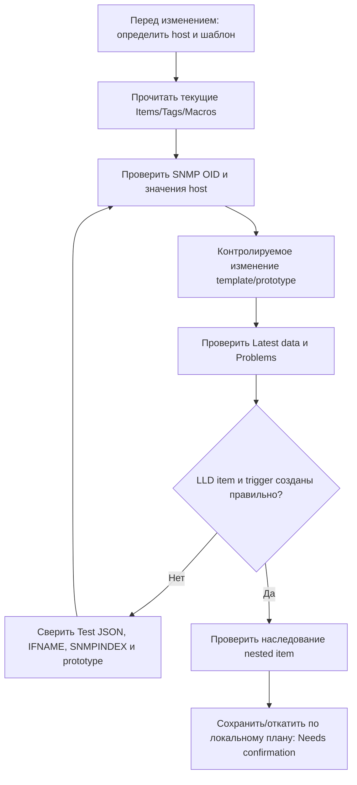

# Глава 5 — Mermaid-диаграммы по RAG

Основание: принятый RAG PDF 197–228. Диаграммы отражают **структуру из текста книги**, а не извлечённые рисунки 5.1–5.48. Имена и примеры подтверждены страницами, отсутствующие значения — `RAG_MISS`.

## 1. Шаблон и наследование элементов ([p0205](../../../rag/chunks/p0201-p0300/p0205-c01.md)–[p0209](../../../rag/chunks/p0201-p0300/p0209-c01.md))

Item создаётся на уровне template **один раз**, но каждый host получает собственные измерения. Точное выражение триггера доступно только на рисунке — здесь `change(sysName)` обозначает **смысл**, а не готовый синтаксис формулы.

## 2. Теги и макросы ([p0201](../../../rag/chunks/p0201-p0300/p0201-c01.md)–[p0203](../../../rag/chunks/p0201-p0300/p0203-c01.md), [p0210](../../../rag/chunks/p0201-p0300/p0210-c01.md)–[p0214](../../../rag/chunks/p0201-p0300/p0214-c01.md))

User macro имеет форму `{$MACRONAME}`; built-in `{HOST.HOST}` получает имя из конфигурации конкретного host. Текст источника подтверждает значения `lar-` и `dev-`, но **не** полное значение имени пользовательского макроса на рисунке 5.18.

## 3. LLD: от discovery к реальным объектам ([p0215](../../../rag/chunks/p0201-p0300/p0215-c01.md)–[p0224](../../../rag/chunks/p0201-p0300/p0224-c01.md))

Числовой интерфейсный OID в одном поясняющем абзаце p222 отличается от OID приведённых значений. Для готового `net.if.discovery` / SNMP item **не восстанавливать** недостающие поля из рисунков по памяти.

## 4. Вложенные шаблоны ([p0225](../../../rag/chunks/p0201-p0300/p0225-c01.md)–[p0228](../../../rag/chunks/p0201-p0300/p0228-c01.md))

Источник прямо отмечает, что вложенность уменьшает дублирование, но усложняет поддерживаемую структуру.

## 5. Контроль изменения ([p0207](../../../rag/chunks/p0201-p0300/p0207-c01.md), [p0222](../../../rag/chunks/p0201-p0300/p0222-c01.md), [p0226](../../../rag/chunks/p0201-p0300/p0226-c01.md))

**Защитные ограничения:** `Delete lost resources = Immediately` приводит к риску безвозвратной потери истории; restart snmpd и hostnamectl — изменения ОС. См. [source-findings.md](source-findings.md).
