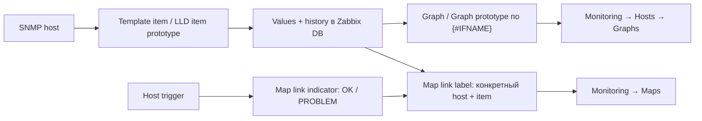
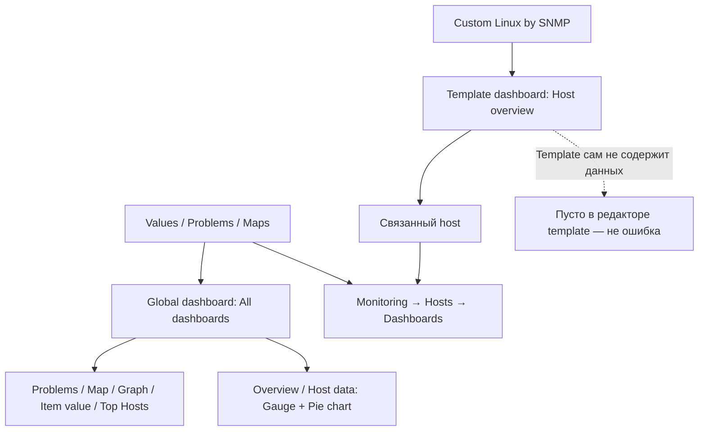
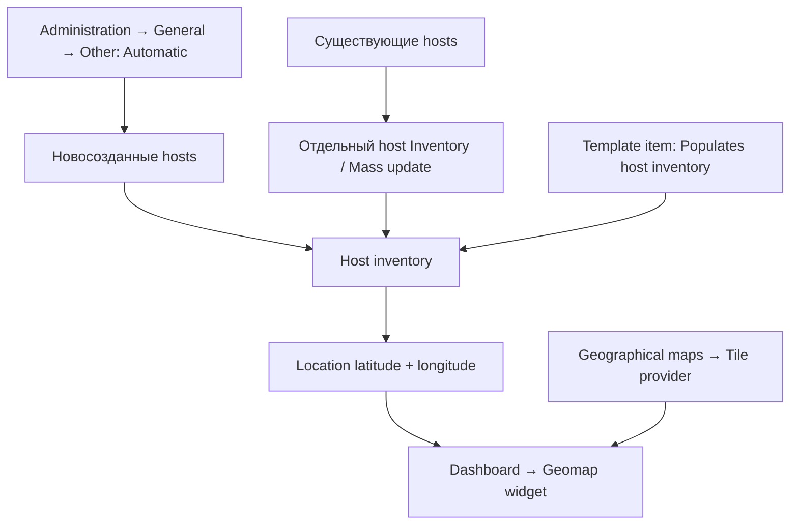
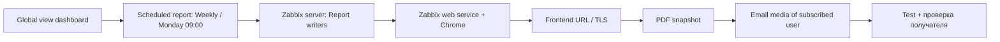
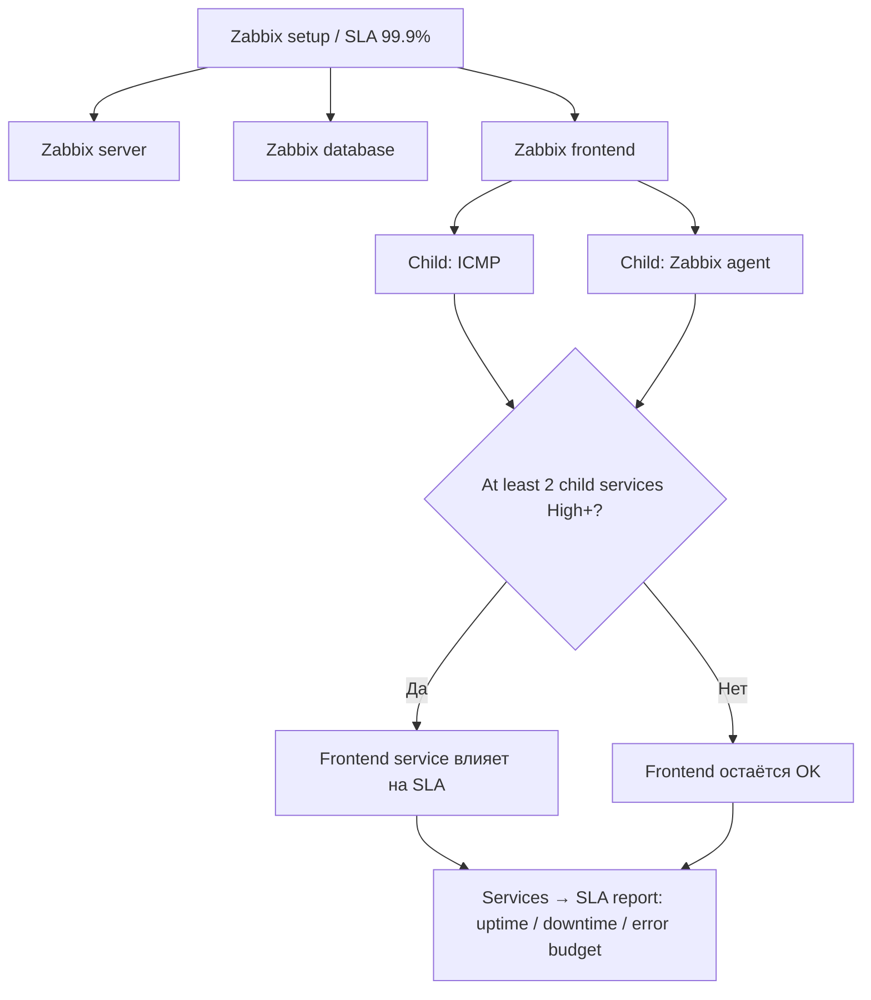

# Глава 6 — Mermaid-схемы визуализации, отчётности и SLA

Только [RAG PDF 229–290](README.md). Все схемы выражают связи из текста; подробности настроек из рисунков не додуманы.

## 1. От items к графикам и картам ([p0230](../../../rag/chunks/p0201-p0300/p0230-c01.md)–[p0243](../../../rag/chunks/p0201-p0300/p0243-c01.md))

В книге для трафика используется `(current - previous) / time_delta * 8` для значения в бит/с, график по имени интерфейса создаётся из LLD; link на карте требует явного hostname.

## 2. Глобальные dashboard и шаблонные host dashboards ([p0244](../../../rag/chunks/p0201-p0300/p0244-c01.md)–[p0258](../../../rag/chunks/p0201-p0300/p0258-c01.md))

## 3. Связь inventory и Geomap ([p0259](../../../rag/chunks/p0201-p0300/p0259-c01.md)–[p0265](../../../rag/chunks/p0201-p0300/p0265-c01.md))

Глобальный default не обновляет существующие узлы. Координаты с рисунков источника помечены `RAG_MISS`.

## 4. Контур Scheduled PDF ([p0270](../../../rag/chunks/p0201-p0300/p0270-c01.md)–[p0274](../../../rag/chunks/p0201-p0300/p0274-c01.md))

В учебном рецепте `IgnoreURLCertErrors=1` отключает проверку TLS-сертификата. Не считать этот обход production-ready.

## 5. Дерево бизнес-услуг и правила SLA ([p0280](../../../rag/chunks/p0201-p0300/p0280-c01.md)–[p0290](../../../rag/chunks/p0201-p0300/p0290-c01.md))

Базовое состояние frontend в примере `Set status to OK`; дополнительное правило High+ по **двум** child, а не по одному.

## Границы проверки

Конкретные UI-макросы/координаты, параметры SQL/MIB из рисунков отсутствуют в текстовом RAG: `RAG_MISS`. Противоречивые команды установки, расписание Weekly/Ежедневно, TLS обход и отсутствие процедур rollback сохраняются в [source-findings.md](source-findings.md).
