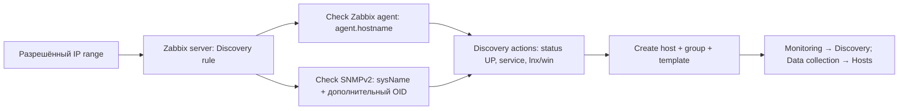
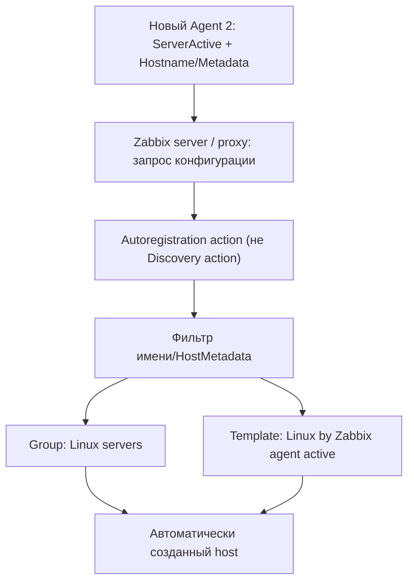
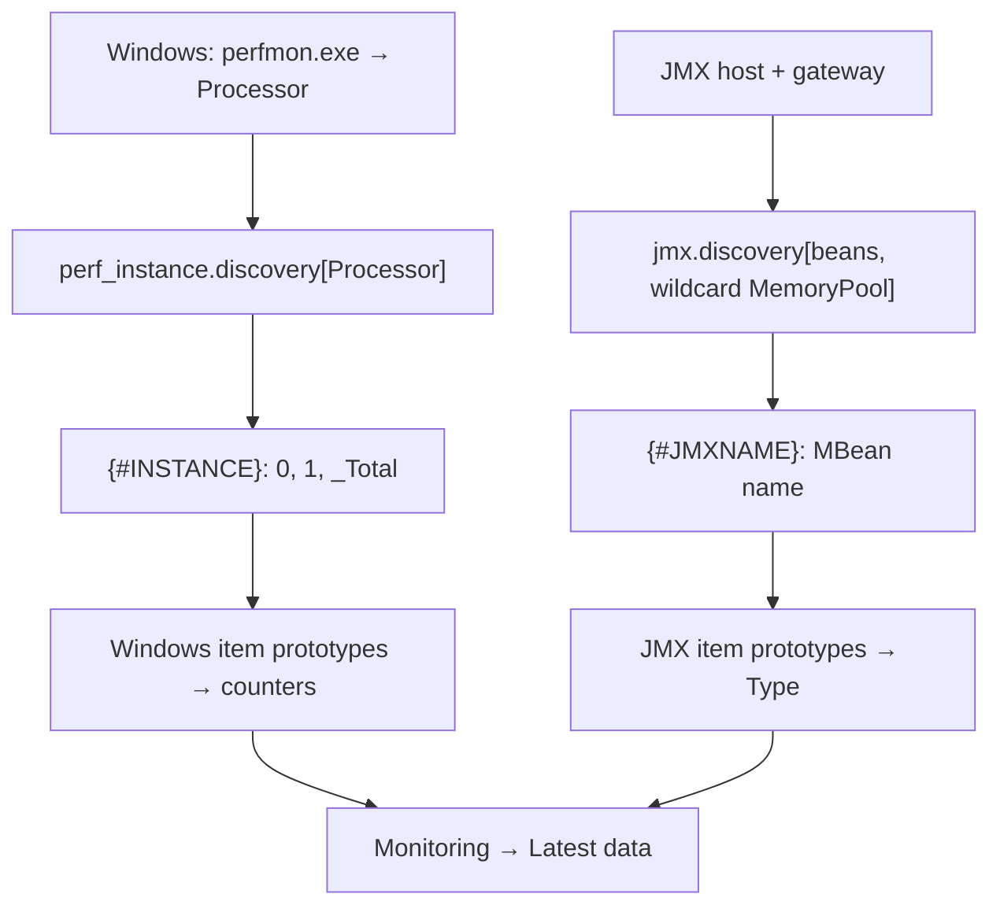
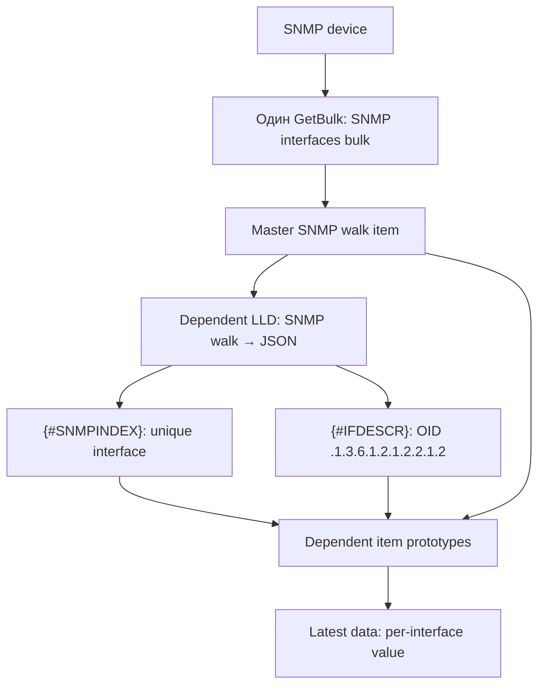
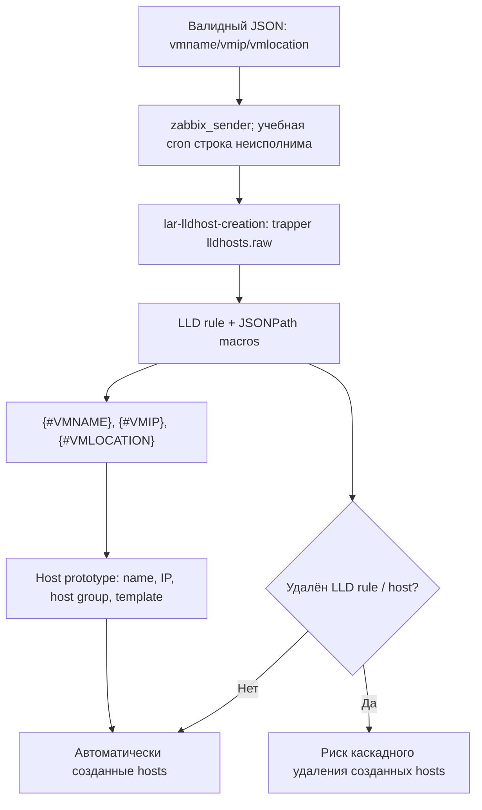
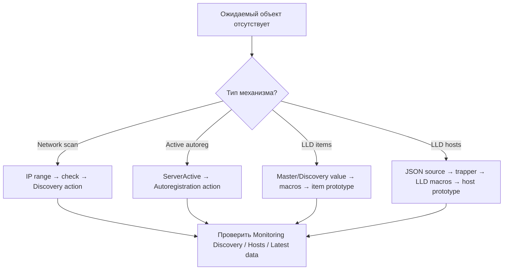

# Глава 7 — Mermaid: маршруты обнаружения и создание объектов

Источник: accepted RAG PDF 291–335. Схемы — **структура из извлечённого текста**, не реконструкция значений UI из скриншотов.

## 1. Network Discovery по диапазону ([p0292](../../../rag/chunks/p0201-p0300/p0292-c01.md)–[p0303](../../../rag/chunks/p0301-p0400/p0303-c01.md))

Сетевой scan выполняется сервером. Для Agent hostname (`lnx` или `win`) и service `Zabbix Agent`; SNMP OID нельзя выбирать вне реальной структуры устройства. Чем меньше интервал и шире range, тем выше нагрузка.

## 2. Active Agent autoregistration — другой старт ([p0303](../../../rag/chunks/p0301-p0400/p0303-c01.md)–[p0308](../../../rag/chunks/p0301-p0400/p0308-c01.md))

`HostMetadata` уместен для среды, где hostname не отражает ОС. Существование active agent не является доказательством настройки самого action.

## 3. LLD объектов: Windows и JMX ([p0309](../../../rag/chunks/p0301-p0400/p0309-c01.md)–[p0320](../../../rag/chunks/p0301-p0400/p0320-c01.md))

JMX ключ дан полностью в [p0319](../../../rag/chunks/p0301-p0400/p0319-c01.md), здесь короткое описание из-за разбиения блоков. Число instances зависит от целевой Windows среды.

## 4. SNMP GetBulk — один master, много dependent ([p0321](../../../rag/chunks/p0301-p0400/p0321-c01.md)–[p0327](../../../rag/chunks/p0301-p0400/p0327-c01.md))

Детали preprocessing, показанные только на рисунках 7.54 и 7.57, остаются `RAG_MISS`.

## 5. JSON-driven host prototypes и жизненный цикл ([p0328](../../../rag/chunks/p0301-p0400/p0328-c01.md)–[p0335](../../../rag/chunks/p0301-p0400/p0335-c01.md))

Важно: текст p335 прямо предупреждает, что удаление discovery parent может удалить созданные hosts. Не производить тестовое удаление без backup и проверенного recovery.

## 6. Диагностика по границам

**Необратимые изменения и источник:** `hostnamectl`, `snmpd`, конфигурация Agent, cron, широкое scan и удаление LLD objects требуют локальной проверки. [source-findings.md](source-findings.md).
