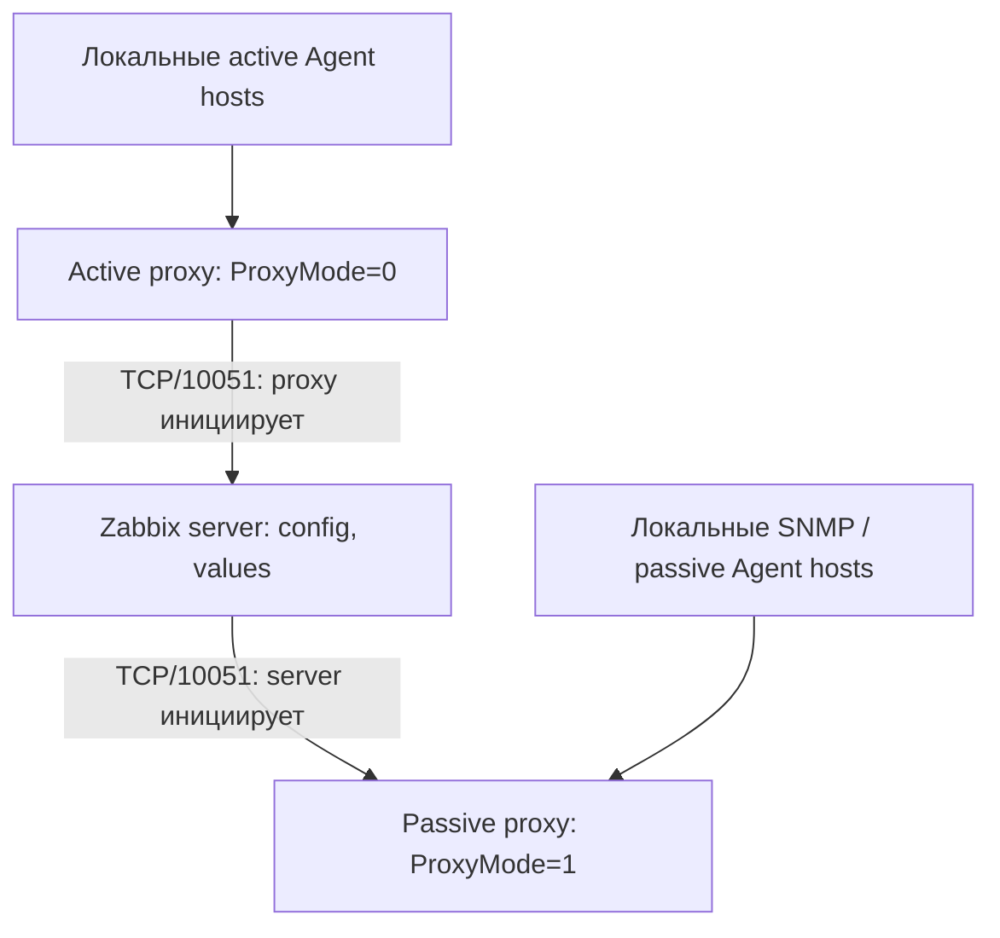
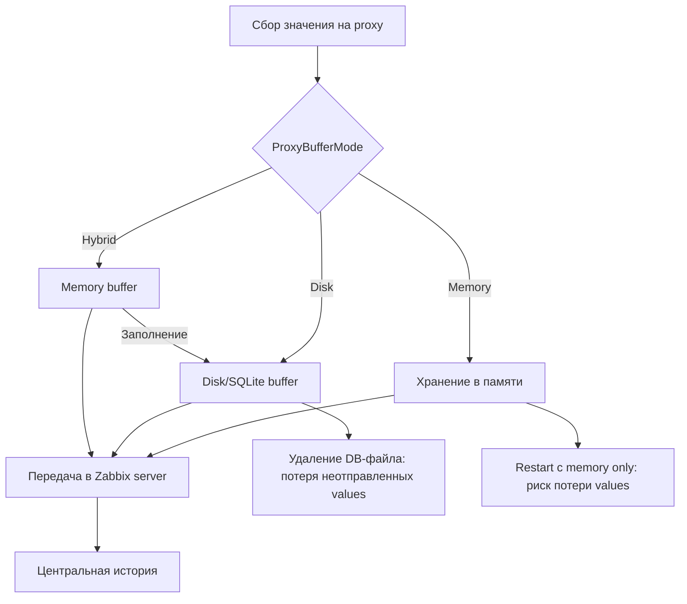
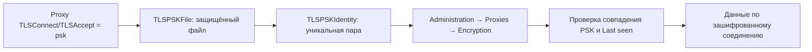
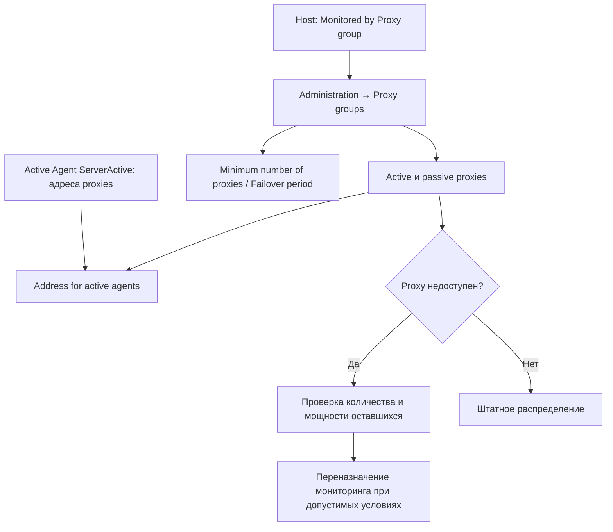
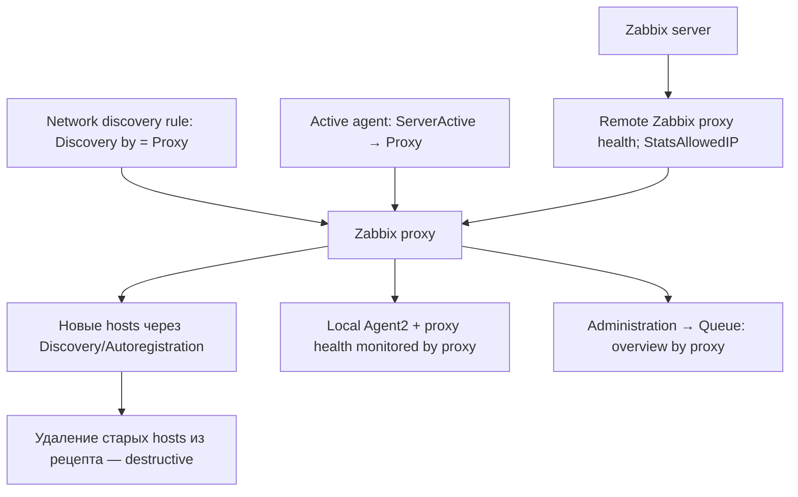

# Глава 8 — Mermaid: Zabbix proxy, режимы, безопасность и HA

**Основание:** accepted RAG PDF 336–370. Это авторское представление **только текстовых отношений** главы, а не реконструкция рисунков 8.1–8.42.

## 1. Кто инициирует соединение? ([p0343](../../../rag/chunks/p0301-p0400/p0343-c01.md)–[p0350](../../../rag/chunks/p0301-p0400/p0350-c01.md))

`ProxyMode` — это режим соединения **proxy↔server**. Он не эквивалентен автоматически passive/active режиму **агента**: хост может использовать разные комбинации проверок, если маршруты корректны.

## 2. Куда уходят значения и где возможна потеря? ([p0338](../../../rag/chunks/p0301-p0400/p0338-c01.md)–[p0340](../../../rag/chunks/p0301-p0400/p0340-c01.md), [p0352](../../../rag/chunks/p0301-p0400/p0352-c01.md))

`ProxyOfflineBuffer` определяет срок сохранения при сбое связи (источник: default 1 час), но **не гарантирует** хранение вне заданной конфигурации.

## 3. PSK требует согласования обеих сторон ([p0352](../../../rag/chunks/p0301-p0400/p0352-c01.md)–[p0355](../../../rag/chunks/p0301-p0400/p0355-c01.md))

Исходная `cat`-проверка может раскрыть секрет, а `chmod 400/etc/...` и `Systemctl` на p354 — сломанные команды; см. [source-findings.md](source-findings.md).

## 4. Proxy group и failover ([p0355](../../../rag/chunks/p0301-p0400/p0355-c01.md)–[p0360](../../../rag/chunks/p0301-p0400/p0360-c01.md))

Источник отдельно предупреждает, что SNMP traps могут потребовать дополнительного способа доставки на несколько экземпляров группы.

## 5. Discovery через proxy и два вида health checks ([p0361](../../../rag/chunks/p0301-p0400/p0361-c01.md)–[p0370](../../../rag/chunks/p0301-p0400/p0370-c01.md))

Local monitoring может зависеть от состояния proxy. Remote monitoring обеспечивает альтернативный наблюдающий контур. **Никакой восстановительной процедуры удалённых хостов или истории в главе нет**.

## Контроль результата

Проверки: `Last seen(age)`, `Latest data`, proxy log, queue by proxy; проверить конкретную связь host→proxy, режим/TLS/PSK, сохранившиеся значения и фактическое failover, не только наличие объектов в UI. Конкретные настройки только на рисунках обозначены `RAG_MISS`.
