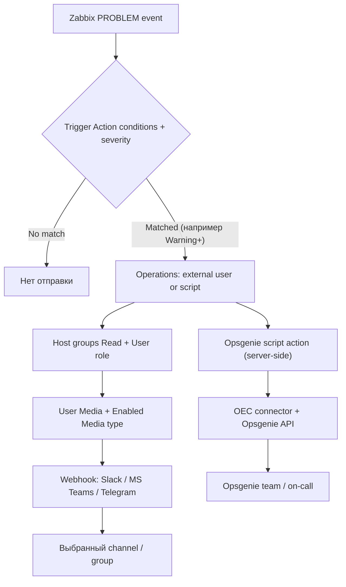
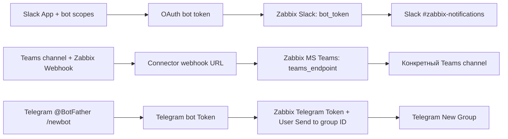
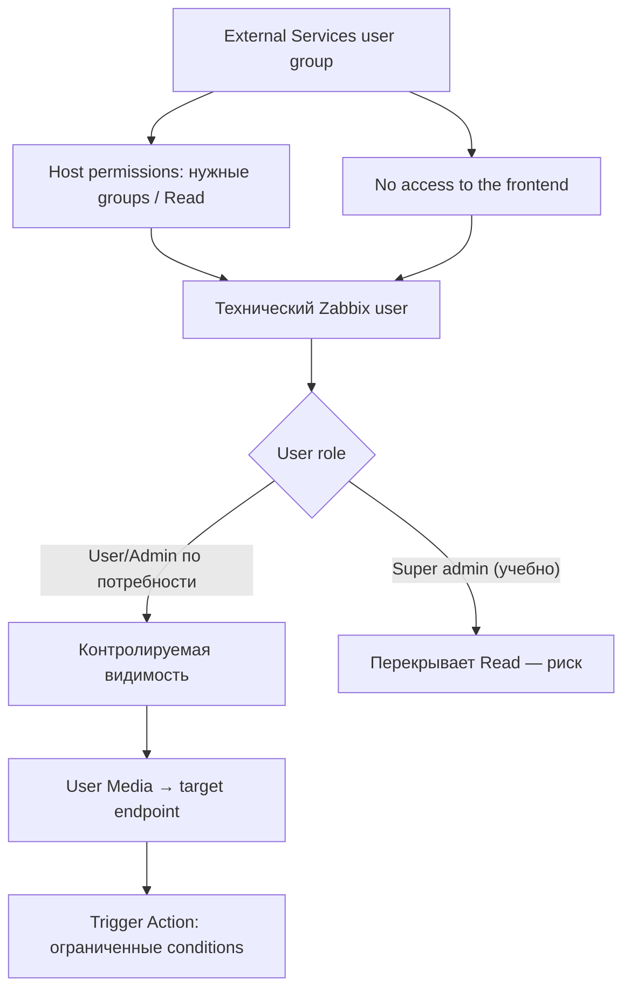
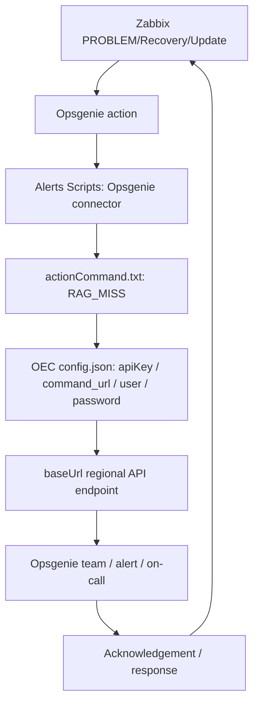
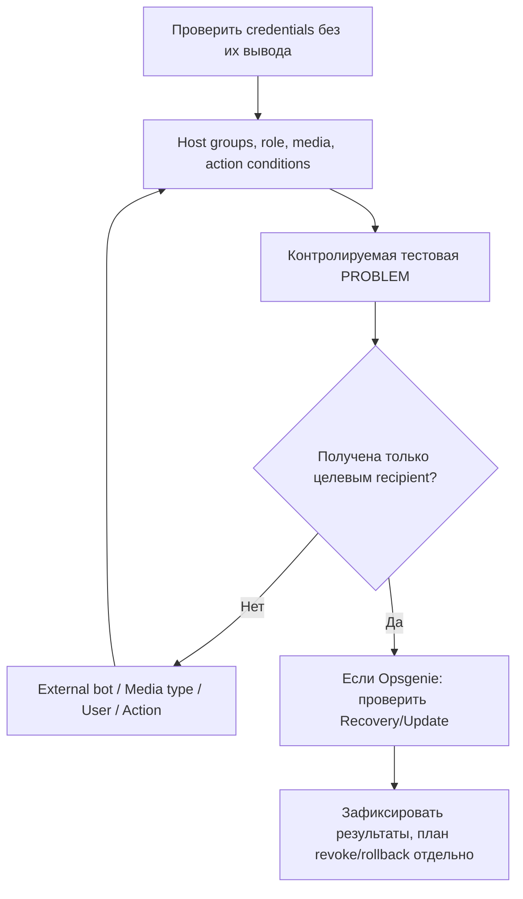

# Глава 9 — Mermaid: Zabbix → внешние сервисы

Основание: **только accepted RAG PDF 371–411**. На схемах не используются непроверенные идентификаторы из рисунков; конфигурационные fields только со скриншотов = `RAG_MISS`.

## 1. Общий маршрут оповещения ([p0382](../../../rag/chunks/p0301-p0400/p0382-c01.md)–[p0384](../../../rag/chunks/p0301-p0400/p0384-c01.md), [p0392](../../../rag/chunks/p0301-p0400/p0392-c01.md), [p0402](../../../rag/chunks/p0401-p0500/p0402-c01.md))

Если у action нет conditions, авторы прямо указывают, что он сопоставляет все PROBLEM. User `Super admin` перекрывает назначенные группы `Read`. Это **не безопасный production default**.

## 2. Три канала и три секрета ([p0373](../../../rag/chunks/p0301-p0400/p0373-c01.md)–[p0402](../../../rag/chunks/p0401-p0500/p0402-c01.md))

Не выдавать токены/URL за обычные ссылки; это секретные параметры. Для Telegram `Send to` получает **group ID** из `/getgroupid@myidbot`, в примере он начинается с `-`.

## 3. Ограничение прав и маршрутизация ([p0380](../../../rag/chunks/p0301-p0400/p0380-c01.md)–[p0382](../../../rag/chunks/p0301-p0400/p0382-c01.md))

В книге Super admin выбран «для удобства» для Slack, Teams, Telegram и Opsgenie; там же явно сказано, что это меняет эффективные права.

## 4. Opsgenie — двусторонняя интеграция ([p0403](../../../rag/chunks/p0401-p0500/p0403-c01.md)–[p0410](../../../rag/chunks/p0401-p0500/p0410-c01.md))

Стрелка ответа передаёт **смысл двустороннего взаимодействия**, заявленный на p410; точный HTTP/API protocol и shell code в RAG не даны.

## 5. Приёмка без массовых уведомлений

Источник не описывает конечный тест delivery timeout, idempotency, revoke и полноценный rollback. `[Needs confirmation]`. Список проблем и `RAG_MISS`: [source-findings.md](source-findings.md).
