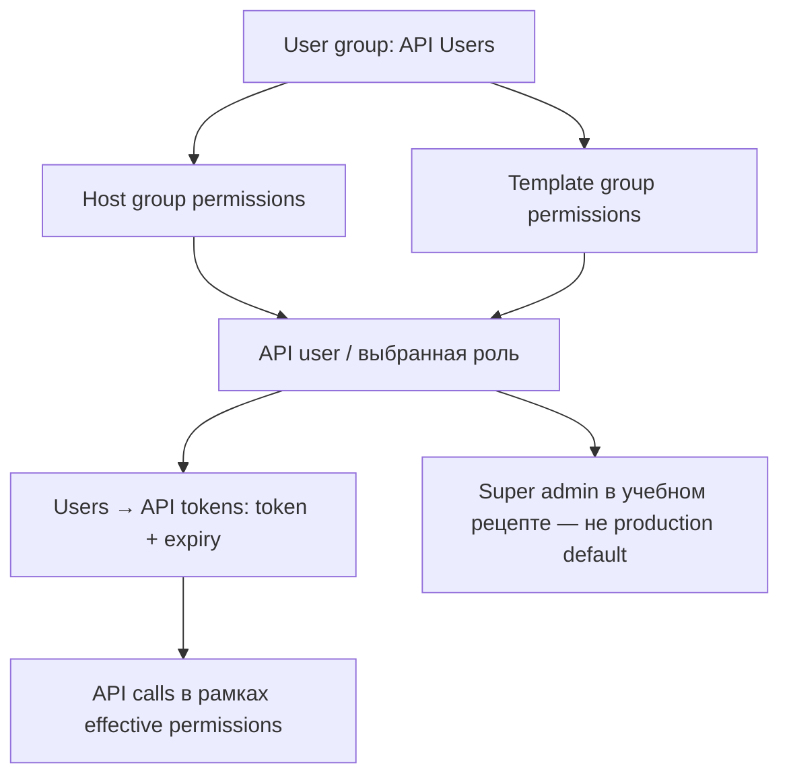
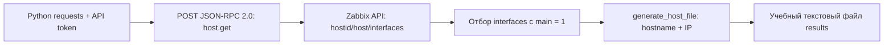
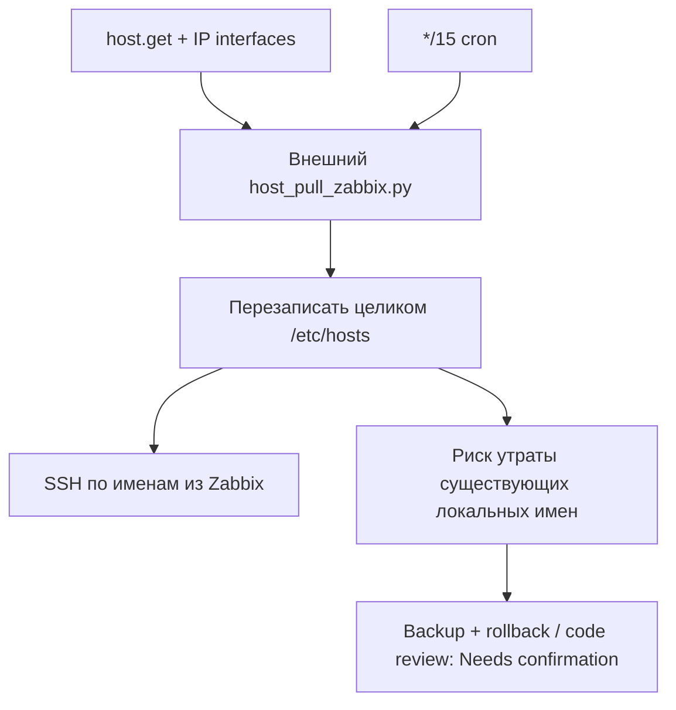
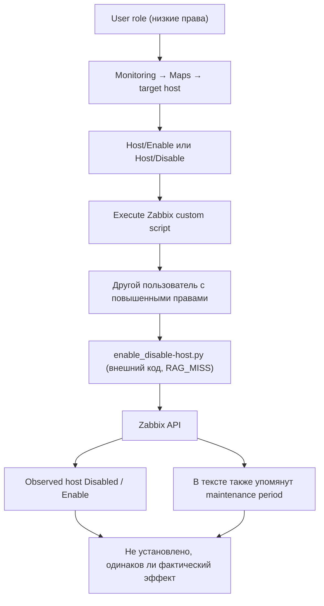
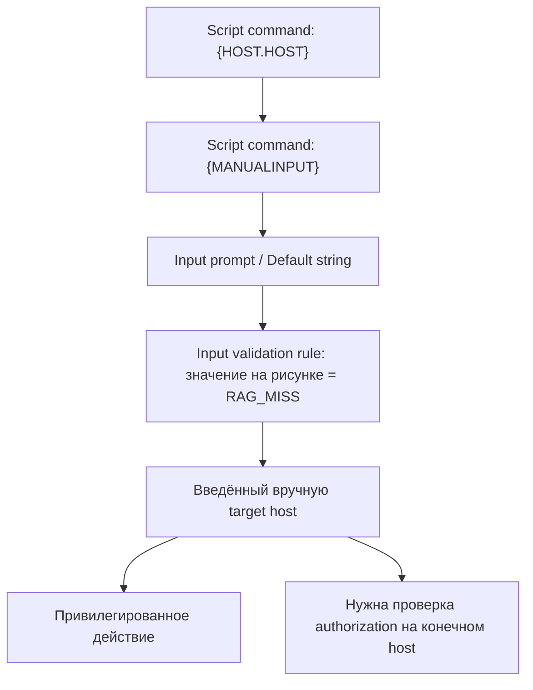
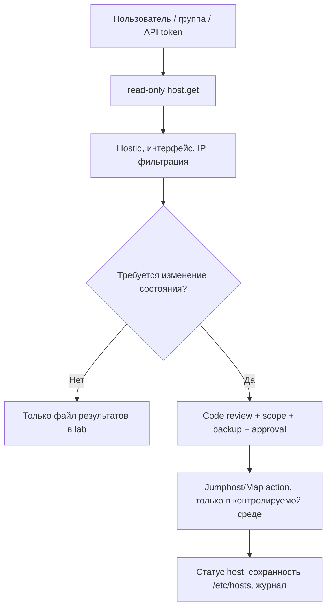

# Глава 10 — Mermaid: Zabbix API, Python и управление через карту

Основание: **accepted RAG PDF 412–433**. Диаграммы представляют *отношения из текста*, а не скрытые скриншотные команды. Отсутствующий исходный код `RAG_MISS`.

## 1. User → permissions → API token ([p0413](../../../rag/chunks/p0401-p0500/p0413-c01.md)–[p0417](../../../rag/chunks/p0401-p0500/p0417-c01.md))

Источник на p416 предлагает отключить expiry, но p417 сам рекомендует разумный срок и ротацию.

## 2. API host.get → host/IP file ([p0418](../../../rag/chunks/p0401-p0500/p0418-c01.md)–[p0422](../../../rag/chunks/p0401-p0500/p0422-c01.md))

В тексте разнится `/home/zabbix/results` vs `/home/results`; API-read и локальная запись имеют разные последствия.

## 3. Jumphost: превращение данных мониторинга в системное состояние ([p0423](../../../rag/chunks/p0401-p0500/p0423-c01.md)–[p0427](../../../rag/chunks/p0401-p0500/p0427-c01.md))

В источнике прямо указано, что перезапись `/etc/hosts` полная, поэтому использование на реальном бастионе без защиты запрещено как учебное допущение.

## 4. Map UI → elevated execution boundary ([p0427](../../../rag/chunks/p0401-p0500/p0427-c01.md)–[p0431](../../../rag/chunks/p0401-p0500/p0431-c01.md))

Скриншоты 10.18–10.19 не позволяют построить подтверждённую точную команду, а фактический вид API change без загрузки скрипта неизвестен.

## 5. Manual input увеличивает изменяемую область ([p0432](../../../rag/chunks/p0401-p0500/p0432-c01.md)–[p0433](../../../rag/chunks/p0401-p0500/p0433-c01.md))

## 6. Общая последовательность диагностики

Расхождения строк, токены и критичные изменения из источника — [source-findings.md](source-findings.md).
