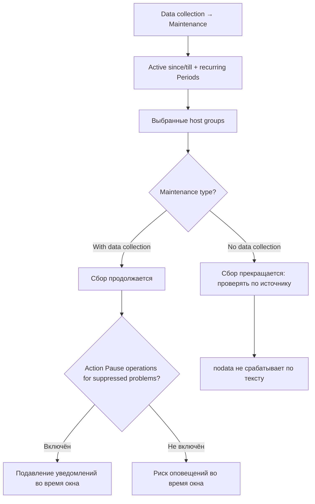
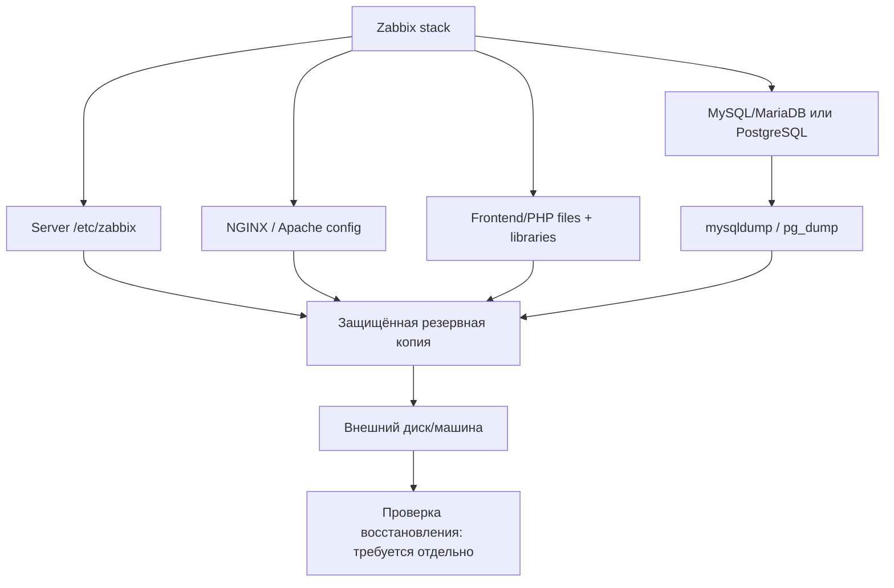
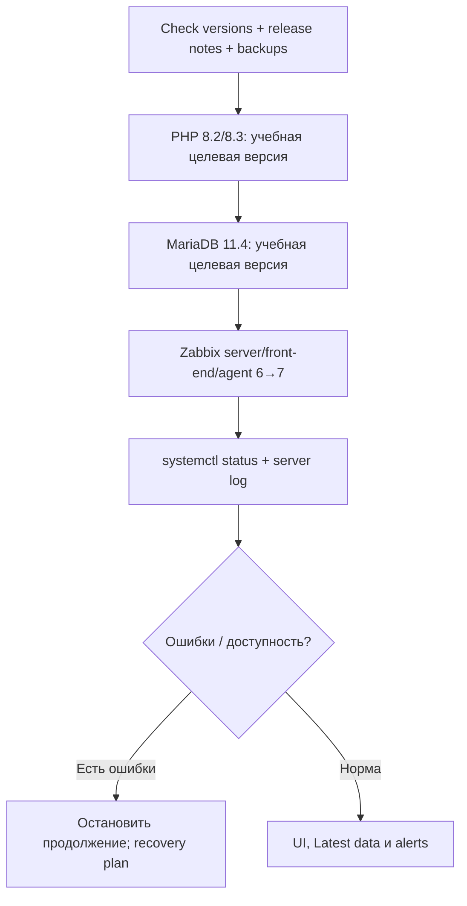
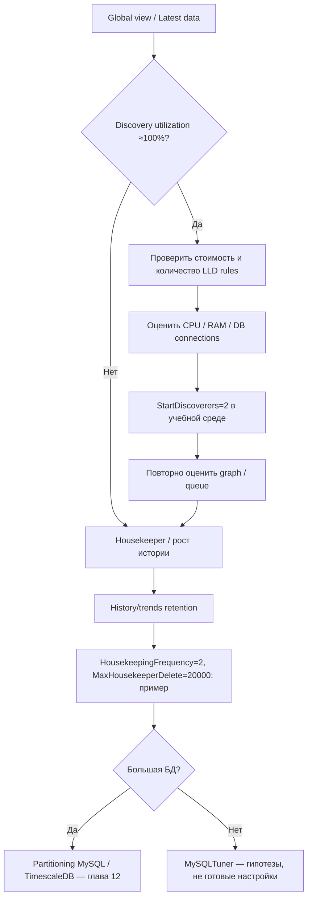

# Глава 11 — Mermaid-диаграммы обслуживания и производительности

Основание: **RAG PDF 434–464, ACCEPTED**. Схемы отображают смысл текстовых инструкций, не параметры рисунков; значения только в графических формах = `RAG_MISS`.

## 1. Maintenance: подавление vs сбор данных ([p0435](../../../rag/chunks/p0401-p0500/p0435-c01.md)–[p0437](../../../rag/chunks/p0401-p0500/p0437-c01.md))

В p437 **дважды назван `With data collection`** с противоположным назначением — второе упоминание помечено в [source-findings.md](source-findings.md).

## 2. Границы резервного копирования ([p0438](../../../rag/chunks/p0401-p0500/p0438-c01.md)–[p0441](../../../rag/chunks/p0401-p0500/p0441-c01.md))

Cron строки источника имеют сломанные пути, секреты DB и возможное destructive удаление старых backup-файлов; ни один такой фрагмент не используется как production automation.

## 3. Последовательность upgrade ([p0442](../../../rag/chunks/p0401-p0500/p0442-c01.md)–[p0454](../../../rag/chunks/p0401-p0500/p0454-c01.md))

Схема **не является гарантированным путём обновления современной среды**: актуальные версии, миграции DB и rollback из текста не подтверждаются.

## 4. Анализ performance bottlenecks ([p0455](../../../rag/chunks/p0401-p0500/p0455-c01.md)–[p0464](../../../rag/chunks/p0401-p0500/p0464-c01.md))

**Асинхронные pollers** в тексте: agent, HTTP-agent и SNMP `walk/get`, до 1000 проверок на poller в зависимости от `MaxConcurrentChecksPerPoller` — [p0464](../../../rag/chunks/p0401-p0500/p0464-c01.md). Масштабирование только числом процессов без устранения конфигурационных проблем неэффективно.

**Source policy:** без внешних данных и PDF-скриншотов; [source-findings.md](source-findings.md).
