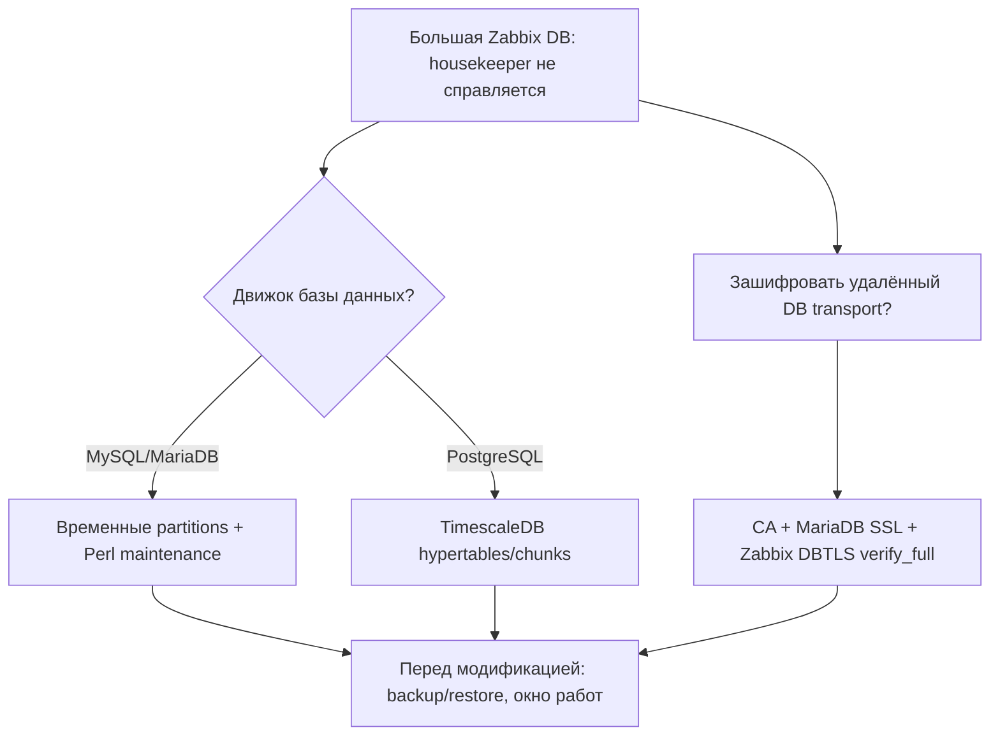
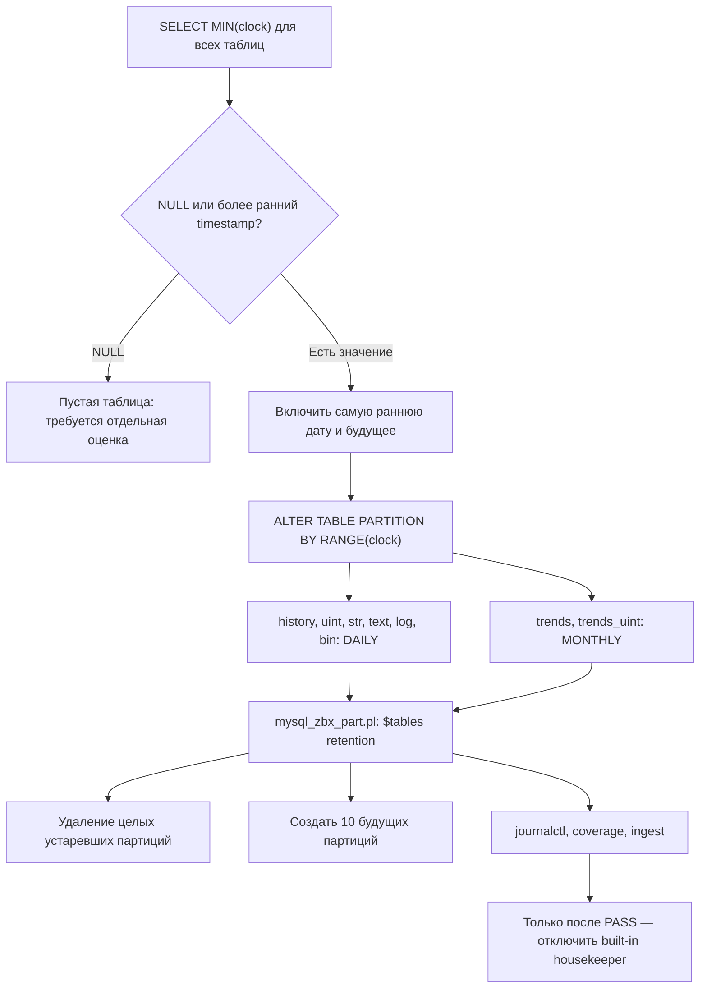
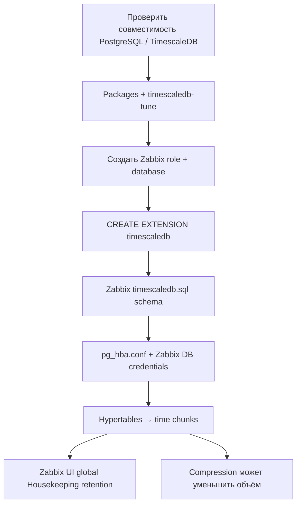
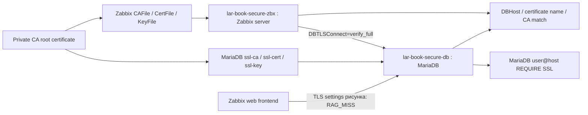
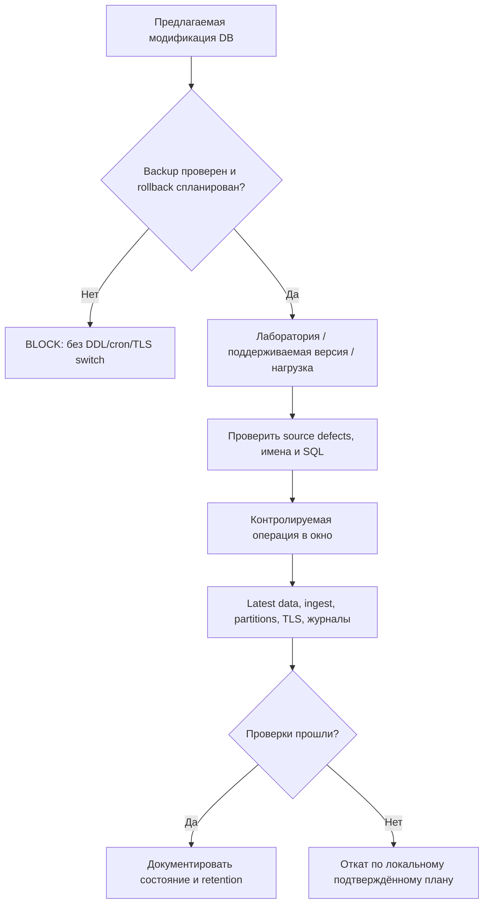

# Глава 12 — схемы Mermaid, связанные с источником

Основание: **accepted RAG PDF 465–489**, прямой доступ к PDF/рисункам запрещён. Все диаграммы показывают **проверенные связи текста**, не представляют восстановленные UI-формы с иллюстраций.

## 1. Разделение задач по базе данных ([p0465](../../../rag/chunks/p0401-p0500/p0465-c01.md), [p0474](../../../rag/chunks/p0401-p0500/p0474-c01.md), [p0479](../../../rag/chunks/p0401-p0500/p0479-c01.md))

Шифрование связи — **отдельный** сценарий; его не надо выполнять после партиционирования как следующую обязательную стадию.

## 2. MySQL: daily history, monthly trends и автоматическое удаление ([p0467](../../../rag/chunks/p0401-p0500/p0467-c01.md)–[p0474](../../../rag/chunks/p0401-p0500/p0474-c01.md))

Учебная политика retention: 30 дней/12 месяцев. Длительная DDL и безвозвратная очистка требуют backup. SQL `'history_uint'` из p467 имеет дефект синтаксиса.

## 3. PostgreSQL + TimescaleDB ([p0474](../../../rag/chunks/p0401-p0500/p0474-c01.md)–[p0479](../../../rag/chunks/p0401-p0500/p0479-c01.md))

Версии PostgreSQL 12/15 и broken package names из исходника не исправляются без проверки. Индивидуальная retention per item по тексту недоступна.

## 4. TLS: разделение сервера базы и сервера Zabbix ([p0480](../../../rag/chunks/p0401-p0500/p0480-c01.md)–[p0489](../../../rag/chunks/p0401-p0500/p0489-c01.md))

Факты источника: CA срок 3650 дней, конечный сертификат — 365 дней; в p480 и p485 адреса DB account **не совпадают**, поэтому не делать автоматический cutover. Конфигурация TLS frontend представлена не текстом, а рисунком.

## 5. Риск-контур при работе с retention и сертификатами

Полный rollback в source RAG **отсутствует**, поэтому recovery вне рамок главы = `[Needs confirmation]`. [source-findings.md](source-findings.md).
