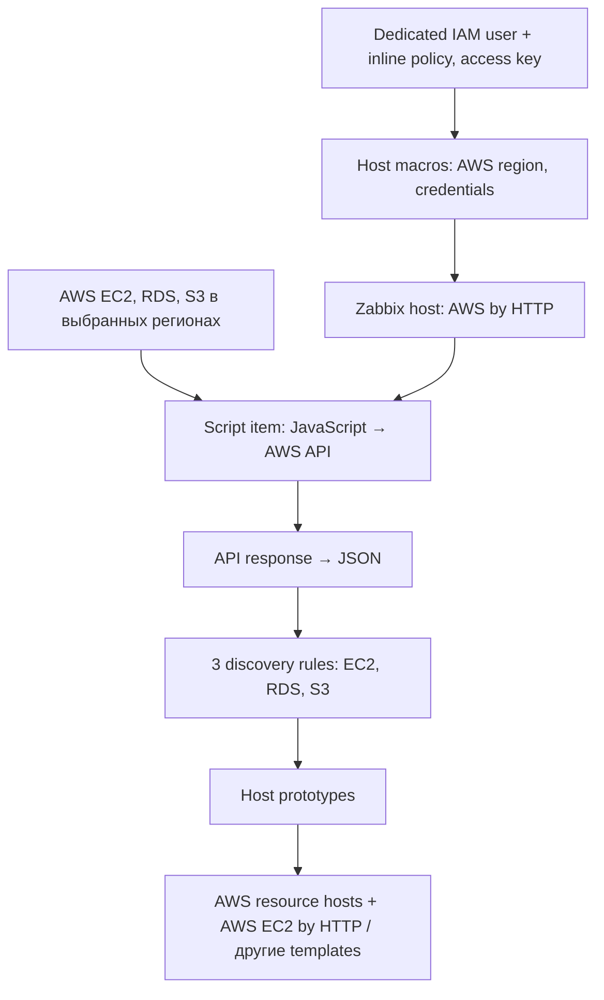
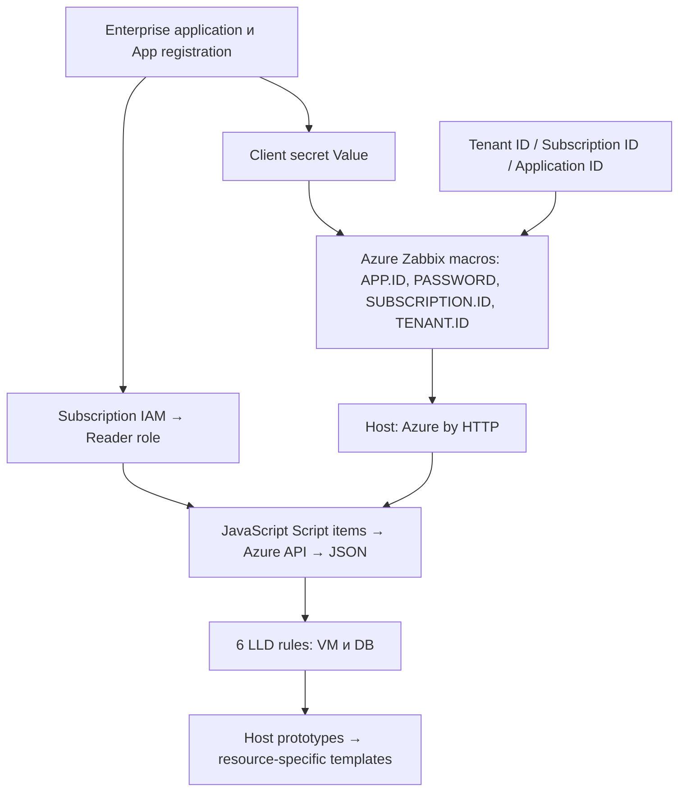
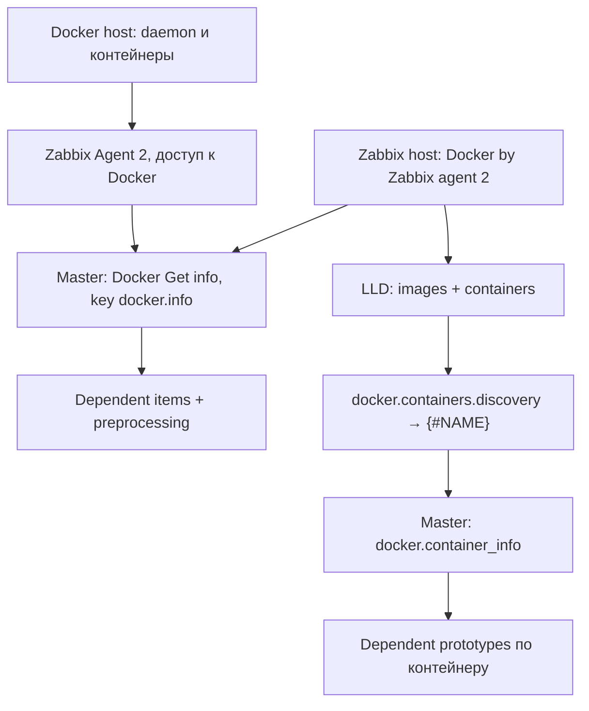
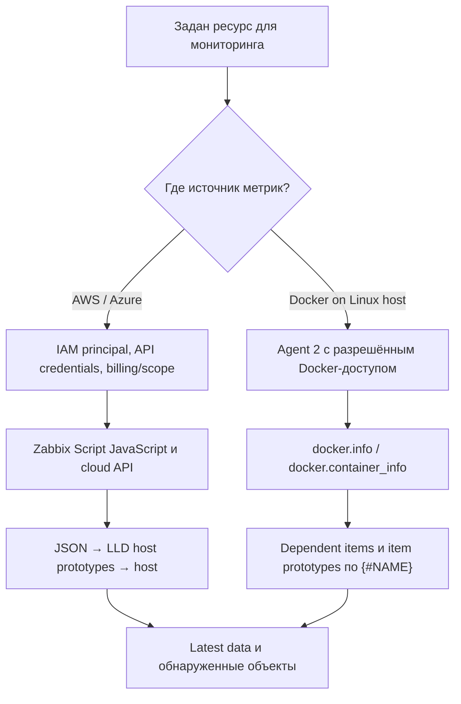
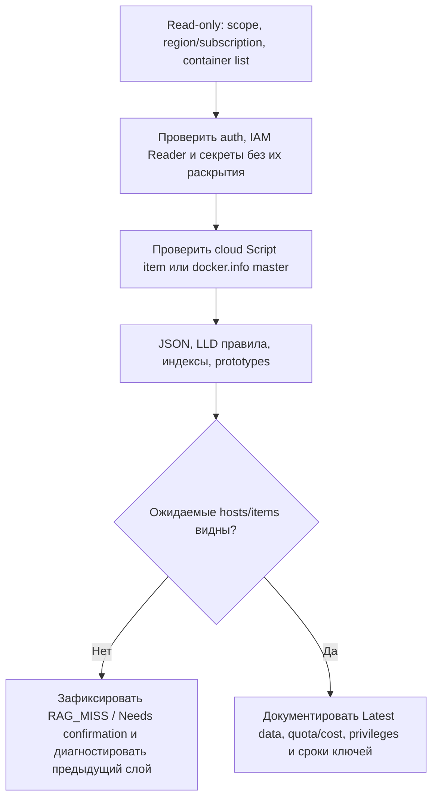

# Глава 13 — Mermaid-диаграммы облачного мониторинга

Схемы основаны только на **accepted RAG PDF 490–510**; отсутствующие на рисунках IAM JSON / JavaScript / preprocessing fields помечены `RAG_MISS`, без добавления внешнего кода.

## 1. AWS → Zabbix Script → обнаруженные hosts ([p0491](../../../rag/chunks/p0401-p0500/p0491-c01.md)–[p0498](../../../rag/chunks/p0401-p0500/p0498-c01.md))

Скрипт и policy JSON **показаны только на рисунках**, поэтому нельзя считать диаграмму готовым deployment workflow. CloudWatch может быть платным.

## 2. Azure: identity, Reader, LLD ([p0499](../../../rag/chunks/p0401-p0500/p0499-c01.md)–[p0507](../../../rag/chunks/p0501-p0600/p0507-c01.md))

Связь двух объектов Azure portal (Enterprise application vs App registration) текстом описана не полностью: `[Needs confirmation]`. Права Reader нужно проверять на нужной Subscription.

## 3. Docker: agent master → dependent items ([p0507](../../../rag/chunks/p0501-p0600/p0507-c01.md)–[p0510](../../../rag/chunks/p0501-p0600/p0510-c01.md))

Команда `gpasswd -a zabbix docker` из источника выдаёт права группе Docker и **не является безопасным универсальным default**.

## 4. Сравнение: облачный host discovery vs локальный Docker LLD

## 5. Приёмка перед небезопасным изменением

Исходник не даёт полного rollback и не гарантирует стоимость CloudWatch, безопасность membership `docker`, отсутствие лишних IAM разрешений или работоспособность старых облачных UI. См. [source-findings.md](source-findings.md).
